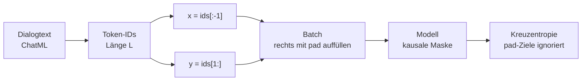

# Gruppe A: Vom Dialog zum Trainingsbeispiel

**Transformer, Sitzung 2 · Arbeitsblatt A**

> **Leitfrage:** Wie sieht ein Trainingsbeispiel aus, wie bereitet das Skript einen Guppy-Dialog dafür auf, und warum kann das Modell beim Training nicht abschreiben?

## So arbeiten Sie

1. **Erst lesen.** Die Lesefragen lassen sich nur aus dem Text beantworten.
2. **Erst vorhersagen, dann messen.** Notieren Sie Ihre Erwartung, bevor Sie eine Zelle ausführen. Eine nicht bestätigte Erwartung ist ein Ergebnis.
3. Die Abschnittsnummern beziehen sich auf das Original-Notebook. Variante b enthält denselben Code ohne Überschriften; suchen Sie dort nach den Funktionsnamen.
4. Der Datensatz ist englisch. Stellen Sie Guppy englische Fragen.
5. Am Ende stellen Sie Ihr Ergebnis in wenigen Minuten vor: eine Kernaussage, ein Beleg aus dem Notebook.

## Worum es geht

Ein Sprachmodell lernt, das jeweils nächste Token vorherzusagen. Die Zielwerte muss niemand von Hand erstellen: Sie stecken bereits im Text. Aus einer Tokenfolge $s_0,\ldots,s_T$ entstehen Eingabe und Ziel durch Verschieben um eine Position:

$$
x_t=s_t,\qquad y_t=s_{t+1}
$$

<svg xmlns="http://www.w3.org/2000/svg" viewBox="0 0 760 300" width="100%" style="max-width:760px" font-family="Helvetica, Arial, sans-serif" role="img">
<rect x="0" y="0" width="760" height="300" rx="10" fill="#ffffff" stroke="#e5e7eb"/>
<defs><marker id="pf" markerWidth="9" markerHeight="9" refX="7" refY="4.5" orient="auto"><path d="M0,0 L9,4.5 L0,9 z" fill="#6b7280"/></marker></defs>
<text x="20" y="30" font-size="15" fill="#1f2937" text-anchor="start" font-weight="bold">Aus einer Tokenfolge werden Eingabe und Ziel</text>
<text x="20" y="74" font-size="13" fill="#6b7280" text-anchor="start">Folge s</text>
<rect x="150" y="52" width="96" height="36" rx="6" fill="#fef3c7" stroke="#b45309" stroke-width="1.5"/><text x="198.0" y="74.9" font-size="14" text-anchor="middle" fill="#1f2937">&lt;Start&gt;</text>
<rect x="256" y="52" width="96" height="36" rx="6" fill="#fef3c7" stroke="#b45309" stroke-width="1.5"/><text x="304.0" y="74.9" font-size="14" text-anchor="middle" fill="#1f2937">Gut</text>
<rect x="362" y="52" width="96" height="36" rx="6" fill="#fef3c7" stroke="#b45309" stroke-width="1.5"/><text x="410.0" y="74.9" font-size="14" text-anchor="middle" fill="#1f2937">Ding</text>
<rect x="468" y="52" width="96" height="36" rx="6" fill="#fef3c7" stroke="#b45309" stroke-width="1.5"/><text x="516.0" y="74.9" font-size="14" text-anchor="middle" fill="#1f2937">braucht</text>
<rect x="574" y="52" width="96" height="36" rx="6" fill="#fef3c7" stroke="#b45309" stroke-width="1.5"/><text x="622.0" y="74.9" font-size="14" text-anchor="middle" fill="#1f2937">Weile</text>
<text x="20" y="154" font-size="13" fill="#2563eb" text-anchor="start" font-weight="bold">x (Eingabe)</text>
<rect x="150" y="132" width="96" height="36" rx="6" fill="#dbeafe" stroke="#2563eb" stroke-width="1.5"/><text x="198.0" y="154.9" font-size="14" text-anchor="middle" fill="#1f2937">&lt;Start&gt;</text>
<rect x="256" y="132" width="96" height="36" rx="6" fill="#dbeafe" stroke="#2563eb" stroke-width="1.5"/><text x="304.0" y="154.9" font-size="14" text-anchor="middle" fill="#1f2937">Gut</text>
<rect x="362" y="132" width="96" height="36" rx="6" fill="#dbeafe" stroke="#2563eb" stroke-width="1.5"/><text x="410.0" y="154.9" font-size="14" text-anchor="middle" fill="#1f2937">Ding</text>
<rect x="468" y="132" width="96" height="36" rx="6" fill="#dbeafe" stroke="#2563eb" stroke-width="1.5"/><text x="516.0" y="154.9" font-size="14" text-anchor="middle" fill="#1f2937">braucht</text>
<rect x="574" y="132" width="96" height="36" rx="6" fill="#e5e7eb" stroke="#6b7280" stroke-width="1.5" stroke-dasharray="5 4"/><text x="622.0" y="154.9" font-size="14" text-anchor="middle" fill="#6b7280">&lt;pad&gt;</text>
<text x="20" y="244" font-size="13" fill="#0f766e" text-anchor="start" font-weight="bold">y (Ziel)</text>
<rect x="150" y="222" width="96" height="36" rx="6" fill="#ccfbf1" stroke="#0f766e" stroke-width="1.5"/><text x="198.0" y="244.9" font-size="14" text-anchor="middle" fill="#1f2937">Gut</text>
<rect x="256" y="222" width="96" height="36" rx="6" fill="#ccfbf1" stroke="#0f766e" stroke-width="1.5"/><text x="304.0" y="244.9" font-size="14" text-anchor="middle" fill="#1f2937">Ding</text>
<rect x="362" y="222" width="96" height="36" rx="6" fill="#ccfbf1" stroke="#0f766e" stroke-width="1.5"/><text x="410.0" y="244.9" font-size="14" text-anchor="middle" fill="#1f2937">braucht</text>
<rect x="468" y="222" width="96" height="36" rx="6" fill="#ccfbf1" stroke="#0f766e" stroke-width="1.5"/><text x="516.0" y="244.9" font-size="14" text-anchor="middle" fill="#1f2937">Weile</text>
<rect x="574" y="222" width="96" height="36" rx="6" fill="#e5e7eb" stroke="#6b7280" stroke-width="1.5" stroke-dasharray="5 4"/><text x="622.0" y="244.9" font-size="14" text-anchor="middle" fill="#6b7280">&lt;pad&gt;</text>
<line x1="198.0" y1="170" x2="198.0" y2="218" stroke="#6b7280" stroke-width="1.5" marker-end="url(#pf)"/>
<line x1="304.0" y1="170" x2="304.0" y2="218" stroke="#6b7280" stroke-width="1.5" marker-end="url(#pf)"/>
<line x1="410.0" y1="170" x2="410.0" y2="218" stroke="#6b7280" stroke-width="1.5" marker-end="url(#pf)"/>
<line x1="516.0" y1="170" x2="516.0" y2="218" stroke="#6b7280" stroke-width="1.5" marker-end="url(#pf)"/>
<text x="622.0" y="200" font-size="11" fill="#6b7280" text-anchor="middle">zählt nicht</text>
<text x="150" y="284" font-size="11" fill="#6b7280" text-anchor="start">Position 0</text>
<text x="468" y="284" font-size="11" fill="#6b7280" text-anchor="start">Position 3</text>
<text x="206.0" y="198" font-size="11" fill="#6b7280" text-anchor="start">sagt vorher</text>
<text x="574" y="284" font-size="11" fill="#6b7280" text-anchor="start">Füllung im Batch</text>
</svg>

Im Skript läuft ein Dialog durch diese Stationen:



## 1. Lesen

| Quelle | Abschnitt |
|---|---|
| Original-Notebook | Abschnitt 2, nur „ChatML" |
| Original-Notebook | Abschnitt 3 vollständig, mit „Beobachtung: Der Versatz um eine Position" |
| Original-Notebook | Abschnitt 4.1, Absatz „Kausale Maske" mit Tabelle |
| Lehrbuch | Kapitel 2 und Kapitel 5 |

**Lesefragen**

1. Was geschieht mit einem Beispiel, das länger als `max_seq_len + 1` Tokens ist? Warum wurde das so entschieden?
2. Das Notebook stellt Training und Inferenz in einer Tabelle gegenüber. Nennen Sie vier Unterschiede.
3. Unter welcher Bedingung wäre eine zusätzliche Padding-Maske doch nötig?

## 2. Aufgaben

1. Verfolgen Sie einen einzigen Dialog von der JSONL-Zeile bis zum Verlustwert. Markieren Sie Benutzerfrage, Antwort und Rollenmarkierungen.
2. Wählen Sie eine kurze Tokenfolge. Schreiben Sie `x` und `y` zuerst von Hand auf und vergleichen Sie dann mit der Ausgabe der Beobachtungszelle. Benennen Sie für zwei Positionen Eingabetoken und Zieltoken.
3. Wie viele Vorhersageaufgaben liefert ein Dialog mit $L$ Tokens? Warum darf ein Beispiel `max_seq_len + 1` Tokens lang sein?
4. Betrachten Sie einen Batch mit unterschiedlich langen Beispielen. Welche Ziele gehen in den Verlust ein? Erklären Sie den Unterschied zwischen der **Token-ID 0** und der **Position 0**.
5. Unterscheiden Sie die maximale Kontextlänge von der tatsächlichen Länge eines Batches. Was bedeutet eine größere Länge für den Rechenaufwand der Attention?
6. Was bewirkt die kausale Maske, was bewirkt `ignore_index`? Ordnen Sie beide einer Stelle im Code zu.
7. Das Skript kennt keine Epochen. Wie werden die Batches gezogen, und wie oft wird ein Dialog im Mittel gesehen?
8. Die Benutzerfrage wird im Verlust mitbewertet. Kann das Modell sie vorhersagen? Was folgt daraus für den erreichbaren Verlust?

## 3. Experiment: Kann das Modell in die Zukunft schauen?

Zwei gleich lange Eingaben sind bis einschließlich Position `p` identisch und unterscheiden sich nur danach.

**a) Erwartung.** An welchen Positionen müssen die Logits beider Eingaben übereinstimmen, wenn die Maske aktiv ist? Und ohne Maske?

**b) Versuch.** Fügen Sie die Zelle unterhalb von Abschnitt 4.4 ein und führen Sie sie aus. Sie braucht kein trainiertes Modell.

```python
torch.manual_seed(0)
probe = GuppyLM(konfig).eval()
T, p = 12, 5

a = torch.randint(3, konfig.vocab_size, (1, T))
b = a.clone()
b[0, p + 1:] = torch.randint(3, konfig.vocab_size, (T - p - 1,))

def vergleiche(titel):
    with torch.no_grad():
        la, _ = probe(a)
        lb, _ = probe(b)
    bis = (la[0, :p + 1] - lb[0, :p + 1]).abs().max().item()
    nach = (la[0, p + 1:] - lb[0, p + 1:]).abs().max().item()
    print(f"{titel}: größte Abweichung bis p = {bis:.2e}, nach p = {nach:.2e}")

vergleiche("mit Maske ")

# Maske vorübergehend abschalten: jede Position sieht alle anderen
maske_original = kausale_maske
kausale_maske = lambda T, device=None: torch.ones(T, T, device=device).view(1, 1, T, T)
vergleiche("ohne Maske")
kausale_maske = maske_original          # unbedingt wiederherstellen
```

**c) Beobachtung.** Tragen Sie die vier Messwerte ein.

| | Abweichung bis `p` | Abweichung nach `p` |
|---|---|---|
| mit Maske | | |
| ohne Maske | | |

**d) Erklärung.**

- Warum steht das Zieltoken für Position `p` im Training bereits in der Eingabe?
- Weshalb ist die Maske deshalb unverzichtbar?
- Warum vergleicht man mit einer kleinen Toleranz statt auf exakte Gleichheit?

## 4. Ihr Ergebnis

- Ein kommentiertes Beispiel: Text, Tokens und die verschobenen Folgen `x` und `y`.
- Die Messwerte mit und ohne Maske, mit Ihrer Erklärung.
- **Eine Kernaussage** für das Plenum: Warum liefert ein einziger Dialog viele Trainingsaufgaben auf einmal, ohne dass das Modell abschreiben kann?
