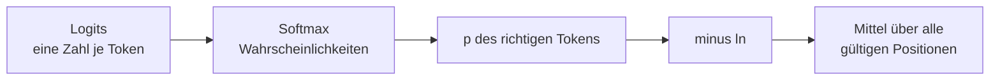
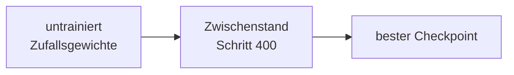

# Gruppe B: Loss und was er belegt

**Transformer, Sitzung 2 · Arbeitsblatt B**

> **Leitfrage:** Welche Verlustfunktion nutzt das Skript, warum diese, und was sagt ein niedriger Verlust über die Qualität der Antworten?

## So arbeiten Sie

1. **Erst lesen.** Die Lesefragen lassen sich nur aus dem Text beantworten.
2. **Erst vorhersagen, dann messen.** Notieren Sie Ihre Erwartung, bevor Sie eine Zelle ausführen. Eine nicht bestätigte Erwartung ist ein Ergebnis.
3. Die Abschnittsnummern beziehen sich auf das Original-Notebook. Variante b enthält denselben Code ohne Überschriften; suchen Sie dort nach den Funktionsnamen.
4. Der Datensatz ist englisch. Stellen Sie Guppy englische Fragen.
5. Am Ende stellen Sie Ihr Ergebnis in wenigen Minuten vor: eine Kernaussage, ein Beleg aus dem Notebook.

> **Wichtig vor dem Trainingsstart:** Ihr Experiment braucht einen frühen Zwischenstand des Modells. Fügen Sie die Zeilen aus Abschnitt 3 a) in die Trainingsschleife ein, **bevor** Sie das Training starten.

## Worum es geht

Das Modell gibt an jeder Position eine Wahrscheinlichkeit $p_{t,k}$ für jedes Token $k$ des Vokabulars aus. Bewertet wird nur die Wahrscheinlichkeit, die es dem tatsächlich folgenden Token $y_t$ gegeben hat:

$$
\mathcal L_t=-\ln p_{t,y_t}
$$

<svg xmlns="http://www.w3.org/2000/svg" viewBox="0 0 760 330" width="100%" style="max-width:760px" font-family="Helvetica, Arial, sans-serif" role="img">
<rect x="0" y="0" width="760" height="330" rx="10" fill="#ffffff" stroke="#e5e7eb"/>
<text x="20" y="30" font-size="15" fill="#1f2937" text-anchor="start" font-weight="bold">Verlust an einer Position, abhängig von der Wahrscheinlichkeit des richtigen Tokens</text>
<line x1="80" y1="270" x2="700" y2="270" stroke="#1f2937" stroke-width="1.2"/><line x1="80" y1="50" x2="80" y2="270" stroke="#1f2937" stroke-width="1.2"/>
<line x1="80" y1="270.0" x2="700" y2="270.0" stroke="#e5e7eb"/>
<text x="70" y="274.0" font-size="12" fill="#6b7280" text-anchor="end">0</text>
<line x1="80" y1="226.0" x2="700" y2="226.0" stroke="#e5e7eb"/>
<text x="70" y="230.0" font-size="12" fill="#6b7280" text-anchor="end">1</text>
<line x1="80" y1="182.0" x2="700" y2="182.0" stroke="#e5e7eb"/>
<text x="70" y="186.0" font-size="12" fill="#6b7280" text-anchor="end">2</text>
<line x1="80" y1="138.0" x2="700" y2="138.0" stroke="#e5e7eb"/>
<text x="70" y="142.0" font-size="12" fill="#6b7280" text-anchor="end">3</text>
<line x1="80" y1="94.0" x2="700" y2="94.0" stroke="#e5e7eb"/>
<text x="70" y="98.0" font-size="12" fill="#6b7280" text-anchor="end">4</text>
<line x1="80" y1="50.0" x2="700" y2="50.0" stroke="#e5e7eb"/>
<text x="70" y="54.0" font-size="12" fill="#6b7280" text-anchor="end">5</text>
<line x1="80" y1="270" x2="80" y2="275" stroke="#1f2937"/>
<text x="80" y="290" font-size="12" fill="#6b7280" text-anchor="middle">0,0</text>
<line x1="204.0" y1="270" x2="204.0" y2="275" stroke="#1f2937"/>
<text x="204.0" y="290" font-size="12" fill="#6b7280" text-anchor="middle">0,2</text>
<line x1="328.0" y1="270" x2="328.0" y2="275" stroke="#1f2937"/>
<text x="328.0" y="290" font-size="12" fill="#6b7280" text-anchor="middle">0,4</text>
<line x1="452.0" y1="270" x2="452.0" y2="275" stroke="#1f2937"/>
<text x="452.0" y="290" font-size="12" fill="#6b7280" text-anchor="middle">0,6</text>
<line x1="576.0" y1="270" x2="576.0" y2="275" stroke="#1f2937"/>
<text x="576.0" y="290" font-size="12" fill="#6b7280" text-anchor="middle">0,8</text>
<line x1="700.0" y1="270" x2="700.0" y2="275" stroke="#1f2937"/>
<text x="700.0" y="290" font-size="12" fill="#6b7280" text-anchor="middle">1,0</text>
<path d="M84.2,50.0 L86.7,70.5 L89.1,84.4 L91.6,95.0 L94.1,103.5 L96.6,110.6 L99.1,116.8 L101.5,122.2 L104.0,127.0 L106.5,131.3 L109.0,135.2 L111.5,138.8 L113.9,142.2 L116.4,145.3 L118.9,148.2 L121.4,150.9 L123.9,153.5 L126.3,155.9 L128.8,158.2 L131.3,160.3 L133.8,162.4 L136.3,164.4 L138.7,166.3 L141.2,168.1 L143.7,169.9 L146.2,171.6 L148.7,173.2 L151.1,174.7 L153.6,176.2 L156.1,177.7 L158.6,179.1 L161.1,180.5 L163.5,181.8 L166.0,183.1 L168.5,184.3 L171.0,185.6 L173.5,186.7 L175.9,187.9 L178.4,189.0 L180.9,190.1 L183.4,191.2 L185.9,192.2 L188.3,193.2 L190.8,194.2 L193.3,195.2 L195.8,196.2 L198.3,197.1 L200.7,198.0 L203.2,198.9 L205.7,199.8 L208.2,200.6 L210.7,201.5 L213.1,202.3 L215.6,203.1 L218.1,203.9 L220.6,204.7 L223.1,205.5 L225.5,206.2 L228.0,207.0 L230.5,207.7 L233.0,208.4 L235.5,209.1 L237.9,209.8 L240.4,210.5 L242.9,211.2 L245.4,211.9 L247.9,212.5 L250.3,213.2 L252.8,213.8 L255.3,214.4 L257.8,215.0 L260.3,215.6 L262.7,216.2 L265.2,216.8 L267.7,217.4 L270.2,218.0 L272.7,218.6 L275.1,219.1 L277.6,219.7 L280.1,220.2 L282.6,220.8 L285.1,221.3 L287.5,221.8 L290.0,222.4 L292.5,222.9 L295.0,223.4 L297.5,223.9 L299.9,224.4 L302.4,224.9 L304.9,225.4 L307.4,225.9 L309.9,226.3 L312.3,226.8 L314.8,227.3 L317.3,227.7 L319.8,228.2 L322.3,228.7 L324.7,229.1 L327.2,229.5 L329.7,230.0 L332.2,230.4 L334.7,230.8 L337.1,231.3 L339.6,231.7 L342.1,232.1 L344.6,232.5 L347.1,232.9 L349.5,233.3 L352.0,233.8 L354.5,234.1 L357.0,234.5 L359.5,234.9 L361.9,235.3 L364.4,235.7 L366.9,236.1 L369.4,236.5 L371.9,236.8 L374.3,237.2 L376.8,237.6 L379.3,238.0 L381.8,238.3 L384.3,238.7 L386.7,239.0 L389.2,239.4 L391.7,239.7 L394.2,240.1 L396.7,240.4 L399.1,240.8 L401.6,241.1 L404.1,241.5 L406.6,241.8 L409.1,242.1 L411.5,242.5 L414.0,242.8 L416.5,243.1 L419.0,243.4 L421.5,243.8 L423.9,244.1 L426.4,244.4 L428.9,244.7 L431.4,245.0 L433.9,245.3 L436.3,245.6 L438.8,245.9 L441.3,246.2 L443.8,246.5 L446.3,246.8 L448.7,247.1 L451.2,247.4 L453.7,247.7 L456.2,248.0 L458.7,248.3 L461.1,248.6 L463.6,248.9 L466.1,249.2 L468.6,249.4 L471.1,249.7 L473.5,250.0 L476.0,250.3 L478.5,250.6 L481.0,250.8 L483.5,251.1 L485.9,251.4 L488.4,251.6 L490.9,251.9 L493.4,252.2 L495.9,252.4 L498.3,252.7 L500.8,252.9 L503.3,253.2 L505.8,253.5 L508.3,253.7 L510.7,254.0 L513.2,254.2 L515.7,254.5 L518.2,254.7 L520.7,255.0 L523.1,255.2 L525.6,255.5 L528.1,255.7 L530.6,256.0 L533.1,256.2 L535.5,256.4 L538.0,256.7 L540.5,256.9 L543.0,257.2 L545.5,257.4 L547.9,257.6 L550.4,257.9 L552.9,258.1 L555.4,258.3 L557.9,258.5 L560.3,258.8 L562.8,259.0 L565.3,259.2 L567.8,259.4 L570.3,259.7 L572.7,259.9 L575.2,260.1 L577.7,260.3 L580.2,260.6 L582.7,260.8 L585.1,261.0 L587.6,261.2 L590.1,261.4 L592.6,261.6 L595.1,261.8 L597.5,262.1 L600.0,262.3 L602.5,262.5 L605.0,262.7 L607.5,262.9 L609.9,263.1 L612.4,263.3 L614.9,263.5 L617.4,263.7 L619.9,263.9 L622.3,264.1 L624.8,264.3 L627.3,264.5 L629.8,264.7 L632.3,264.9 L634.7,265.1 L637.2,265.3 L639.7,265.5 L642.2,265.7 L644.7,265.9 L647.1,266.1 L649.6,266.3 L652.1,266.5 L654.6,266.7 L657.1,266.8 L659.5,267.0 L662.0,267.2 L664.5,267.4 L667.0,267.6 L669.5,267.8 L671.9,268.0 L674.4,268.1 L676.9,268.3 L679.4,268.5 L681.9,268.7 L684.3,268.9 L686.8,269.1 L689.3,269.2 L691.8,269.4 L694.3,269.6 L696.7,269.8 L699.2,269.9" fill="none" stroke="#2563eb" stroke-width="2.5" stroke-linejoin="round"/>
<text x="390.0" y="312" font-size="13" fill="#1f2937" text-anchor="middle">Wahrscheinlichkeit p für das richtige Token</text>
<text x="24" y="160.0" font-size="13" fill="#1f2937" text-anchor="middle" transform="rotate(-90 24 160.0)">Verlust −ln p</text>
<text x="140" y="90" font-size="12" fill="#b91c1c" text-anchor="start">sehr sicher und falsch: hoher Verlust</text>
<text x="690" y="228" font-size="12" fill="#0f766e" text-anchor="end">sicher und richtig: Verlust nahe 0</text>
</svg>



Über einen Batch wird gemittelt, und zwar nur über die $N$ gültigen Zielpositionen:

$$
\mathcal L=-\frac1N\sum_{b,t}\mathbf 1_{b,t}\,\ln p_{b,t,y_{b,t}}
$$

## 1. Lesen

| Quelle | Abschnitt |
|---|---|
| Original-Notebook | Abschnitt 4.4, Punkt 5 von `forward` |
| Original-Notebook | Abschnitt 4.5 „Sanity-Check" |
| Original-Notebook | Abschnitt 5: „Den Validierungsverlust berechnen" und „Beobachtung: Die Verlustkurve lesen" |
| Lehrbuch | Kapitel 8 und Kapitel 12, „Was ein niedriger Verlust belegt" |

**Lesefragen**

1. Warum ist $\ln V$ eine Referenz und kein garantierter Startwert?
2. Das Notebook nennt Gründe, weshalb der Validierungsverlust unter dem Trainingsverlust liegen kann. Welche?
3. Wie viele der verwendeten 320 Validierungsdialoge stehen wortgleich im Training? Was folgt daraus laut Text?

## 2. Aufgaben zum Verlust

1. Wo im Code wird der Verlust berechnet? Warum steht davor kein Softmax-Aufruf?
2. Berechnen Sie von Hand den Verlust, wenn das richtige Token die Wahrscheinlichkeit 0,9, 0,1 oder 0,01 erhält. Was fällt auf?
3. Warum wäre der quadratische Abstand zwischen zwei Token-IDs kein sinnvolles Fehlermaß?
4. Berechnen Sie $\ln V$ mit der tatsächlichen Vokabulargröße, **bevor** Sie die Zelle in Abschnitt 4.5 ausführen. Vergleichen Sie mit dem gemessenen Startverlust.
5. Rechnen Sie den Endverlust Ihres Laufs in Perplexität um: $\mathrm{PPL}=e^{\mathcal L}$. Was bedeutet diese Zahl, und was bedeutet sie nicht?
6. Beschreiben Sie die Verlustkurve in Phasen. Nach etwa 3.000 Schritten sinkt der Verlust erfahrungsgemäß nicht weiter, auch bei viel längerem Training nicht. Warum kann er bei diesen Daten nicht gegen null gehen?
7. Wie viele Beispiele gehen in die Validierung ein, und welche Rolle spielt sie bei der Auswahl des Checkpoints?

## 3. Experiment: Was verändert das Training an den Antworten?

**a) Vorbereitung, vor dem Training.** Fügen Sie in der Trainingsschleife direkt nach der Zeile `verlaufsverlust.append(verlust.item())` ein:

```python
    if schritt == 400:
        torch.save({
            "schritt": schritt,
            "model_state_dict": modell.state_dict(),
            "konfig": asdict(konfig),
            "eval_verlust": float("nan"),
            "tokenizer_json": tokenizer_json,
            "tokenizer_sha256": tokenizer_sha256,
        }, WORK / "Checkpoints" / "zwischenstand.pt")
```

**b) Fragen festlegen, bevor Sie Antworten ansehen.**

- Wählen Sie drei unterschiedliche Fragen aus den Trainingsdaten.
- Formulieren Sie zu jeder eine sinngleiche neue Frage. Prüfen Sie mit der Zelle unten, dass sie nicht wortgleich im Training vorkommt.
- Ergänzen Sie eine Frage zu einem Thema außerhalb der Fischgespräche. Notieren Sie, welche Art von Antwort Sie erwarten.

**c) Drei Modellstände befragen.** Verwenden Sie überall dieselben Fragen und Temperatur 0, also Greedy-Decoding.



```python
train_fragen = {t.split("user\n", 1)[1].split("<|im_end|>", 1)[0] for t in texte["train"]}
print(len(train_fragen), "verschiedene Benutzerfragen im Training")
print("neu?", "hi little fish" not in train_fragen)      # eigene Formulierung prüfen

fragen = ["hello guppy", "hi little fish"]                # hier die eigene Liste eintragen

staende = {
    "untrainiert": GuppyLM(konfig).to(DEVICE).eval(),
    "Zwischenstand": lade_checkpoint(WORK / "Checkpoints" / "zwischenstand.pt", DEVICE)[0],
    "bester Stand": lade_checkpoint(WORK / "Checkpoints" / "bestes_modell.pt", DEVICE)[0],
}
for name, netz in staende.items():
    modell = netz                                         # antworte() nutzt die Variable modell
    for frage in fragen:
        text, grund = antworte(frage, temperatur=0, return_info=True)
        print(f"{name:14s} | {frage:28s} -> {text} [{grund}]")
```

In Variante b heißt der Checkpoint `bestes_modell_b.pt`.

**d) Beobachtung.**

| Frage und Typ | Untrainiert | Zwischenstand | Bester Stand | Beobachtung |
|---|---|---|---|---|
| Bekannte Trainingsfrage | | | | |
| Neue Formulierung dazu | | | | |
| Frage außerhalb der Themen | | | | |

**e) Auswertung.**

- Beurteilen Sie sprachliche Plausibilität, thematische Passung und den Abbruchgrund. Unterscheiden Sie ein gelerntes Ende vom Tokenlimit.
- Wo stimmen sinkender Verlust und bessere Antworten überein?
- Wo reicht der Verlust zur Beurteilung nicht aus?

## 4. Ihr Ergebnis

- Die Verlustkurve Ihres Laufs mit einer kurzen, begründeten Interpretation.
- Die ausgefüllte Antworttabelle.
- **Eine Kernaussage** für das Plenum: Was belegt ein niedriger Verlust bei diesem Datensatz, und was nicht?
