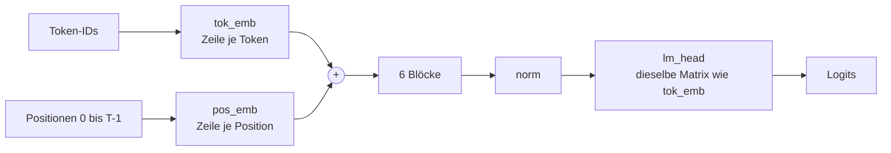

# Gruppe C: Was wird gelernt?

**Transformer, Sitzung 2 · Arbeitsblatt C**

> **Leitfrage:** Wie kann eine Embedding-Tabelle überhaupt lernen, und was unterscheidet gelernte von festen Positionen?

## So arbeiten Sie

1. **Erst lesen.** Die Lesefragen lassen sich nur aus dem Text beantworten.
2. **Erst vorhersagen, dann messen.** Notieren Sie Ihre Erwartung, bevor Sie eine Zelle ausführen. Eine nicht bestätigte Erwartung ist ein Ergebnis.
3. Die Abschnittsnummern beziehen sich auf das Original-Notebook. Variante b enthält denselben Code ohne Überschriften; suchen Sie dort nach den Funktionsnamen.
4. Der Datensatz ist englisch. Stellen Sie Guppy englische Fragen.
5. Am Ende stellen Sie Ihr Ergebnis in wenigen Minuten vor: eine Kernaussage, ein Beleg aus dem Notebook.

> **Sie brauchen beide Notebooks.** Das Original lernt seine Positionstabelle, Variante b verwendet eine feste Sinustabelle. Alles andere ist gleich.

## Worum es geht

Am Eingang des Modells werden zwei Tabellenzeilen addiert: eine für das Token, eine für die Position.

$$
X_t^{(0)}=E[x_t]+E_{\mathrm{pos}}[t]
$$



Im Original sind beide Tabellen lernbar. In Variante b wird die Positionstabelle berechnet und nicht verändert:

$$
\mathrm{PE}_{t,2m}=\alpha\,\sin\!\left(\frac{t}{10000^{2m/d}}\right),\qquad
\mathrm{PE}_{t,2m+1}=\alpha\,\cos\!\left(\frac{t}{10000^{2m/d}}\right)
$$

<svg xmlns="http://www.w3.org/2000/svg" viewBox="0 0 760 330" width="100%" style="max-width:760px" font-family="Helvetica, Arial, sans-serif" role="img">
<rect x="0" y="0" width="760" height="330" rx="10" fill="#ffffff" stroke="#e5e7eb"/>
<text x="20" y="30" font-size="15" fill="#1f2937" text-anchor="start" font-weight="bold">Drei Spalten der Sinustabelle über die Positionen 0 bis 127</text>
<line x1="110" y1="85" x2="710" y2="85" stroke="#e5e7eb"/>
<path d="M110.0,85.0 L111.2,78.1 L112.4,71.6 L113.5,65.9 L114.7,61.4 L115.9,58.4 L117.1,57.1 L118.3,57.4 L119.4,59.5 L120.6,63.2 L121.8,68.2 L123.0,74.3 L124.2,81.0 L125.4,88.0 L126.5,94.8 L127.7,101.0 L128.9,106.2 L130.1,110.1 L131.3,112.4 L132.4,113.0 L133.6,111.8 L134.8,109.1 L136.0,104.8 L137.2,99.2 L138.3,92.8 L139.5,85.9 L140.7,79.0 L141.9,72.4 L143.1,66.6 L144.3,62.0 L145.4,58.7 L146.6,57.2 L147.8,57.3 L149.0,59.2 L150.2,62.6 L151.3,67.5 L152.5,73.5 L153.7,80.1 L154.9,87.1 L156.1,93.9 L157.2,100.2 L158.4,105.6 L159.6,109.6 L160.8,112.2 L162.0,113.0 L163.1,112.1 L164.3,109.5 L165.5,105.4 L166.7,100.0 L167.9,93.7 L169.1,86.9 L170.2,79.9 L171.4,73.2 L172.6,67.3 L173.8,62.5 L175.0,59.1 L176.1,57.3 L177.3,57.2 L178.5,58.8 L179.7,62.1 L180.9,66.8 L182.0,72.6 L183.2,79.2 L184.4,86.2 L185.6,93.1 L186.8,99.4 L188.0,104.9 L189.1,109.2 L190.3,111.9 L191.5,113.0 L192.7,112.3 L193.9,109.9 L195.0,106.0 L196.2,100.8 L197.4,94.6 L198.6,87.8 L199.8,80.8 L200.9,74.1 L202.1,68.0 L203.3,63.1 L204.5,59.4 L205.7,57.4 L206.9,57.1 L208.0,58.5 L209.2,61.6 L210.4,66.1 L211.6,71.8 L212.8,78.3 L213.9,85.2 L215.1,92.2 L216.3,98.6 L217.5,104.3 L218.7,108.7 L219.8,111.6 L221.0,112.9 L222.2,112.5 L223.4,110.4 L224.6,106.6 L225.7,101.6 L226.9,95.5 L228.1,88.7 L229.3,81.7 L230.5,74.9 L231.7,68.8 L232.8,63.6 L234.0,59.8 L235.2,57.6 L236.4,57.0 L237.6,58.2 L238.7,61.1 L239.9,65.4 L241.1,71.0 L242.3,77.4 L243.5,84.3 L244.6,91.3 L245.8,97.8 L247.0,103.6 L248.2,108.2 L249.4,111.3 L250.6,112.9 L251.7,112.7 L252.9,110.7 L254.1,107.2 L255.3,102.3 L256.5,96.3 L257.6,89.6 L258.8,82.6 L260.0,75.8 L261.2,69.6 L262.4,64.3 L263.5,60.3 L264.7,57.8 L265.9,57.0 L267.1,58.0 L268.3,60.6 L269.4,64.8 L270.6,70.2 L271.8,76.5 L273.0,83.4 L274.2,90.4 L275.4,97.0 L276.5,102.9 L277.7,107.7 L278.9,111.0 L280.1,112.8 L281.3,112.8 L282.4,111.1 L283.6,107.8 L284.8,103.0 L286.0,97.2 L287.2,90.5 L288.3,83.6 L289.5,76.7 L290.7,70.3 L291.9,64.9 L293.1,60.7 L294.3,58.0 L295.4,57.0 L296.6,57.7 L297.8,60.2 L299.0,64.1 L300.2,69.4 L301.3,75.6 L302.5,82.5 L303.7,89.4 L304.9,96.1 L306.1,102.2 L307.2,107.1 L308.4,110.7 L309.6,112.6 L310.8,112.9 L312.0,111.4 L313.1,108.3 L314.3,103.7 L315.5,98.0 L316.7,91.4 L317.9,84.5 L319.1,77.6 L320.2,71.1 L321.4,65.6 L322.6,61.2 L323.8,58.3 L325.0,57.0 L326.1,57.5 L327.3,59.7 L328.5,63.5 L329.7,68.6 L330.9,74.8 L332.0,81.5 L333.2,88.5 L334.4,95.3 L335.6,101.4 L336.8,106.5 L338.0,110.3 L339.1,112.5 L340.3,113.0 L341.5,111.7 L342.7,108.8 L343.9,104.4 L345.0,98.8 L346.2,92.3 L347.4,85.4 L348.6,78.5 L349.8,72.0 L350.9,66.2 L352.1,61.7 L353.3,58.6 L354.5,57.1 L355.7,57.4 L356.9,59.4 L358.0,62.9 L359.2,67.9 L360.4,73.9 L361.6,80.6 L362.8,87.6 L363.9,94.4 L365.1,100.6 L366.3,105.9 L367.5,109.9 L368.7,112.3 L369.8,113.0 L371.0,112.0 L372.2,109.3 L373.4,105.1 L374.6,99.6 L375.7,93.2 L376.9,86.4 L378.1,79.4 L379.3,72.8 L380.5,66.9 L381.7,62.2 L382.8,58.9 L384.0,57.2 L385.2,57.2 L386.4,59.0 L387.6,62.4 L388.7,67.2 L389.9,73.1 L391.1,79.7 L392.3,86.7 L393.5,93.5 L394.6,99.9 L395.8,105.3 L397.0,109.4 L398.2,112.1 L399.4,113.0 L400.6,112.2 L401.7,109.7 L402.9,105.7 L404.1,100.4 L405.3,94.1 L406.5,87.3 L407.6,80.3 L408.8,73.6 L410.0,67.7 L411.2,62.8 L412.4,59.2 L413.5,57.3 L414.7,57.1 L415.9,58.7 L417.1,61.8 L418.3,66.5 L419.4,72.2 L420.6,78.8 L421.8,85.7 L423.0,92.6 L424.2,99.1 L425.4,104.6 L426.5,109.0 L427.7,111.8 L428.9,113.0 L430.1,112.4 L431.3,110.1 L432.4,106.3 L433.6,101.2 L434.8,95.0 L436.0,88.2 L437.2,81.2 L438.3,74.5 L439.5,68.4 L440.7,63.3 L441.9,59.6 L443.1,57.5 L444.3,57.1 L445.4,58.4 L446.6,61.3 L447.8,65.8 L449.0,71.4 L450.2,77.9 L451.3,84.8 L452.5,91.7 L453.7,98.3 L454.9,103.9 L456.1,108.5 L457.2,111.5 L458.4,112.9 L459.6,112.6 L460.8,110.5 L462.0,106.9 L463.1,101.9 L464.3,95.9 L465.5,89.1 L466.7,82.2 L467.9,75.4 L469.1,69.1 L470.2,63.9 L471.4,60.0 L472.6,57.7 L473.8,57.0 L475.0,58.1 L476.1,60.9 L477.3,65.1 L478.5,70.6 L479.7,77.0 L480.9,83.9 L482.0,90.8 L483.2,97.4 L484.4,103.3 L485.6,107.9 L486.8,111.2 L488.0,112.8 L489.1,112.7 L490.3,110.9 L491.5,107.5 L492.7,102.6 L493.9,96.7 L495.0,90.1 L496.2,83.1 L497.4,76.2 L498.6,69.9 L499.8,64.6 L500.9,60.5 L502.1,57.9 L503.3,57.0 L504.5,57.9 L505.7,60.4 L506.9,64.5 L508.0,69.8 L509.2,76.1 L510.4,83.0 L511.6,89.9 L512.8,96.6 L513.9,102.5 L515.1,107.4 L516.3,110.9 L517.5,112.7 L518.7,112.8 L519.8,111.2 L521.0,108.0 L522.2,103.3 L523.4,97.5 L524.6,91.0 L525.7,84.0 L526.9,77.1 L528.1,70.7 L529.3,65.2 L530.5,60.9 L531.7,58.1 L532.8,57.0 L534.0,57.6 L535.2,60.0 L536.4,63.9 L537.6,69.0 L538.7,75.2 L539.9,82.0 L541.1,89.0 L542.3,95.7 L543.5,101.8 L544.6,106.8 L545.8,110.5 L547.0,112.6 L548.2,112.9 L549.4,111.6 L550.6,108.5 L551.7,104.0 L552.9,98.4 L554.1,91.9 L555.3,84.9 L556.5,78.0 L557.6,71.5 L558.8,65.9 L560.0,61.4 L561.2,58.4 L562.4,57.1 L563.5,57.5 L564.7,59.6 L565.9,63.3 L567.1,68.3 L568.3,74.4 L569.4,81.1 L570.6,88.1 L571.8,94.9 L573.0,101.1 L574.2,106.2 L575.4,110.1 L576.5,112.4 L577.7,113.0 L578.9,111.8 L580.1,109.0 L581.3,104.7 L582.4,99.2 L583.6,92.8 L584.8,85.9 L586.0,78.9 L587.2,72.3 L588.3,66.6 L589.5,61.9 L590.7,58.7 L591.9,57.1 L593.1,57.3 L594.3,59.2 L595.4,62.7 L596.6,67.6 L597.8,73.5 L599.0,80.2 L600.2,87.2 L601.3,94.0 L602.5,100.3 L603.7,105.6 L604.9,109.7 L606.1,112.2 L607.2,113.0 L608.4,112.1 L609.6,109.5 L610.8,105.4 L612.0,100.0 L613.1,93.7 L614.3,86.8 L615.5,79.8 L616.7,73.2 L617.9,67.3 L619.1,62.5 L620.2,59.0 L621.4,57.3 L622.6,57.2 L623.8,58.8 L625.0,62.1 L626.1,66.8 L627.3,72.7 L628.5,79.3 L629.7,86.2 L630.9,93.1 L632.0,99.5 L633.2,105.0 L634.4,109.2 L635.6,111.9 L636.8,113.0 L638.0,112.3 L639.1,109.9 L640.3,106.0 L641.5,100.7 L642.7,94.5 L643.9,87.7 L645.0,80.7 L646.2,74.0 L647.4,68.0 L648.6,63.0 L649.8,59.4 L650.9,57.4 L652.1,57.1 L653.3,58.5 L654.5,61.6 L655.7,66.1 L656.9,71.8 L658.0,78.4 L659.2,85.3 L660.4,92.2 L661.6,98.7 L662.8,104.3 L663.9,108.7 L665.1,111.7 L666.3,113.0 L667.5,112.5 L668.7,110.3 L669.8,106.6 L671.0,101.5 L672.2,95.4 L673.4,88.6 L674.6,81.7 L675.7,74.9 L676.9,68.7 L678.1,63.6 L679.3,59.8 L680.5,57.6 L681.7,57.0 L682.8,58.2 L684.0,61.1 L685.2,65.5 L686.4,71.0 L687.6,77.5 L688.7,84.4 L689.9,91.3 L691.1,97.9 L692.3,103.6 L693.5,108.2 L694.6,111.4 L695.8,112.9 L697.0,112.7 L698.2,110.7 L699.4,107.2 L700.6,102.2 L701.7,96.3 L702.9,89.6 L704.1,82.6 L705.3,75.8 L706.5,69.5 L707.6,64.2 L708.8,60.2 L710.0,57.8" fill="none" stroke="#2563eb" stroke-width="2" stroke-linejoin="round"/>
<text x="20" y="81" font-size="12" fill="#2563eb" text-anchor="start" font-weight="bold">Dimension 0</text>
<text x="20" y="97" font-size="11" fill="#6b7280" text-anchor="start">Wellenlänge ≈ 6</text>
<line x1="110" y1="167" x2="710" y2="167" stroke="#e5e7eb"/>
<path d="M110.0,167.0 L119.4,161.4 L128.9,156.1 L138.3,151.2 L147.8,146.9 L157.2,143.4 L166.7,140.9 L176.1,139.4 L185.6,139.0 L195.0,139.7 L204.5,141.5 L213.9,144.4 L223.4,148.1 L232.8,152.6 L242.3,157.6 L251.7,163.0 L261.2,168.6 L270.6,174.2 L280.1,179.4 L289.5,184.1 L299.0,188.2 L308.4,191.4 L317.9,193.6 L327.3,194.8 L336.8,194.9 L346.2,193.8 L355.7,191.7 L365.1,188.6 L374.6,184.7 L384.0,180.0 L393.5,174.8 L402.9,169.3 L412.4,163.7 L421.8,158.3 L431.3,153.2 L440.7,148.6 L450.2,144.8 L459.6,141.8 L469.1,139.9 L478.5,139.0 L488.0,139.3 L497.4,140.7 L506.9,143.1 L516.3,146.4 L525.7,150.6 L535.2,155.5 L544.6,160.8 L554.1,166.3 L563.5,171.9 L573.0,177.3 L582.4,182.2 L591.9,186.6 L601.3,190.2 L610.8,192.8 L620.2,194.5 L629.7,195.0 L639.1,194.4 L648.6,192.7 L658.0,190.0 L667.5,186.4 L676.9,182.0 L686.4,177.0 L695.8,171.6 L705.3,166.1 L710.0,163.3" fill="none" stroke="#0f766e" stroke-width="2" stroke-linejoin="round"/>
<text x="20" y="163" font-size="12" fill="#0f766e" text-anchor="start" font-weight="bold">Dimension 96</text>
<text x="20" y="179" font-size="11" fill="#6b7280" text-anchor="start">Wellenlänge ≈ 63</text>
<line x1="110" y1="249" x2="710" y2="249" stroke="#e5e7eb"/>
<path d="M110.0,249.0 L119.4,248.4 L128.9,247.9 L138.3,247.3 L147.8,246.8 L157.2,246.2 L166.7,245.6 L176.1,245.1 L185.6,244.5 L195.0,244.0 L204.5,243.4 L213.9,242.9 L223.4,242.3 L232.8,241.8 L242.3,241.3 L251.7,240.7 L261.2,240.2 L270.6,239.7 L280.1,239.1 L289.5,238.6 L299.0,238.1 L308.4,237.6 L317.9,237.1 L327.3,236.6 L336.8,236.1 L346.2,235.6 L355.7,235.1 L365.1,234.6 L374.6,234.1 L384.0,233.7 L393.5,233.2 L402.9,232.7 L412.4,232.3 L421.8,231.8 L431.3,231.4 L440.7,231.0 L450.2,230.5 L459.6,230.1 L469.1,229.7 L478.5,229.3 L488.0,228.9 L497.4,228.5 L506.9,228.1 L516.3,227.8 L525.7,227.4 L535.2,227.1 L544.6,226.7 L554.1,226.4 L563.5,226.1 L573.0,225.7 L582.4,225.4 L591.9,225.1 L601.3,224.9 L610.8,224.6 L620.2,224.3 L629.7,224.0 L639.1,223.8 L648.6,223.6 L658.0,223.3 L667.5,223.1 L676.9,222.9 L686.4,222.7 L695.8,222.5 L705.3,222.3 L710.0,222.3" fill="none" stroke="#b45309" stroke-width="2" stroke-linejoin="round"/>
<text x="20" y="245" font-size="12" fill="#b45309" text-anchor="start" font-weight="bold">Dimension 192</text>
<text x="20" y="261" font-size="11" fill="#6b7280" text-anchor="start">Wellenlänge ≈ 628</text>
<line x1="110" y1="290" x2="710" y2="290" stroke="#1f2937" stroke-width="1.2"/>
<line x1="110.0" y1="290" x2="110.0" y2="295" stroke="#1f2937"/>
<text x="110.0" y="310" font-size="12" fill="#6b7280" text-anchor="middle">0</text>
<line x1="261.1811023622047" y1="290" x2="261.1811023622047" y2="295" stroke="#1f2937"/>
<text x="261.1811023622047" y="310" font-size="12" fill="#6b7280" text-anchor="middle">32</text>
<line x1="412.3622047244094" y1="290" x2="412.3622047244094" y2="295" stroke="#1f2937"/>
<text x="412.3622047244094" y="310" font-size="12" fill="#6b7280" text-anchor="middle">64</text>
<line x1="563.5433070866142" y1="290" x2="563.5433070866142" y2="295" stroke="#1f2937"/>
<text x="563.5433070866142" y="310" font-size="12" fill="#6b7280" text-anchor="middle">96</text>
<line x1="710.0" y1="290" x2="710.0" y2="295" stroke="#1f2937"/>
<text x="710.0" y="310" font-size="12" fill="#6b7280" text-anchor="middle">127</text>
<text x="410.0" y="325" font-size="12" fill="#1f2937" text-anchor="middle">Position t</text>
</svg>

## 1. Lesen

| Quelle | Abschnitt |
|---|---|
| Original-Notebook | Abschnitt 4.4 vollständig |
| Original-Notebook | „Beobachtung: Wo sitzen die Parameter?" |
| Variante b | Kommentar zu `POS_ALPHA`, Funktion `sinus_tabelle`, letzte Zeilen von `GuppyLM.__init__` |
| Lehrbuch | Kapitel 3, Kapitel 7 (Weight Tying), Kapitel 10 („Embeddings lernen über Nachschlagen und Ausgabe") |

**Lesefragen**

1. Woher kommt laut Notebook das Kontextfenster von 128 Tokens?
2. Was bedeutet der Satz, die Zeile `self.lm_head.weight = self.tok_emb.weight` mache „keine Kopie"?
3. Warum bleibt `pos_emb` in Variante b ein `nn.Embedding`, obwohl nichts gelernt wird?
4. Wozu dient der Faktor $\alpha$? Welche Größenordnung hätten die Sinuswerte ohne ihn, verglichen mit den Token-Embeddings?

## 2. Aufgaben zu Embeddings

1. Die Token-ID ist eine ganze Zahl, das Embedding eine Tabelle. Wie kann eine Tabellenzeile einen Gradienten bekommen?
2. Schätzen Sie **vor** der Parameterbilanz, welcher Anteil der Parameter auf die Embeddings und welcher auf die sechs Blöcke entfällt. Prüfen und erklären Sie.
3. Welche Matrix wird beim Weight Tying geteilt, und wie viele Parameter spart das? Warum ist die Ausgabeprojektion trotzdem keine mathematische Umkehrung des Embeddings?

## 3. Experiment: Welche Tabellenzeilen bekommen ein Lernsignal?

**a) Erwartung.** In einem Batch aus 32 Dialogen kommen nur wenige hundert verschiedene Tokens vor.

- Wie viele Zeilen der Token-Tabelle erhalten einen Gradienten ungleich null?
- Wie viele Zeilen der Positionstabelle erhalten einen, im Original und in Variante b?

**b) Versuch.** Führen Sie die Zelle in **beiden** Notebooks aus.

```python
modell.train()
x, y = baue_batch(train_seq, list(range(32)))
_, verlust = modell(x.to(DEVICE), y.to(DEVICE))
modell.zero_grad(set_to_none=True)
verlust.backward()

g = modell.tok_emb.weight.grad
print("Token-Zeilen mit Gradient:", (g.abs().sum(dim=1) > 0).sum().item(), "von", g.size(0))
print("Verschiedene Tokens im Batch:", x.unique().numel())

gp = modell.pos_emb.weight.grad
if gp is None:
    print("Positionstabelle: kein Gradient")
else:
    print("Positions-Zeilen mit Gradient:", (gp.abs().sum(dim=1) > 0).sum().item(),
          "von", gp.size(0), "| Batchlänge:", x.size(1))
modell.eval()
```

**c) Beobachtung.**

| | Original | Variante b |
|---|---|---|
| Token-Zeilen mit Gradient | | |
| Verschiedene Tokens im Batch | | |
| Positions-Zeilen mit Gradient | | |

**d) Erklärung.** Erklären Sie jede Zahl. Zwei davon überraschen die meisten.

## 4. Vergleich der beiden Positionskodierungen

1. Welche Zeilen Code unterscheiden die beiden Notebooks? Was ändert sich dadurch an der Zahl der trainierbaren Parameter?
2. Zeichnen Sie die Positionstabelle beider **trainierter** Modelle. Die Heatmap-Zelle aus Variante b läuft auch im Original. Beschreiben Sie die Muster.
3. Zeichnen Sie zusätzlich die Länge jeder Tabellenzeile über der Position (Zelle unten). Sehen im Original alle Zeilen gleich „gelernt" aus? Vergleichen Sie mit der Längenverteilung der Dialoge aus Abschnitt 2.
4. Vergleichen Sie Verlustkurven und Antworten beider Varianten, bei gleicher Schrittzahl und Temperatur 0. Ist ein Unterschied erkennbar?
5. Was lässt sich aus je einem Trainingslauf schließen, was nicht?
6. Beantworten Sie begründet: **In welcher Situation würden Sie einen Unterschied zwischen beiden Verfahren erwarten?** Denken Sie an Eingaben, die länger sind als alle Trainingsbeispiele.

```python
werte = modell.pos_emb.weight.detach().cpu()
plt.figure(figsize=(7, 2.5))
plt.plot(werte.norm(dim=1))
plt.xlabel("Position")
plt.ylabel("Länge der Tabellenzeile")
plt.tight_layout()
plt.show()
```

| Kriterium | Gelernte Tabelle | Sinustabelle |
|---|---|---|
| Trainierbare Parameter | | |
| Positionen jenseits der Trainingslängen | | |
| Gemessener Endverlust | | |
| Eindruck der Antworten | | |

## 5. Für schnelle Gruppen: Ohne Positionen trainieren

1. Formulieren Sie eine Hypothese: Was wird ohne Positionsinformation schwieriger? Bedenken Sie, dass die kausale Maske weiterhin eine Richtung vorgibt.
2. Entfernen Sie in `GuppyLM.forward` die Addition von `positions_embeddings` und trainieren Sie ein frisches Modell mit eigenem Checkpointnamen.
3. Vergleichen Sie Verlust und Antworten auf dieselben Fragen. Passt das Ergebnis zu Ihrer Hypothese?

## 6. Ihr Ergebnis

- Eine Erklärung, wie Embeddings lernen, gestützt auf Ihre Messwerte aus beiden Notebooks.
- Die ausgefüllte Gegenüberstellung der beiden Positionsverfahren.
- **Eine Kernaussage** für das Plenum: Wann würden Sie welche Variante einsetzen, und wie sicher ist dieses Urteil?
