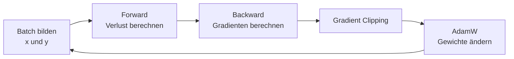

# Gruppe D: Lernsignal und Optimierer

**Transformer, Sitzung 2 · Arbeitsblatt D**

> **Leitfrage:** Wie erreicht das Lernsignal die vorderen Schichten, obwohl sechs Blöcke dazwischenliegen, und was macht der Optimierer aus den Gradienten?

## So arbeiten Sie

1. **Erst lesen.** Die Lesefragen lassen sich nur aus dem Text beantworten.
2. **Erst vorhersagen, dann messen.** Notieren Sie Ihre Erwartung, bevor Sie eine Zelle ausführen. Eine nicht bestätigte Erwartung ist ein Ergebnis.
3. Die Abschnittsnummern beziehen sich auf das Original-Notebook. Variante b enthält denselben Code ohne Überschriften; suchen Sie dort nach den Funktionsnamen.
4. Der Datensatz ist englisch. Stellen Sie Guppy englische Fragen.
5. Am Ende stellen Sie Ihr Ergebnis in wenigen Minuten vor: eine Kernaussage, ein Beleg aus dem Notebook.

## Worum es geht

Ein Trainingsschritt besteht aus immer denselben Stationen. Sie untersuchen zwei davon genauer: den Rückweg der Gradienten durch die Blöcke und den Schritt des Optimierers.



Jeder Block **addiert** seinen Beitrag zum bisherigen Vektor, statt ihn zu ersetzen:

$$
y=x+F(x)
$$

Der Optimierer AdamW führt für jedes Gewicht gleitende Mittel des Gradienten ($\widehat m$) und seines Quadrats ($\widehat v$) und verändert das Gewicht so:

$$
\theta\leftarrow(1-\eta\lambda)\,\theta-\eta\,\frac{\widehat m}{\sqrt{\widehat v}+\varepsilon_{\mathrm{opt}}}
$$

Dabei ist $\eta$ die Lernrate und $\lambda$ der Weight Decay. Die Lernrate ist nicht konstant:

<svg xmlns="http://www.w3.org/2000/svg" viewBox="0 0 760 320" width="100%" style="max-width:760px" font-family="Helvetica, Arial, sans-serif" role="img">
<rect x="0" y="0" width="760" height="320" rx="10" fill="#ffffff" stroke="#e5e7eb"/>
<text x="20" y="30" font-size="15" fill="#1f2937" text-anchor="start" font-weight="bold">Lernratenplan: Warmup, danach halbe Kosinuskurve</text>
<line x1="130" y1="250" x2="700" y2="250" stroke="#1f2937" stroke-width="1.2"/><line x1="130" y1="50" x2="130" y2="250" stroke="#1f2937" stroke-width="1.2"/>
<line x1="130" y1="68.2" x2="700" y2="68.2" stroke="#e5e7eb" stroke-dasharray="4 4"/>
<text x="122" y="72.18181818181819" font-size="12" fill="#2563eb" text-anchor="end">LR = 3·10⁻⁴</text>
<line x1="130" y1="231.8" x2="700" y2="231.8" stroke="#e5e7eb" stroke-dasharray="4 4"/>
<text x="122" y="235.8181818181818" font-size="12" fill="#0f766e" text-anchor="end">MIN_LR = 3·10⁻⁵</text>
<text x="122" y="254.0" font-size="12" fill="#6b7280" text-anchor="end">0</text>
<line x1="168.0" y1="50" x2="168.0" y2="250" stroke="#b91c1c" stroke-dasharray="5 4"/>
<text x="174.0" y="242" font-size="12" fill="#b91c1c" text-anchor="start">Ende Warmup (Schritt 200)</text>
<path d="M130.0,249.1 L130.9,244.5 L131.9,240.0 L132.8,235.5 L133.8,230.9 L134.8,226.4 L135.7,221.8 L136.7,217.3 L137.6,212.7 L138.6,208.2 L139.5,203.6 L140.4,199.1 L141.4,194.5 L142.3,190.0 L143.3,185.5 L144.2,180.9 L145.2,176.4 L146.2,171.8 L147.1,167.3 L148.1,162.7 L149.0,158.2 L149.9,153.6 L150.9,149.1 L151.8,144.5 L152.8,140.0 L153.8,135.5 L154.7,130.9 L155.7,126.4 L156.6,121.8 L157.6,117.3 L158.5,112.7 L159.4,108.2 L160.4,103.6 L161.3,99.1 L162.3,94.5 L163.2,90.0 L164.2,85.5 L165.2,80.9 L166.1,76.4 L167.1,71.8 L168.0,68.2 L168.9,68.2 L169.9,68.2 L170.8,68.2 L171.8,68.2 L172.8,68.2 L173.7,68.2 L174.7,68.2 L175.6,68.3 L176.6,68.3 L177.5,68.3 L178.4,68.3 L179.4,68.4 L180.3,68.4 L181.3,68.4 L182.2,68.5 L183.2,68.5 L184.2,68.6 L185.1,68.6 L186.1,68.6 L187.0,68.7 L187.9,68.7 L188.9,68.8 L189.8,68.9 L190.8,68.9 L191.8,69.0 L192.7,69.1 L193.7,69.1 L194.6,69.2 L195.6,69.3 L196.5,69.3 L197.4,69.4 L198.4,69.5 L199.4,69.6 L200.3,69.7 L201.2,69.8 L202.2,69.8 L203.1,69.9 L204.1,70.0 L205.1,70.1 L206.0,70.2 L206.9,70.3 L207.9,70.4 L208.9,70.6 L209.8,70.7 L210.8,70.8 L211.7,70.9 L212.6,71.0 L213.6,71.1 L214.6,71.3 L215.5,71.4 L216.4,71.5 L217.4,71.6 L218.3,71.8 L219.3,71.9 L220.2,72.0 L221.2,72.2 L222.1,72.3 L223.1,72.5 L224.1,72.6 L225.0,72.8 L225.9,72.9 L226.9,73.1 L227.8,73.2 L228.8,73.4 L229.8,73.6 L230.7,73.7 L231.7,73.9 L232.6,74.1 L233.6,74.2 L234.5,74.4 L235.4,74.6 L236.4,74.8 L237.3,74.9 L238.3,75.1 L239.2,75.3 L240.2,75.5 L241.2,75.7 L242.1,75.9 L243.1,76.1 L244.0,76.3 L244.9,76.5 L245.9,76.7 L246.8,76.9 L247.8,77.1 L248.8,77.3 L249.7,77.5 L250.7,77.7 L251.6,78.0 L252.6,78.2 L253.5,78.4 L254.4,78.6 L255.4,78.8 L256.4,79.1 L257.3,79.3 L258.2,79.5 L259.2,79.8 L260.1,80.0 L261.1,80.2 L262.0,80.5 L263.0,80.7 L263.9,81.0 L264.9,81.2 L265.9,81.5 L266.8,81.7 L267.8,82.0 L268.7,82.2 L269.6,82.5 L270.6,82.7 L271.5,83.0 L272.5,83.3 L273.4,83.5 L274.4,83.8 L275.4,84.1 L276.3,84.4 L277.2,84.6 L278.2,84.9 L279.1,85.2 L280.1,85.5 L281.1,85.7 L282.0,86.0 L282.9,86.3 L283.9,86.6 L284.9,86.9 L285.8,87.2 L286.8,87.5 L287.7,87.8 L288.6,88.1 L289.6,88.4 L290.6,88.7 L291.5,89.0 L292.4,89.3 L293.4,89.6 L294.4,89.9 L295.3,90.2 L296.2,90.5 L297.2,90.9 L298.1,91.2 L299.1,91.5 L300.1,91.8 L301.0,92.1 L302.0,92.5 L302.9,92.8 L303.9,93.1 L304.8,93.5 L305.8,93.8 L306.7,94.1 L307.6,94.5 L308.6,94.8 L309.6,95.1 L310.5,95.5 L311.5,95.8 L312.4,96.2 L313.4,96.5 L314.3,96.9 L315.2,97.2 L316.2,97.6 L317.1,97.9 L318.1,98.3 L319.1,98.6 L320.0,99.0 L321.0,99.3 L321.9,99.7 L322.9,100.1 L323.8,100.4 L324.8,100.8 L325.7,101.2 L326.6,101.5 L327.6,101.9 L328.5,102.3 L329.5,102.7 L330.5,103.0 L331.4,103.4 L332.4,103.8 L333.3,104.2 L334.2,104.5 L335.2,104.9 L336.1,105.3 L337.1,105.7 L338.0,106.1 L339.0,106.5 L340.0,106.9 L340.9,107.3 L341.9,107.6 L342.8,108.0 L343.8,108.4 L344.7,108.8 L345.6,109.2 L346.6,109.6 L347.5,110.0 L348.5,110.4 L349.5,110.8 L350.4,111.2 L351.4,111.6 L352.3,112.0 L353.2,112.4 L354.2,112.9 L355.1,113.3 L356.1,113.7 L357.0,114.1 L358.0,114.5 L359.0,114.9 L359.9,115.3 L360.9,115.7 L361.8,116.2 L362.8,116.6 L363.7,117.0 L364.6,117.4 L365.6,117.8 L366.5,118.3 L367.5,118.7 L368.4,119.1 L369.4,119.5 L370.4,120.0 L371.3,120.4 L372.2,120.8 L373.2,121.3 L374.1,121.7 L375.1,122.1 L376.0,122.5 L377.0,123.0 L377.9,123.4 L378.9,123.8 L379.9,124.3 L380.8,124.7 L381.8,125.2 L382.7,125.6 L383.6,126.0 L384.6,126.5 L385.5,126.9 L386.5,127.3 L387.4,127.8 L388.4,128.2 L389.4,128.7 L390.3,129.1 L391.2,129.6 L392.2,130.0 L393.1,130.5 L394.1,130.9 L395.1,131.3 L396.0,131.8 L396.9,132.2 L397.9,132.7 L398.9,133.1 L399.8,133.6 L400.8,134.0 L401.7,134.5 L402.6,134.9 L403.6,135.4 L404.6,135.8 L405.5,136.3 L406.4,136.7 L407.4,137.2 L408.4,137.7 L409.3,138.1 L410.2,138.6 L411.2,139.0 L412.1,139.5 L413.1,139.9 L414.1,140.4 L415.0,140.8 L416.0,141.3 L416.9,141.8 L417.9,142.2 L418.8,142.7 L419.8,143.1 L420.7,143.6 L421.7,144.0 L422.6,144.5 L423.6,145.0 L424.5,145.4 L425.4,145.9 L426.4,146.3 L427.3,146.8 L428.3,147.2 L429.2,147.7 L430.2,148.2 L431.1,148.6 L432.1,149.1 L433.0,149.5 L434.0,150.0 L435.0,150.5 L435.9,150.9 L436.9,151.4 L437.8,151.8 L438.8,152.3 L439.7,152.8 L440.7,153.2 L441.6,153.7 L442.6,154.1 L443.5,154.6 L444.4,155.0 L445.4,155.5 L446.4,156.0 L447.3,156.4 L448.2,156.9 L449.2,157.3 L450.1,157.8 L451.1,158.2 L452.0,158.7 L453.0,159.2 L453.9,159.6 L454.9,160.1 L455.8,160.5 L456.8,161.0 L457.8,161.4 L458.7,161.9 L459.7,162.3 L460.6,162.8 L461.6,163.3 L462.5,163.7 L463.4,164.2 L464.4,164.6 L465.4,165.1 L466.3,165.5 L467.2,166.0 L468.2,166.4 L469.1,166.9 L470.1,167.3 L471.1,167.8 L472.0,168.2 L472.9,168.7 L473.9,169.1 L474.8,169.5 L475.8,170.0 L476.7,170.4 L477.7,170.9 L478.7,171.3 L479.6,171.8 L480.6,172.2 L481.5,172.7 L482.4,173.1 L483.4,173.5 L484.4,174.0 L485.3,174.4 L486.2,174.8 L487.2,175.3 L488.1,175.7 L489.1,176.2 L490.1,176.6 L491.0,177.0 L491.9,177.5 L492.9,177.9 L493.8,178.3 L494.8,178.7 L495.8,179.2 L496.7,179.6 L497.7,180.0 L498.6,180.5 L499.6,180.9 L500.5,181.3 L501.4,181.7 L502.4,182.2 L503.4,182.6 L504.3,183.0 L505.2,183.4 L506.2,183.8 L507.1,184.3 L508.1,184.7 L509.1,185.1 L510.0,185.5 L510.9,185.9 L511.9,186.3 L512.8,186.7 L513.8,187.1 L514.8,187.6 L515.7,188.0 L516.7,188.4 L517.6,188.8 L518.5,189.2 L519.5,189.6 L520.5,190.0 L521.4,190.4 L522.4,190.8 L523.3,191.2 L524.2,191.6 L525.2,192.0 L526.1,192.4 L527.1,192.7 L528.0,193.1 L529.0,193.5 L530.0,193.9 L530.9,194.3 L531.8,194.7 L532.8,195.1 L533.8,195.5 L534.7,195.8 L535.6,196.2 L536.6,196.6 L537.5,197.0 L538.5,197.3 L539.5,197.7 L540.4,198.1 L541.4,198.5 L542.3,198.8 L543.2,199.2 L544.2,199.6 L545.2,199.9 L546.1,200.3 L547.0,200.7 L548.0,201.0 L549.0,201.4 L549.9,201.7 L550.8,202.1 L551.8,202.4 L552.8,202.8 L553.7,203.1 L554.6,203.5 L555.6,203.8 L556.5,204.2 L557.5,204.5 L558.5,204.9 L559.4,205.2 L560.4,205.5 L561.3,205.9 L562.2,206.2 L563.2,206.5 L564.2,206.9 L565.1,207.2 L566.0,207.5 L567.0,207.9 L568.0,208.2 L568.9,208.5 L569.8,208.8 L570.8,209.1 L571.8,209.5 L572.7,209.8 L573.6,210.1 L574.6,210.4 L575.5,210.7 L576.5,211.0 L577.5,211.3 L578.4,211.6 L579.4,211.9 L580.3,212.2 L581.2,212.5 L582.2,212.8 L583.2,213.1 L584.1,213.4 L585.0,213.7 L586.0,214.0 L587.0,214.3 L587.9,214.5 L588.9,214.8 L589.8,215.1 L590.8,215.4 L591.7,215.6 L592.6,215.9 L593.6,216.2 L594.5,216.5 L595.5,216.7 L596.5,217.0 L597.4,217.3 L598.3,217.5 L599.3,217.8 L600.2,218.0 L601.2,218.3 L602.2,218.5 L603.1,218.8 L604.0,219.0 L605.0,219.3 L606.0,219.5 L606.9,219.8 L607.9,220.0 L608.8,220.2 L609.8,220.5 L610.7,220.7 L611.6,220.9 L612.6,221.2 L613.5,221.4 L614.5,221.6 L615.5,221.8 L616.4,222.0 L617.3,222.3 L618.3,222.5 L619.2,222.7 L620.2,222.9 L621.2,223.1 L622.1,223.3 L623.0,223.5 L624.0,223.7 L625.0,223.9 L625.9,224.1 L626.9,224.3 L627.8,224.5 L628.8,224.7 L629.7,224.9 L630.6,225.1 L631.6,225.2 L632.5,225.4 L633.5,225.6 L634.5,225.8 L635.4,225.9 L636.3,226.1 L637.3,226.3 L638.2,226.4 L639.2,226.6 L640.2,226.8 L641.1,226.9 L642.0,227.1 L643.0,227.2 L643.9,227.4 L644.9,227.5 L645.9,227.7 L646.8,227.8 L647.8,228.0 L648.7,228.1 L649.6,228.2 L650.6,228.4 L651.6,228.5 L652.5,228.6 L653.5,228.7 L654.4,228.9 L655.4,229.0 L656.3,229.1 L657.2,229.2 L658.2,229.3 L659.1,229.4 L660.1,229.6 L661.0,229.7 L662.0,229.8 L663.0,229.9 L663.9,230.0 L664.9,230.1 L665.8,230.2 L666.8,230.2 L667.7,230.3 L668.6,230.4 L669.6,230.5 L670.6,230.6 L671.5,230.7 L672.5,230.7 L673.4,230.8 L674.4,230.9 L675.3,230.9 L676.2,231.0 L677.2,231.1 L678.1,231.1 L679.1,231.2 L680.0,231.3 L681.0,231.3 L682.0,231.4 L682.9,231.4 L683.9,231.4 L684.8,231.5 L685.8,231.5 L686.7,231.6 L687.6,231.6 L688.6,231.6 L689.6,231.7 L690.5,231.7 L691.5,231.7 L692.4,231.7 L693.4,231.8 L694.3,231.8 L695.2,231.8 L696.2,231.8 L697.1,231.8 L698.1,231.8 L699.0,231.8 L699.8,231.8" fill="none" stroke="#2563eb" stroke-width="2.5" stroke-linejoin="round"/>
<line x1="130.0" y1="250" x2="130.0" y2="255" stroke="#1f2937"/>
<text x="130.0" y="270" font-size="12" fill="#6b7280" text-anchor="middle">0</text>
<line x1="225.0" y1="250" x2="225.0" y2="255" stroke="#1f2937"/>
<text x="225.0" y="270" font-size="12" fill="#6b7280" text-anchor="middle">500</text>
<line x1="320.0" y1="250" x2="320.0" y2="255" stroke="#1f2937"/>
<text x="320.0" y="270" font-size="12" fill="#6b7280" text-anchor="middle">1.000</text>
<line x1="415.0" y1="250" x2="415.0" y2="255" stroke="#1f2937"/>
<text x="415.0" y="270" font-size="12" fill="#6b7280" text-anchor="middle">1.500</text>
<line x1="510.0" y1="250" x2="510.0" y2="255" stroke="#1f2937"/>
<text x="510.0" y="270" font-size="12" fill="#6b7280" text-anchor="middle">2.000</text>
<line x1="605.0" y1="250" x2="605.0" y2="255" stroke="#1f2937"/>
<text x="605.0" y="270" font-size="12" fill="#6b7280" text-anchor="middle">2.500</text>
<line x1="700.0" y1="250" x2="700.0" y2="255" stroke="#1f2937"/>
<text x="700.0" y="270" font-size="12" fill="#6b7280" text-anchor="middle">3.000</text>
<text x="415.0" y="294" font-size="13" fill="#1f2937" text-anchor="middle">Trainingsschritt n</text>
</svg>

$$
\eta_n=\eta_{\max}\,\frac{n+1}{n_{\mathrm{warm}}}\quad\text{für } n<n_{\mathrm{warm}}
$$

$$
\eta_n=\eta_{\min}+(\eta_{\max}-\eta_{\min})\cdot\frac12\left(1+\cos\frac{\pi\,(n-n_{\mathrm{warm}})}{n_{\mathrm{ges}}-n_{\mathrm{warm}}}\right)\quad\text{danach}
$$

## 1. Lesen

| Quelle | Abschnitt |
|---|---|
| Original-Notebook | Abschnitt 4.3 „Der Block" |
| Original-Notebook | Abschnitt 5: Einleitung mit Einstellungstabelle und „Das Modell trainieren" |
| Lehrbuch | Kapitel 9 und Kapitel 11 |

**Lesefragen**

1. Was bedeutet im Notebook der Satz „Der Strom wird ergänzt, nicht ersetzt"?
2. Wie begründet das Notebook den Warmup?
3. Was begrenzt `clip_grad_norm_` laut Text, und was ausdrücklich nicht?

## 2. Aufgaben zur Residualverbindung

1. Wo stehen die Residualverbindungen im Code? Zeichnen Sie einen Block mit beiden Additionen und den vorgeschalteten LayerNorm-Schichten.
2. Welche Ableitung hat $y=x+F(x)$ nach $x$? Was würde ohne die Addition fehlen?
3. Angenommen, in jedem der sechs Blöcke wäre $F'(x)=0{,}1$. Mit welchem Faktor käme ein Gradient vorne an, einmal ohne und einmal mit Residualverbindung? Rechnen Sie.
4. Am Pluszeichen treffen zwei Wege zusammen. Teilt sich der Gradient dort auf beide Zweige auf?
5. Präzisieren Sie die folgende Aussage: „Im Transformer werden die Gewichte bei der Backpropagation nicht von hinten nach vorne zurückgespielt." Was läuft tatsächlich rückwärts, und in welcher Richtung?

## 3. Experiment: Kommt das Signal vorne an?

**a) Erwartung.** Block 0 liegt am weitesten vom Verlust entfernt, Block 5 am nächsten. Sind die Gradienten in Block 0 viel kleiner als in Block 5?

**b) Versuch.**

```python
modell.train()
x, y = baue_batch(train_seq, list(range(32)))
_, verlust = modell(x.to(DEVICE), y.to(DEVICE))
modell.zero_grad(set_to_none=True)
verlust.backward()
for name, p in modell.named_parameters():
    if name.endswith("ffn.hoch.weight"):
        print(f"{name:28s} Gradientennorm {p.grad.norm():.4f}")
modell.eval()
```

**c) Beobachtung.**

| Block | 0 | 1 | 2 | 3 | 4 | 5 |
|---|---|---|---|---|---|---|
| Gradientennorm | | | | | | |

**d) Erklärung.** Passt die Messung zu Ihrer Rechnung aus Aufgabe 3?

## 4. Aufgaben zum Optimierer

1. Ordnen Sie die Stationen eines Trainingsschritts dem Code zu: Batchbildung, Vorwärtsrechnung, Verlust, Rückwärtsrechnung, Clipping, Optimierung, Validierung, Checkpoint. **Welche eine Zeile verändert die Gewichte?**
2. Was unterscheidet AdamW von einfachem Gradientenabstieg $\theta\leftarrow\theta-\eta\nabla_\theta\mathcal L$? Wofür steht das „W"?
3. Berechnen Sie die Lernrate für die Schritte 0, 100, 199, 1.600 und 2.999 von Hand und vergleichen Sie mit dem Plot im Notebook.

| Schritt $n$ | 0 | 100 | 199 | 1.600 | 2.999 |
|---|---|---|---|---|---|
| Lernrate $\eta_n$ | | | | | |

4. Warum beginnt die Lernrate klein, und warum sinkt sie am Ende wieder?
5. Auf welche Parameter wirkt der Weight Decay im Notebook? Gilt das auch für die eingefrorene Positionstabelle in Variante b?
6. Notieren Sie Trainingskonfiguration, Gerät, Schrittzahl und Laufzeit Ihres Laufs.

## 5. Für schnelle Gruppen: Training ohne Warmup

Vergleichen Sie zwei Kurzläufe mit `MAX_STEPS = 300`, einmal mit `WARMUP = 200`, einmal mit `WARMUP = 1`. Führen Sie dazu die Einstellungszelle und die Trainingszelle neu aus und verwenden Sie einen eigenen Checkpointnamen. Formulieren Sie vorher eine Erwartung.

## 6. Ihr Ergebnis

- Eine beschriftete Blockskizze mit dem Weg des Gradienten.
- Die gemessenen Gradientennormen und der nachgerechnete Lernratenverlauf.
- **Eine Kernaussage** für das Plenum: Warum lässt sich ein Netz mit sechs Blöcken überhaupt trainieren, und warum mit AdamW statt mit einfachem Gradientenabstieg?
