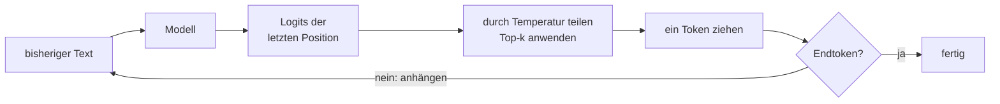

# Gruppe E: Verhalten des fertigen Modells

**Transformer, Sitzung 2 · Arbeitsblatt E**

> **Leitfrage:** Ist Guppy ein Instruct-Modell? Wenn nicht: Warum antwortet er trotzdem auf Fragen? Und was verändert die Temperatur?

## So arbeiten Sie

1. **Erst lesen.** Die Lesefragen lassen sich nur aus dem Text beantworten.
2. **Erst vorhersagen, dann messen.** Notieren Sie Ihre Erwartung, bevor Sie eine Zelle ausführen. Eine nicht bestätigte Erwartung ist ein Ergebnis.
3. Die Abschnittsnummern beziehen sich auf das Original-Notebook. Variante b enthält denselben Code ohne Überschriften; suchen Sie dort nach den Funktionsnamen.
4. Der Datensatz ist englisch. Stellen Sie Guppy englische Fragen.
5. Am Ende stellen Sie Ihr Ergebnis in wenigen Minuten vor: eine Kernaussage, ein Beleg aus dem Notebook.

## Worum es geht

Große Sprachmodelle gibt es oft in zwei Fassungen: ein Basismodell, das Text nur fortsetzt, und ein Instruct-Modell, das in einer zweiten Trainingsphase gelernt hat, Anweisungen zu befolgen. Sie untersuchen, wo Guppy einzuordnen ist.

Die Funktion `antworte` verpackt jede Frage so, bevor das Modell sie sieht:

<svg xmlns="http://www.w3.org/2000/svg" viewBox="0 0 760 290" width="100%" style="max-width:760px" font-family="Helvetica, Arial, sans-serif" role="img">
<rect x="0" y="0" width="760" height="290" rx="10" fill="#ffffff" stroke="#e5e7eb"/>
<text x="20" y="30" font-size="15" fill="#1f2937" text-anchor="start" font-weight="bold">So sieht das Modell die Frage „hello guppy“</text>
<rect x="150" y="52" width="150" height="34" rx="6" fill="#fef3c7" stroke="#b45309" stroke-width="1.5"/><text x="225.0" y="73.55" font-size="13" text-anchor="middle" fill="#1f2937" font-family="Menlo, Consolas, monospace">&lt;|im_start|&gt;</text>
<rect x="308" y="52" width="70" height="34" rx="6" fill="#dbeafe" stroke="#2563eb" stroke-width="1.5"/><text x="343.0" y="73.55" font-size="13" text-anchor="middle" fill="#1f2937" font-family="Menlo, Consolas, monospace">user</text>
<rect x="150" y="98" width="130" height="34" rx="6" fill="#dbeafe" stroke="#2563eb" stroke-width="1.5"/><text x="215.0" y="119.55" font-size="13" text-anchor="middle" fill="#1f2937" font-family="Menlo, Consolas, monospace">hello guppy</text>
<rect x="288" y="98" width="130" height="34" rx="6" fill="#fef3c7" stroke="#b45309" stroke-width="1.5"/><text x="353.0" y="119.55" font-size="13" text-anchor="middle" fill="#1f2937" font-family="Menlo, Consolas, monospace">&lt;|im_end|&gt;</text>
<rect x="150" y="144" width="150" height="34" rx="6" fill="#fef3c7" stroke="#b45309" stroke-width="1.5"/><text x="225.0" y="165.55" font-size="13" text-anchor="middle" fill="#1f2937" font-family="Menlo, Consolas, monospace">&lt;|im_start|&gt;</text>
<rect x="308" y="144" width="110" height="34" rx="6" fill="#ccfbf1" stroke="#0f766e" stroke-width="1.5"/><text x="363.0" y="165.55" font-size="13" text-anchor="middle" fill="#1f2937" font-family="Menlo, Consolas, monospace">assistant</text>
<rect x="150" y="190" width="300" height="34" rx="6" fill="#ffffff" stroke="#0f766e" stroke-width="1.5" stroke-dasharray="5 4"/><text x="300.0" y="211.9" font-size="14" text-anchor="middle" fill="#0f766e">?   ?   ?</text>
<text x="462" y="212" font-size="12" fill="#0f766e" text-anchor="start">hier schreibt das Modell weiter</text>
<path d="M132,52 L122,52 L122,178 L132,178" fill="none" stroke="#6b7280" stroke-width="1.5"/>
<text x="112" y="111.0" font-size="12" fill="#6b7280" text-anchor="end">Prompt, von</text>
<text x="112" y="127.0" font-size="12" fill="#6b7280" text-anchor="end">antworte() gebaut</text>
<rect x="150" y="246" width="14" height="14" rx="6" fill="#fef3c7" stroke="#b45309" stroke-width="1.5"/><text x="157.0" y="257.9" font-size="14" text-anchor="middle" fill="#1f2937"></text>
<text x="172" y="258" font-size="12" fill="#6b7280" text-anchor="start">Sondertoken mit fester ID</text>
<rect x="360" y="246" width="14" height="14" rx="6" fill="#dbeafe" stroke="#2563eb" stroke-width="1.5"/><text x="367.0" y="257.9" font-size="14" text-anchor="middle" fill="#1f2937"></text>
<text x="382" y="258" font-size="12" fill="#6b7280" text-anchor="start">Benutzer</text>
<rect x="470" y="246" width="14" height="14" rx="6" fill="#ccfbf1" stroke="#0f766e" stroke-width="1.5"/><text x="477.0" y="257.9" font-size="14" text-anchor="middle" fill="#1f2937"></text>
<text x="492" y="258" font-size="12" fill="#6b7280" text-anchor="start">Assistant</text>
</svg>

Danach erzeugt das Modell Token für Token:



Die Temperatur $\tau$ verändert, wie aus den Logits $\ell_k$ Wahrscheinlichkeiten werden:

$$
p_k^{(\tau)}=\frac{\exp(\ell_k/\tau)}{\sum_r\exp(\ell_r/\tau)}
$$

## 1. Lesen

| Quelle | Abschnitt |
|---|---|
| Original-Notebook | Abschnitt 2, „ChatML" |
| Original-Notebook | Abschnitt 6 vollständig, mit „Beobachtung: Was die Temperatur macht" |
| Original-Notebook | Abschnitt 7 |
| Lehrbuch | Kapitel 12 |

**Lesefragen**

1. Womit endet der Prompt, den `antworte` baut, und warum genau dort?
2. Welche zwei Tokens sperrt `erzeuge`, und mit welcher Begründung?
3. Welche drei Abbruchgründe gibt es? Welcher davon ist „gelernt"?
4. Warum hat Guppy kein Gedächtnis über mehrere Fragen hinweg?

## 2. Aufgaben zur Instruct-Frage

1. Gab es beim Training eine eigene Phase, in der Guppy das Befolgen von Anweisungen gelernt hat? Belegen Sie Ihre Antwort am Trainingscode.
2. Woran erkennt das Modell, dass jetzt eine Antwort folgen soll?
3. Im Training wird auch der Text der Benutzerfrage im Verlust bewertet. Was hat das Modell dadurch nebenbei gelernt?

## 3. Experiment: Was schreibt Guppy ohne den üblichen Rahmen?

**a) Erwartung.** Sagen Sie für jeden der vier Prompts voraus, was Guppy schreibt.

| Nr. | Prompt | Ihre Erwartung | Beobachtung |
|---|---|---|---|
| 1 | nur `hello guppy`, ohne Rollenmarkierung | | |
| 2 | nur der Beginn einer Benutzerrolle | | |
| 3 | nur der Beginn der Assistant-Rolle, ohne Frage | | |
| 4 | vollständige Frage, aber der Rollenstart der Antwort fehlt | | |

**b) Versuch.**

```python
def setze_fort(prompt, **kw):
    ids = tokenizer.encode(prompt).ids
    alle, grund = erzeuge(modell, ids, return_info=True, **kw)
    return tokenizer.decode(alle[len(ids):], skip_special_tokens=False), grund

print(setze_fort("hello guppy"))                               # 1
print(setze_fort("<|im_start|>user\n"))                        # 2
print(setze_fort("<|im_start|>assistant\n"))                   # 3
print(setze_fort("<|im_start|>user\nhello guppy<|im_end|>\n")) # 4
```

**c) Erklärung.**

- Bei Prompt 4 kann das Modell den Rollenwechsel nicht selbst schreiben. Warum nicht, und was tut es stattdessen?
- Formulieren Sie ein begründetes Urteil: Instruct-Modell oder nicht? Was genau unterscheidet Guppy von einem Instruct-Modell, was hat er mit ihm gemeinsam?

## 4. Experiment: Was verändert die Temperatur?

**a) Handrechnung.** Drei Tokens haben die Logits $(2;\,1;\,0)$. Berechnen Sie die Wahrscheinlichkeiten.

| Temperatur $\tau$ | $p_1$ | $p_2$ | $p_3$ |
|---:|---|---|---|
| 0,5 | | | |
| 1,0 | | | |
| 2,0 | | | |

**b) Erwartung.** Wie verändert sich die Verteilung des nächsten Tokens bei den Temperaturen 0,1, 0,7 und 1,5?

**c) Versuch 1: die Verteilung des nächsten Tokens.** Dieselben Logits, drei Temperaturen, ohne Top-k.

```python
prompt = "<|im_start|>user\nhello guppy<|im_end|>\n<|im_start|>assistant\n"
ids = torch.tensor([tokenizer.encode(prompt).ids], device=DEVICE)
with torch.no_grad():
    logits = modell(ids)[0][0, -1]

for tau in (0.1, 0.7, 1.5):
    p = F.softmax(logits / tau, dim=-1)
    werte, nummern = p.topk(5)
    zeile = ", ".join(f"{tokenizer.id_to_token(n)!r} {w:.3f}"
                      for n, w in zip(nummern.tolist(), werte.tolist()))
    print(f"tau = {tau}: {zeile}")
```

**d) Versuch 2: vollständige Antworten.** Je Temperatur fünf Antworten mit denselben fünf Seeds.

```python
for tau in (0.1, 0.7, 1.5):
    for seed in range(5):
        torch.manual_seed(seed)
        text, grund = antworte("hello guppy", temperatur=tau, top_k=None, return_info=True)
        print(f"tau = {tau} | Seed {seed} | {text} [{grund}]")
```

**e) Auswertung.**

1. Vergleichen Sie Vielfalt, Passung, Länge und Abbruchgrund. Behandeln Sie die wenigen Antworten als Beobachtungen, nicht als Nachweis.
2. Ändert die Temperatur die Rangfolge der Tokens?
3. Wie setzt der Code „Temperatur 0" um? Warum nicht durch Einsetzen von $\tau=0$ in die Formel?
4. Wiederholen Sie Versuch 2 für $\tau=1{,}5$ mit `top_k=50`. Was bewirkt Top-k?
5. Erklären Sie, warum veränderte Antworten hier kein weiteres Lernen bedeuten. Welche Größen ändern sich, welche bleiben gleich?

## 5. Ihr Ergebnis

- Ihr begründetes Urteil zur Instruct-Frage, mit den vier Fortsetzungen als Beleg.
- Der Vergleich der Tokenverteilungen und Antworten bei drei Temperaturen.
- **Eine Kernaussage** für das Plenum: Warum „gehorcht" ein Modell, das nur das nächste Token vorhersagt?
