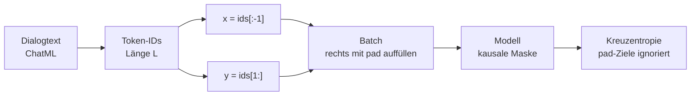

# Transformer, Sitzung 2: Das Training verstehen

## Ideensammlung für die Gruppenarbeit am GuppyLM-Notebook

Stand: 13.11.2026 · Grundlage: `guppylm_lehrnotebook_b.ipynb` und `Transformer_Lehrbuch.md`

---

## 1. Ausgangslage und Ziel

- **Zielgruppe:** 20 Bachelor-Studierende, DQR-5-Prüfung bestanden, Vorwissen bis CNN.
- **Stand nach Sitzung 1:** Grundaufbau des Transformers frontal erklärt (Embedding, Positional Encoding, Attention, LayerNorm). BPE-Tokenizer ist verstanden. Das Training wurde noch nicht behandelt.
- **Annahme:** Die Lehrbuch-Hausaufgabe wurde nicht in der Tiefe bearbeitet. Die Gruppenaufträge dienen der Vertiefung; das Lehrbuch ist dabei die erste Quelle, das Notebook das Labor.
- **Ziel der Sitzung:** Die Studierenden trainieren eine eigene Guppy-Variante und erklären sich das Skript selbst. Der Dozent arbeitet als Tutor.


Durchgängiges Arbeitsprinzip für alle Gruppen: **erst vorhersagen, dann messen.** Jede Gruppe notiert ihre Erwartung, bevor sie die Zelle ausführt.

---

## 2. Was das Notebook b tatsächlich tut

Diese Werte sind aus dem Notebook abgelesen und dienen als Referenz für alle Gruppen.

| Aspekt | Notebook b | Zelle |
|---|---|---|
| Architektur | Decoder-only, 6 Blöcke, $d=384$, 6 Köpfe, FFN 1.536, GELU, Pre-LN | 1, 10–14 |
| Positionen | feste Sinustabelle, mit $\alpha=0{,}02\sqrt2$ skaliert, **eingefroren** | 14 |
| Ausgabe | Weight Tying: `lm_head.weight = tok_emb.weight` | 14 |
| Vokabular | Zielgröße 4.096, im dokumentierten Lauf 2.597 | 4 |
| Datenformat | ChatML, ein Dialog je Beispiel | 2, 3 |
| Batch | 32 zufällig gezogene Beispiele, mit Zurücklegen, rechts gepaddet | 7, 21 |
| Loss | Kreuzentropie, `ignore_index=pad_id`, alle Nicht-Padding-Ziele | 14 |
| Optimierer | AdamW, $\beta=(0{,}9;\,0{,}95)$, Weight Decay 0,1 auf alle Parameter | 21 |
| Lernrate | 200 Schritte linearer Warmup bis $3\cdot10^{-4}$, dann Kosinus bis $3\cdot10^{-5}$ | 18 |
| Clipping | gemeinsame Gradientennorm höchstens 1 | 21 |
| Schritte | `MAX_STEPS = 6000` | 1 |
| Generierung | Temperatur 0,7; Top-k 50; `<pad>` und `<\|im_start\|>` gesperrt | 24 |

---

## 3. Die fünf Gruppen im Überblick

| Gruppe | Thema | Leitfrage | Zellen | Lehrbuch |
|---|---|---|---|---|
| A | Vom Dialog zum Trainingsbeispiel | Wie wird ein Guppy-Dialog für das Training aufbereitet? | 2, 3, 7, 8 | Kap. 2, 5 |
| B | Loss | Welche Verlustfunktion wird benutzt, und warum keine andere? | 14, 17, 20, 22 | Kap. 8 |
| C | Gradientenfluss | Wie kommt das Lernsignal bis zu den Embeddings? | 13, 14, 15 | Kap. 9, 10 |
| D | Optimierung | Welcher Optimierer, welche Lernrate, und warum? | 18, 21 | Kap. 11 |
| E | Verhalten | Gehorcht Guppy, oder setzt er nur fort? | 24–26 | Kap. 12 |

---

## 4. Gruppe A: Vom Dialog zum Trainingsbeispiel

**Leitfrage:** Wie sieht ein Trainingsdatensatz aus, und wie wird ein Guppy-Dialog vom Skript für das Training aufbereitet?

**Auftrag:** Verfolgen Sie einen einzigen Dialog von der JSONL-Zeile bis zum Verlustwert.



**Unterfragen**

1. Warum `ids[:-1]` als Eingabe und `ids[1:]` als Ziel? Wie viele Vorhersageaufgaben liefert ein Dialog mit $L$ Tokens?
2. Warum darf ein Beispiel `max_seq_len + 1` Tokens lang sein?
3. Alle 32 Zeilen eines Batches müssen gleich lang sein. Wie löst `baue_batch` das, und wie groß ist der Padding-Anteil (Zelle 8)?
4. Was bewirkt `ignore_index=pad_id` genau? Verschwindet `<pad>` damit aus dem Modell?
5. Warum braucht die Attention keine eigene Padding-Maske?
6. Das Skript kennt keine Epochen. Wie oft sieht das Modell einen Dialog im Mittel?
7. Die Benutzerfrage wird im Loss mitbewertet. Kann das Modell sie überhaupt vorhersagen? Was folgt daraus für den erreichbaren Verlust?

**Experiment**

- Zelle 8 für verschiedene Indizes ausführen, `x` und `y` als Text nebeneinanderlegen und die Verschiebung zeigen.
- Vier sehr unterschiedlich lange Dialoge in einen Batch legen und den Padding-Anteil vergleichen.

**Fachlicher Kern (für den Tutor)**

- $x_t=s_t$, $y_t=s_{t+1}$: Ein Dialog mit $L$ Tokens liefert $L-1$ Aufgaben, alle in einem Vorwärtslauf. Möglich macht das die kausale Maske. Das Vorgeben der echten Vorgänger heißt Teacher Forcing.
- `ignore_index` streicht ganze **Zielpositionen** aus Summe und Mittelung. Die Klasse `<pad>` bleibt im Softmax-Nenner jeder gültigen Position stehen.
- Rechtes Padding liegt hinter allen gültigen Tokens. Wegen der kausalen Maske kann keine gültige Position darauf zugreifen.
- Sampling: $6000\cdot32=192\,000$ Ziehungen aus 57.000 Dialogen, im Mittel also etwa 3,4 je Dialog. Mit Zurücklegen bleiben rund $e^{-3{,}4}\approx3\,\%$ der Dialoge ungesehen.
- Die Benutzerfrage ist aus dem Kontext kaum vorhersagbar. Ihre Tokens halten den Verlust dauerhaft über null, auch bei perfekt gelernten Antworten. Zugleich lernt das Modell dadurch, wie Benutzerfragen aussehen (Anschluss an Gruppe E).

---

## 5. Gruppe B: Loss

**Leitfrage:** Welche Verlustfunktion nutzt das Skript, und warum diese und keine andere?

**Unterfragen**

1. Wo im Code wird der Verlust berechnet? Warum steht davor kein Softmax-Aufruf?
2. Warum ist die Token-ID kein sinnvolles Regressionsziel (quadratischer Fehler)?
3. Welchen Verlust erwarten Sie bei einem untrainierten Modell? Rechnen Sie, bevor Sie Zelle 17 ausführen.
4. Was bedeutet ein Verlust von 0,4 anschaulich? Rechnen Sie in Perplexität um.
5. Warum kann der Evaluationsverlust unter dem angezeigten Trainingsverlust liegen (Zelle 21, 22)?
6. Wieso reicht ein einziger Verlustwert, um Embeddings, Attention, FFN und LayerNorm gleichzeitig zu trainieren?

**Fachlicher Kern (für den Tutor)**

- Verlust an einer Position: $\mathcal L_t=-\ln p_{t,y_t}$. Das ist die Kreuzentropie mit One-hot-Ziel.
- Begründung über Maximum Likelihood: Die Wahrscheinlichkeit eines Textes ist das Produkt der Tokenwahrscheinlichkeiten; der negative Logarithmus macht daraus eine Summe.

$$
-\ln\prod_t P_\theta(s_{t+1}\mid s_{\le t})=-\sum_t\ln P_\theta(s_{t+1}\mid s_{\le t})
$$

- Der Gradient nach den Logits ist besonders einfach und sättigt nicht:

$$
\frac{\partial\mathcal L}{\partial\ell_{t,k}}=\frac1N\left(p_{t,k}-\mathbf 1[k=y_t]\right)
$$

- Startwert bei Gleichverteilung: $\ln n_{\mathrm{vocab}}$, für 2.597 Tokens also etwa 7,86. Der gemessene Wert weicht leicht ab, weil Zufallsgewichte keine exakte Gleichverteilung liefern.
- Perplexität $=e^{\mathcal L}$; $e^{0{,}4}\approx1{,}5$. Sie ist keine Trefferquote.
- Eval unter Train: Dropout ist bei der Validierung aus, und der Trainingswert mittelt über die letzten 200 Schritte, enthält also ältere, schlechtere Modellstände.
- `F.cross_entropy` rechnet Log-Softmax intern und numerisch stabil.

**Experiment**

- Für drei erfundene Wahrscheinlichkeiten des richtigen Tokens (0,9; 0,1; 0,01) den Verlust von Hand berechnen und die Asymmetrie beschreiben.
- Die Kurve aus Zelle 22 in Phasen einteilen: Wo fällt sie steil, wo flach, und was lernt das Modell vermutlich in welcher Phase?

---

## 6. Gruppe C: Gradientenfluss

**Leitfrage:** Wie erreicht das Lernsignal aus dem Verlust die Embedding-Tabelle, obwohl sechs Blöcke dazwischenliegen?

**Präzisierung vorab:** Rückwärts durchs Netz laufen **Gradienten**, keine Gewichte. Das gilt im Transformer wie in jedem anderen Netz, von hinten nach vorne. Die Residualverbindung ersetzt die Backpropagation nicht; sie fügt dem Rechengraphen einen zusätzlichen direkten Weg hinzu.

**Unterfragen**

1. Wo stehen die Residualverbindungen im Code (Zelle 13)? Was bedeutet der Kommentar „Beitrag, kein Ersatz"?
2. Welche Ableitung hat $y=x+F(x)$ nach $x$? Was ändert die 1?
3. Teilt sich der Gradient am Pluszeichen auf beide Zweige auf?
4. Ein Embedding ist nur eine Tabelle, die Token-ID eine ganze Zahl. Wie kann eine Tabellenzeile einen Gradienten bekommen?
5. In einem Batch kommen viele Tokens gar nicht vor. Bekommen ihre Embedding-Zeilen trotzdem einen Gradienten?
6. Wird die Positionskodierung in diesem Notebook trainiert? Woran erkennen Sie das in Zelle 14 und 15?

**Experiment: vorhersagen, dann messen**

```python
modell.train()
x, y = baue_batch(train_seq, list(range(32)))
_, verlust = modell(x.to(DEVICE), y.to(DEVICE))
modell.zero_grad(set_to_none=True)
verlust.backward()

g = modell.tok_emb.weight.grad
print("Embedding-Zeilen mit Gradient ungleich null:",
      (g.abs().sum(dim=1) > 0).sum().item(), "von", g.size(0))
print("Verschiedene Tokens im Batch:", x.unique().numel())
print("Gradient der Positionstabelle:", modell.pos_emb.weight.grad)

for name, p in modell.named_parameters():
    if p.grad is not None and name.endswith("ffn.hoch.weight"):
        print(f"{name:32s} {p.grad.norm():.4f}")
```

Vorher zu beantworten: Wie viele Zeilen werden es sein, und was steht bei der Positionstabelle?

**Fachlicher Kern (für den Tutor)**

- Residualschritt: $\dfrac{\partial\mathcal L}{\partial x}=\dfrac{\partial\mathcal L}{\partial y}\left(1+F'(x)\right)$. Ohne direkten Pfad bliebe nur $F'(x)$; über viele Schichten werden solche Produkte leicht sehr klein.
- Die Ableitung einer Summe nach jedem Summanden ist 1. Beide Zweige erhalten den vollen ankommenden Gradienten.
- Bild des Residualstroms: Jeder Block liest daraus und addiert eine Korrektur. Der Embedding-Vektor bleibt bis zum Ausgang als Summand erhalten.
- Embedding-Eingangspfad: Die nachgeschlagene Zeile erhält genau den Gradienten, der an ihrer Position im Residualstrom ankommt; alle Vorkommen desselben Tokens summieren sich.
- Weight Tying liefert einen zweiten Weg: Über die Ausgabe nehmen alle Vokabularzeilen an der Softmax teil. Deshalb haben praktisch alle Zeilen einen Gradienten, auch nicht eingegebene.
- Positionstabelle: `requires_grad_(False)`, der Gradient ist `None`. Zelle 15 zeigt „trainierbar" kleiner als „gesamt". Es gibt in diesem Notebook also kein Training des Positional Encodings.
- Bedeutung in den Embeddings entsteht ohne eigenes Ziel: Tokens, die in ähnlichen Kontexten vorkommen, erhalten ähnliche Rückmeldungen.

**Optionale Erweiterung (nicht erprobt):** In `Block.forward` die beiden `x +` entfernen, ein frisches Modell anlegen und die Gradientennormen je Block vergleichen. Der Ausgang ist bei nur sechs Blöcken offen; die Gruppe soll beschreiben und begründen, was sie sieht.

---

## 7. Gruppe D: Optimierung

**Leitfrage:** Welcher Optimierer wird benutzt, wie verändert sich die Lernrate, und warum?

**Unterfragen**

1. Was unterscheidet AdamW von einfachem Gradientenabstieg (SGD)?
2. Wofür steht das „W"? Auf welche Parameter wirkt der Weight Decay im Notebook?
3. Zeichnen Sie den Verlauf der Lernrate aus `lernrate()` nach. Warum beginnt er nicht beim Höchstwert?
4. Warum sinkt die Lernrate gegen Ende wieder?
5. Was begrenzt `clip_grad_norm_`? Begrenzt es auch die Größe des Parameterschritts?
6. In welcher Reihenfolge stehen `backward`, Clipping, `step` und `zero_grad`, und was verändert jeder Aufruf?

**Fachlicher Kern (für den Tutor)**

- AdamW führt gleitende Mittel des Gradienten ($m$) und seines Quadrats ($v$) und skaliert jeden Parameter einzeln:

$$
\theta\leftarrow(1-\eta\lambda)\,\theta-\eta\,\frac{\widehat m}{\sqrt{\widehat v}+\varepsilon_{\mathrm{opt}}}
$$

- Folge: Die Schrittweite je Parameter liegt in der Größenordnung von $\eta$, weitgehend unabhängig von der Gradientengröße. Das hilft bei sehr ungleichen Skalen, etwa zwischen selten vorkommenden Embedding-Zeilen und Attention-Matrizen.
- Warmup, an der Formel begründet: Im ersten Schritt ist $\widehat m/\sqrt{\widehat v}=g/|g|=\pm1$. Jeder Parameter bewegt sich also um die volle Lernrate, egal wie klein oder verrauscht sein Gradient ist. Eine kleine Anfangslernrate entschärft diese Phase, bis die Mittelwerte tragfähig sind.
- Kosinusabfall: große Schritte für die Grobsuche, kleine für die Feinabstimmung; Endwert $3\cdot10^{-5}$.
- Weight Decay ist vom Gradienten entkoppelt und zieht Parameter Richtung null. Das Notebook übergibt alle Parameter, also auch Biases und LayerNorm; nanoGPT nimmt diese aus.
- Clipping begrenzt die gemeinsame Norm aller Gradienten auf 1, nicht die Länge des AdamW-Updates.
- `backward` berechnet Gradienten, `step` ändert Gewichte, `zero_grad` verhindert Akkumulation.

**Experiment**

- Lernrate an den Schritten 0, 100, 200, 3.100 und 5.999 von Hand berechnen und mit dem Plot aus Zelle 18 vergleichen.
- Optional, falls die Trainingszeit es zulässt: Kurzläufe mit `MAX_STEPS = 300` und verändertem `WARMUP` oder `LR` vergleichen. Achtung: `lernrate()` liest `MAX_STEPS` global, die Zellen 18 und 21 müssen neu ausgeführt werden.

---

## 8. Gruppe E: Verhalten des trainierten Modells

**Leitfrage:** Ist Guppy ein Instruct-Modell? Und falls nicht: Warum antwortet er trotzdem auf Fragen?

### 8.1 Instruct oder Fortsetzung?

**Unterfragen**

1. Was tut `antworte()` mit der Frage, bevor das Modell sie sieht (Zelle 24)?
2. Gab es beim Training zwei Phasen (Vortraining, dann Instruction-Tuning) oder nur eine?
3. Woran erkennt das Modell, dass jetzt eine Antwort folgen soll?
4. Woran endet eine Antwort? Entscheidet das Modell oder das Programm?

**Experimente mit `erzeuge()` direkt**

```python
def setze_fort(prompt, **kw):
    ids = tokenizer.encode(prompt).ids
    alle, grund = erzeuge(modell, ids, return_info=True, **kw)
    return tokenizer.decode(alle[len(ids):], skip_special_tokens=False), grund

print(setze_fort("hello guppy"))                          # ohne jedes Template
print(setze_fort("<|im_start|>user\n"))                   # Guppy schreibt die Frage
print(setze_fort("<|im_start|>assistant\n"))              # Antwort ohne Frage
print(setze_fort("<|im_start|>user\nhello guppy<|im_end|>\n"))  # Rollenstart fehlt
```

Zum letzten Fall: `erzeuge()` sperrt `<|im_start|>`. Das Modell kann den Rollenwechsel also nicht selbst schreiben. Was tut es stattdessen?

**Fachlicher Kern (für den Tutor)**

- Guppy ist ein reiner Nächstes-Token-Vorhersager, von Grund auf mit einer einzigen Zielfunktion trainiert. Ein getrenntes Instruction-Tuning gibt es nicht; die Dialogform steckt allein in den Daten.
- „Gehorchen" heißt hier: Nach `<|im_start|>assistant\n` ist statistisch immer eine Antwort gefolgt. Das Modell setzt ein Dokument fort.
- Weil auch der Benutzertext im Loss bewertet wird, kann Guppy selbst Benutzerfragen erzeugen.
- Instruction-Tuning bei großen Modellen nutzt dieselbe Zielfunktion auf anderen Daten. Der Unterschied liegt im Datensatz, nicht in der Architektur.
- Das Endtoken wird wie jedes Token gelernt; abgebrochen wird vom Programm.

### 8.2 Auswendig gelernt oder verallgemeinert?

**Unterfragen**

1. Wie viele Evaluationsdialoge stehen wortgleich im Training?
2. Wie viele verschiedene Benutzerfragen gibt es überhaupt?
3. Was belegt dann ein Evaluationsverlust von 0,4?

```python
train_menge = set(texte["train"])
doppelt = sum(t in train_menge for t in texte["test"])
print(f"{doppelt} von {len(texte['test'])} Eval-Dialogen stehen wortgleich im Training")
print(f"{len(train_menge)} verschiedene Trainingsdialoge von {len(texte['train'])}")

def frage(t):
    return t.split("user\n", 1)[1].split("<|im_end|>", 1)[0]

print(len({frage(t) for t in texte["train"]}), "verschiedene Benutzerfragen")
```

Danach drei Fragetypen an Guppy stellen: eine wörtliche Trainingsfrage, eine Umformulierung davon, eine themenfremde Frage.

**Fachlicher Kern (für den Tutor)**

- Laut Lehrbuch Kap. 12: 2.320 von 3.000 Evaluationsdialogen sind Duplikate; 57.000 Trainingsdialoge enthalten 15.613 verschiedene mit 713 verschiedenen Fragen.
- Der Evaluationsverlust misst überwiegend Wiedererkennen. Zusätzlich wählt er den besten Checkpoint aus und ist schon deshalb kein unabhängiger Test.
- Ein fairer Test braucht neue Formulierungen und sauber getrennte Daten.

### 8.3 Temperatur und Top-k

**Unterfragen**

1. An welcher Stelle im Code wirkt die Temperatur? Vor oder nach der Softmax?
2. Ändert die Temperatur die Rangfolge der Tokens?
3. Wie setzt der Code „Temperatur 0" um?
4. Was macht Top-k, und in welcher Reihenfolge mit der Temperatur?
5. Lernt das Modell bei anderer Temperatur etwas anderes?

**Handrechnung:** Logits $(2;\,1;\,0)$ für drei Tokens.

| Temperatur $\tau$ | $p_1$ | $p_2$ | $p_3$ |
|---:|---:|---:|---:|
| 0,5 | 0,867 | 0,117 | 0,016 |
| 1,0 | 0,665 | 0,245 | 0,090 |
| 2,0 | 0,506 | 0,307 | 0,186 |

$$
p_k^{(\tau)}=\frac{\exp(\ell_k/\tau)}{\sum_r\exp(\ell_r/\tau)}
$$

**Fachlicher Kern (für den Tutor)**

- Die Logits werden vor der Softmax durch $\tau$ geteilt. Die Rangfolge bleibt, nur die Schärfe ändert sich.
- Die Formel hat die Gestalt der Boltzmann-Verteilung; daher der Name.
- $\tau=0$ ist im Code ein eigener Argmax-Zweig, keine Division durch null.
- Top-k behält die $k$ größten Logits und normiert neu. Zusammen mit den gesperrten Tokens wird nicht exakt aus der rohen Modellverteilung gezogen.
- Die Gewichte bleiben bei der Generierung unverändert.

**Experiment:** Zelle 25 mit `top_k=None` und $\tau=1{,}5$ wiederholen und mit `top_k=50` vergleichen.

---

## 9. Stolperstellen vor dem Einsatz

- **Ordnernamen:** Das Notebook lädt aus `Data`, speichert den Tokenizer aber nach `data`; es legt `Checkpoints` an, speichert aber nach `checkpoints`. Auf macOS und Windows fällt das nicht auf, unter Linux oder Colab brechen Zelle 4 und Zelle 21 ab.
- **Erste Zelle:** benötigt `requirements-training.txt` neben dem Notebook.
- **Trainingsdauer:** 6.000 Schritte auf dem Zielgerät vorab messen. Gruppen C, D und E brauchen einen fertigen Checkpoint oder ein laufendes Modell.
- **Modellzustand:** Nach Zelle 23 ist `modell` der geladene beste Checkpoint im Evaluationsmodus. Das Experiment von Gruppe C schaltet auf `train()`; danach wieder `modell.eval()` setzen.

---

## 10. Offene Punkte

1. Dauer der Gruppenphase und Form der Ergebnissicherung (Kurzvortrag, Plakat, Gruppenpuzzle).
2. Zuschnitt von Gruppe E: Sie trägt drei Teilthemen. Alternative: Abschnitt 8.2 zu Gruppe B verlagern („Was misst der Verlust?").
3. Vergleich mit der Notebook-Fassung mit gelernter Positionstabelle: als Zusatzauftrag für schnelle Gruppen geeignet.
4. Die Code-Schnipsel in den Abschnitten 6 und 8 sind gegen das Notebook geschrieben, aber nicht ausgeführt worden.
