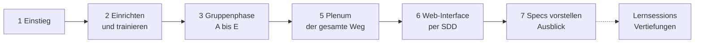
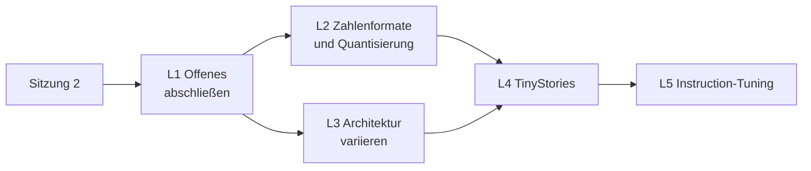

# Transformer, Sitzung 2: Unterrichtsskizze

**Thema:** Einen Transformer selbst trainieren und das Training verstehen

**Rahmen:** 20 Bachelor-Studierende, vier Stunden Präsenz, danach selbstorganisierte Lernsessions

**Material:** `guppylm_lehrnotebook.ipynb` (Original), `guppylm_lehrnotebook_b.ipynb` (Variante b), `Transformer_Lehrbuch.md`, Arbeitsblätter A bis E, Hinweisblatt TinyStories

---

## 1. Leitgedanke

Die erste Sitzung war ein vierstündiger Vortrag. Diese Sitzung dreht das Verhältnis um: Die Studierenden arbeiten, die Dozierenden begleiten als Tutoren. Drei Dinge sind gesetzt:

1. **Selbst trainieren.** Jede und jeder bringt das Training auf dem eigenen Gerät zum Laufen. Die dabei auftretenden Schwierigkeiten (Python-Version, Bibliotheksversionen, CUDA) sind gewollt; sie gehören zur Praxis.
2. **Selbst erklären.** Die Gruppen erarbeiten sich das Skript anhand der Arbeitsblätter. Gründliches Lesen der Notebook-Texte ist Teil der Leistung.
3. **Spec-Driven Development.** Am Ende steht ein Web-Interface, das den eigenen Checkpoint lädt. Die Spec wird im Plenum vorgestellt. SDD ist im Kurs das Minimum, kein Zusatz.

## 2. Lernziele

Nach der Sitzung können die Studierenden

- eine Trainingsumgebung einrichten und einen Trainingslauf durchführen und dokumentieren,
- erklären, wie aus einem Dialog Trainingsbeispiele werden und warum paralleles Training möglich ist,
- begründen, warum Kreuzentropie verwendet wird und was ein niedriger Verlust belegt,
- beschreiben, wie Embeddings lernen und was gelernte von festen Positionen unterscheidet,
- den Weg des Gradienten und die Aufgabe von AdamW und Lernratenplan erläutern,
- einordnen, warum ein reiner Nächstes-Token-Vorhersager auf Fragen antwortet,
- eine Spec für eine kleine Anwendung schreiben und daraus ein lauffähiges Web-Interface erzeugen.

## 3. Ablauf der vier Stunden

<svg xmlns="http://www.w3.org/2000/svg" viewBox="0 0 760 300" width="100%" style="max-width:760px" font-family="Helvetica, Arial, sans-serif" role="img">
<rect x="0" y="0" width="760" height="300" rx="10" fill="#ffffff" stroke="#e5e7eb"/>
<text x="30" y="34" font-size="15" fill="#1f2937" text-anchor="start" font-weight="bold">Vier Stunden im Überblick (240 Minuten)</text>
<rect x="30.0" y="62" width="43.8" height="46" fill="#fef3c7" stroke="#b45309" stroke-width="1.5"/>
<text x="51.875" y="90.0" font-size="15" fill="#b45309" text-anchor="middle" font-weight="bold">1</text>
<line x1="30.0" y1="108" x2="30.0" y2="114" stroke="#1f2937"/>
<text x="30.0" y="128" font-size="11" fill="#6b7280" text-anchor="middle">0:00</text>
<rect x="30" y="157" width="16" height="16" rx="3" fill="#fef3c7" stroke="#b45309" stroke-width="1.5"/>
<text x="38" y="170" font-size="11" fill="#b45309" text-anchor="middle" font-weight="bold">1</text>
<text x="56" y="170" font-size="13" fill="#1f2937" text-anchor="start">Einstieg · 15 min</text>
<rect x="73.8" y="62" width="131.2" height="46" fill="#dbeafe" stroke="#2563eb" stroke-width="1.5"/>
<text x="139.375" y="90.0" font-size="15" fill="#2563eb" text-anchor="middle" font-weight="bold">2</text>
<line x1="73.8" y1="108" x2="73.8" y2="114" stroke="#1f2937"/>
<text x="73.75" y="128" font-size="11" fill="#6b7280" text-anchor="middle">0:15</text>
<rect x="390" y="157" width="16" height="16" rx="3" fill="#dbeafe" stroke="#2563eb" stroke-width="1.5"/>
<text x="398" y="170" font-size="11" fill="#2563eb" text-anchor="middle" font-weight="bold">2</text>
<text x="416" y="170" font-size="13" fill="#1f2937" text-anchor="start">Einrichten und trainieren · 45 min</text>
<rect x="205.0" y="62" width="218.8" height="46" fill="#ccfbf1" stroke="#0f766e" stroke-width="1.5"/>
<text x="314.375" y="90.0" font-size="15" fill="#0f766e" text-anchor="middle" font-weight="bold">3</text>
<line x1="205.0" y1="108" x2="205.0" y2="114" stroke="#1f2937"/>
<text x="205.0" y="128" font-size="11" fill="#6b7280" text-anchor="middle">1:00</text>
<rect x="30" y="185" width="16" height="16" rx="3" fill="#ccfbf1" stroke="#0f766e" stroke-width="1.5"/>
<text x="38" y="198" font-size="11" fill="#0f766e" text-anchor="middle" font-weight="bold">3</text>
<text x="56" y="198" font-size="13" fill="#1f2937" text-anchor="start">Gruppenphase A bis E · 75 min</text>
<rect x="423.8" y="62" width="43.8" height="46" fill="#f3f4f6" stroke="#6b7280" stroke-width="1.5"/>
<text x="445.625" y="90.0" font-size="15" fill="#6b7280" text-anchor="middle" font-weight="bold">4</text>
<line x1="423.8" y1="108" x2="423.8" y2="114" stroke="#1f2937"/>
<text x="423.75" y="128" font-size="11" fill="#6b7280" text-anchor="middle">2:15</text>
<rect x="390" y="185" width="16" height="16" rx="3" fill="#f3f4f6" stroke="#6b7280" stroke-width="1.5"/>
<text x="398" y="198" font-size="11" fill="#6b7280" text-anchor="middle" font-weight="bold">4</text>
<text x="416" y="198" font-size="13" fill="#1f2937" text-anchor="start">Pause · 15 min</text>
<rect x="467.5" y="62" width="116.7" height="46" fill="#ede9fe" stroke="#6d28d9" stroke-width="1.5"/>
<text x="525.8333333333334" y="90.0" font-size="15" fill="#6d28d9" text-anchor="middle" font-weight="bold">5</text>
<line x1="467.5" y1="108" x2="467.5" y2="114" stroke="#1f2937"/>
<text x="467.5" y="128" font-size="11" fill="#6b7280" text-anchor="middle">2:30</text>
<rect x="30" y="213" width="16" height="16" rx="3" fill="#ede9fe" stroke="#6d28d9" stroke-width="1.5"/>
<text x="38" y="226" font-size="11" fill="#6d28d9" text-anchor="middle" font-weight="bold">5</text>
<text x="56" y="226" font-size="13" fill="#1f2937" text-anchor="start">Plenum · 40 min</text>
<rect x="584.2" y="62" width="116.7" height="46" fill="#fee2e2" stroke="#b91c1c" stroke-width="1.5"/>
<text x="642.5" y="90.0" font-size="15" fill="#b91c1c" text-anchor="middle" font-weight="bold">6</text>
<line x1="584.2" y1="108" x2="584.2" y2="114" stroke="#1f2937"/>
<text x="584.1666666666666" y="128" font-size="11" fill="#6b7280" text-anchor="middle">3:10</text>
<rect x="390" y="213" width="16" height="16" rx="3" fill="#fee2e2" stroke="#b91c1c" stroke-width="1.5"/>
<text x="398" y="226" font-size="11" fill="#b91c1c" text-anchor="middle" font-weight="bold">6</text>
<text x="416" y="226" font-size="13" fill="#1f2937" text-anchor="start">Web-Interface per SDD · 40 min</text>
<rect x="700.8" y="62" width="29.2" height="46" fill="#fef3c7" stroke="#b45309" stroke-width="1.5"/>
<text x="715.4166666666667" y="90.0" font-size="15" fill="#b45309" text-anchor="middle" font-weight="bold">7</text>
<line x1="700.8" y1="108" x2="700.8" y2="114" stroke="#1f2937"/>
<text x="700.8333333333334" y="128" font-size="11" fill="#6b7280" text-anchor="middle">3:50</text>
<rect x="30" y="241" width="16" height="16" rx="3" fill="#fef3c7" stroke="#b45309" stroke-width="1.5"/>
<text x="38" y="254" font-size="11" fill="#b45309" text-anchor="middle" font-weight="bold">7</text>
<text x="56" y="254" font-size="13" fill="#1f2937" text-anchor="start">Specs und Ausblick · 10 min</text>
<line x1="730" y1="108" x2="730" y2="114" stroke="#1f2937"/>
<text x="730" y="128" font-size="11" fill="#6b7280" text-anchor="middle">4:00</text>
</svg>



| Nr. | Zeit | Phase | Studierende | Dozierende |
|---|---|---|---|---|
| 1 | 0:00 bis 0:15 | Einstieg | Ziele und Ablauf aufnehmen, fünf Vierergruppen bilden | Ablauf, Arbeitsprinzip „erst vorhersagen, dann messen", Gruppen einteilen |
| 2 | 0:15 bis 1:00 | Einrichten und trainieren | Umgebung einrichten, beide Notebooks starten; Probleme zuerst in der Gruppe lösen; während des Trainings lesen | Tutor; bei Blockaden helfen, nicht vormachen; fertige Checkpoints bereithalten |
| 3 | 1:00 bis 2:15 | Gruppenphase | Arbeitsblatt bearbeiten: Lesefragen, Aufgaben, Experiment, Ergebnis sichern | Tutor; je Gruppe mindestens ein Besuch; fachlicher Kern aus der Ideensammlung |
| 4 | 2:15 bis 2:30 | Pause | | |
| 5 | 2:30 bis 3:10 | Plenum | Je Gruppe etwa sechs Minuten: eine Kernaussage, ein Beleg. Danach gemeinsam den gesamten Weg von der Frage zur Antwort erklären | Moderation, Lücken schließen, Fehlvorstellungen aufgreifen |
| 6 | 3:10 bis 3:50 | Web-Interface per SDD | Spec schreiben, Anwendung erzeugen lassen, eigenen Checkpoint laden und ansteuern | Tutor; auf die Spec achten, nicht auf den Code |
| 7 | 3:50 bis 4:00 | Specs und Ausblick | Zwei bis drei Specs kurz zeigen | Aufträge für die Lernsessions ausgeben |

Die Zeiten sind ein Vorschlag. Was nicht fertig wird, wandert in die Lernsessions; das gilt besonders für Phase 6.

## 4. Die Phasen im Einzelnen

### Phase 2: Einrichten und trainieren

- In jeder Gruppe trainiert mindestens ein Gerät das Original und mindestens eines die Variante b. So liegen überall beide Modelle vor.
- **Vor dem Start** fügen alle die Zwischenstand-Zeilen in die Trainingsschleife ein (siehe Arbeitsblatt B, Abschnitt 3 a). Nachträglich geht das nur mit einem neuen Lauf.
- Jede Person notiert Gerät, Rechenhardware (`cuda`, `mps` oder `cpu`), Schrittzahl und Laufzeit. Der Vergleich im Plenum zeigt, was Hardware ausmacht.
- Während das Training läuft, beginnt die Gruppe mit dem Leseauftrag ihres Arbeitsblatts.
- **Rückfallebene:** Wer nach etwa 30 Minuten noch nicht trainiert, erhält einen fertigen Checkpoint und löst das Umgebungsproblem in der Lernsession. Niemand soll in der Gruppenphase ohne Modell dasitzen.

Typische Hürden, auf die Sie vorbereitet sein sollten:

| Symptom | Häufige Ursache |
|---|---|
| Paketinstallation scheitert | Python-Version passt nicht zu den verlangten Paketversionen |
| `DEVICE` ist `cpu` trotz Grafikkarte | PyTorch ohne CUDA-Unterstützung installiert oder Treiber passt nicht |
| Datei nicht gefunden | Notebook nicht in seinem eigenen Ordner geöffnet; unter Linux zusätzlich Groß- und Kleinschreibung der Ordner |
| Training sehr langsam | Rechnung auf dem Prozessor; `MAX_STEPS` für einen ersten Test verkleinern |

### Phase 3: Gruppenphase

| Gruppe | Arbeitsblatt | Leitfrage |
|---|---|---|
| A | Vom Dialog zum Trainingsbeispiel | Wie wird ein Dialog aufbereitet, und warum kann das Modell nicht abschreiben? |
| B | Loss und was er belegt | Welche Verlustfunktion, und was sagt ein niedriger Verlust über die Antworten? |
| C | Was wird gelernt? | Wie lernen Embeddings, und was unterscheidet gelernte von festen Positionen? |
| D | Lernsignal und Optimierer | Wie kommt das Signal durch sechs Blöcke, und was macht der Optimierer daraus? |
| E | Verhalten des fertigen Modells | Gehorcht Guppy, oder setzt er nur fort? Was bewirkt die Temperatur? |

Jedes Blatt hat denselben Aufbau: Lesen, Lesefragen, Aufgaben, Experiment, Ergebnis. Bei knapper Zeit haben Lesefragen und Experiment Vorrang.

### Phase 5: Plenum

Die Gruppen tragen in der Reihenfolge A, C, D, B, E vor. Das entspricht dem Weg der Daten: Aufbereitung, Modell, Lernsignal, Bewertung, Anwendung. Anschließend wird der gesamte Weg gemeinsam erklärt:

1. Wie werden Text, Sondertokens und Positionen dargestellt?
2. Wie verändern Attention und FFN diese Darstellung, und wie entstehen Logits?
3. Was wird beim Training parallel berechnet, was muss bei der Generierung Schritt für Schritt geschehen?
4. Wie wird aus einem einzigen Verlustwert ein Update für jede Gewichtsmatrix?
5. Welche Beobachtungen belegen, dass das Modell besser geworden ist, und welche Aussagen lassen sich daraus nicht ableiten?

### Phase 6: Web-Interface per Spec-Driven Development

**Auftrag:** Schreiben Sie eine Spec für ein Web-Interface, das Ihren trainierten Checkpoint lädt und über das Sie Guppy Fragen stellen können. Lassen Sie die Anwendung aus der Spec erzeugen. Bewertet wird die Spec.

Das Interface lädt den PyTorch-Checkpoint direkt. Daraus folgen Fragen, die eine gute Spec beantworten muss:

- **Was steckt im Checkpoint, was nicht?** Er enthält Gewichte, Konfiguration und Tokenizer. Die Klassen des Modells enthält er nicht. Woher bekommt die Anwendung sie? (Notebook Abschnitt 8)
- **Welche Variante?** Original und Variante b unterscheiden sich in `GuppyLM.__init__`. Was passiert, wenn der falsche Code den Checkpoint lädt?
- **Wie wird die Frage verpackt?** Rollenmarkierungen, Abbruch am Endtoken, gesperrte Tokens.
- **Was ist einstellbar?** Temperatur, Top-k, maximale Länge.
- **Was wird angezeigt?** Antwort, Abbruchgrund, eventuell Zeit je Antwort.
- **Was ist ausdrücklich nicht Teil der Anwendung?** Zum Beispiel Training oder Mehrturn-Dialoge.
- **Woran erkennt man, dass die Anwendung richtig arbeitet?** Etwa: Bei Temperatur 0 liefert sie dieselbe Antwort wie das Notebook.

## 5. Nach der Sitzung: Aufträge für die Lernsessions



### L1: Offenes abschließen

- Umgebungsprobleme lösen, bis beide Notebooks auf dem eigenen Gerät laufen.
- Web-Interface fertigstellen und die Spec so überarbeiten, dass eine andere Gruppe daraus dieselbe Anwendung erzeugen könnte.
- Die Aufgaben „Für schnelle Gruppen" auf den Arbeitsblättern C und D.

### L2: Zahlenformate und Quantisierung

**Leitfrage:** Wie viel Genauigkeit brauchen die Gewichte dieses kleinen Modells?

Weil das Interface den PyTorch-Checkpoint lädt, wird direkt am Checkpoint gearbeitet und nicht über GGUF. Vorgeschlagene Stufen:

| Stufe | Bedeutung |
|---|---|
| fp32 | Ausgangszustand |
| fp16 | halbe Genauigkeit, Gleitkomma |
| 8 Bit | 255 gleichmäßige Stufen je Gewichtsmatrix |
| 6, 4, 3, 2 Bit | immer gröbere Stufen |

Der einfachste Weg ist eine **simulierte Quantisierung**: Die Gewichte werden auf die Stufen gerundet und wieder als gewöhnliche Zahlen gespeichert. Das läuft auf jedem Gerät, zeigt den Genauigkeitsverlust unverfälscht und erlaubt beliebige Bitbreiten. Speicher spart es nicht; darum geht es hier auch nicht.

```python
import copy

def quantisiere(modell, bits):
    """Rundet alle Gewichtsmatrizen auf 2^bits Stufen (simuliert, Speicherformat bleibt fp32)."""
    kopie = copy.deepcopy(modell)
    with torch.no_grad():
        for name, p in kopie.named_parameters():
            if p.dim() < 2:
                continue                              # Biases und LayerNorm unverändert
            if bits == 16:
                p.copy_(p.half().float())             # fp16: Gleitkomma mit halber Genauigkeit
            else:
                stufen = 2 ** (bits - 1) - 1
                skala = p.abs().max() / stufen
                p.copy_(torch.round(p / skala) * skala)
    return kopie

for bits in (16, 8, 6, 4, 3, 2):
    print(bits, "Bit: Evaluationsverlust", round(bewerte(quantisiere(modell, bits)), 4))
```

Der Code ist nicht erprobt. Aufgaben dazu:

1. Erwartung: Ab welcher Bitbreite bricht das Modell ein?
2. Messen Sie den Evaluationsverlust je Stufe und stellen Sie dieselben festen Fragen bei Temperatur 0.
3. Die Funktion verwendet eine einzige Skala je Matrix. Was ändert sich mit einer eigenen Skala je Zeile?
4. Die Embedding-Matrix dient wegen des Weight Tying zugleich als Ausgabeschicht. Quantisieren Sie nur diese Matrix, dann nur die Blöcke. Welcher Teil ist empfindlicher?
5. Große Sprachmodelle laufen mit 4 Bit oft brauchbar. Warum verträgt ein Modell mit zwölf Millionen Parametern das möglicherweise schlechter?

Für Interessierte: Echte Quantisierung mit Speicherersparnis bietet in PyTorch die Bibliothek torchao, unter anderem mit int8, int4 und float8. Die ältere Schnittstelle `torch.ao.quantization` wird abgelöst und soll entfernt werden. Wer den Vergleich mit GGUF ziehen will, nutzt zusätzlich das Export-Notebook.

### L3: Architektur variieren

**Leitfrage:** Welche Stellschraube verändert was?

Ändern Sie je Lauf **genau eine** Größe in `GRUNDKONFIG` und trainieren Sie neu, mit eigenem Checkpointnamen:

| Größe | Ausgangswert | Zum Ausprobieren |
|---|---|---|
| `n_layers` | 6 | 2, 4, 8 |
| `d_model` | 384 | 192, 256 |
| `max_seq_len` | 128 | größer; kleiner nur bis zur Länge des längsten Dialogs |
| Aktivierung im FFN | GELU | ReLU |

Halten Sie je Lauf fest: Parameterzahl, Laufzeit, Endverlust, Antworten auf feste Fragen bei Temperatur 0.

Zu beachten:

- `d_model` muss durch `n_heads` teilbar sein.
- Ein zu kleines `max_seq_len` führt zu einer Fehlermeldung in `zu_sequenzen`. Das ist gewollt.
- Der Export nach LM Studio verlangt GELU und den FFN-Faktor 4. Für das eigene Web-Interface gilt diese Einschränkung nicht, wenn die Anwendung denselben Modellcode verwendet wie das Training.
- Ein einzelner Lauf je Einstellung zeigt eine Tendenz und ist kein Nachweis.

### L4: TinyStories

Ein anderer Datensatz, dasselbe Modell: kurze englische Kindergeschichten statt Fischdialogen. Orientierung gibt das **Hinweisblatt TinyStories**. Erwartung vorab: Anders als bei Guppy reichen 3.000 Schritte nicht aus, und der Verlust fällt noch lange.

### L5: Instruction-Tuning

Aufbauend auf L4: Das auf Geschichten vortrainierte Modell wird in einer zweiten Phase auf Beispiele mit Anweisungen weitertrainiert. Damit entsteht der Zweischritt, den Guppy nicht hat (Arbeitsblatt E). Näheres im Hinweisblatt.

## 6. Vor der Sitzung zu erledigen

- [ ] Variante b: `MAX_STEPS` auf 3.000, Ordnernamen `Data` und `Checkpoints` vereinheitlichen.
- [ ] Beide Notebooks einmal vollständig durchlaufen lassen und die Checkpoints als Rückfallebene bereithalten.
- [ ] Zwischenstand-Zeilen in beide Notebooks einfügen oder als Auftrag ausgeben.
- [ ] Die Code-Schnipsel der Arbeitsblätter einmal ausführen.
- [ ] Arbeitsblätter A bis E, Lehrbuch und Hinweisblatt verteilen.

## 7. Quellen

- PyTorch-Dokumentation, Quantization: Hinweis auf die Zusammenführung in torchao und die geplante Entfernung von `torch.ao.quantization`. [docs.pytorch.org/docs/2.14/quantization.html](https://docs.pytorch.org/docs/2.14/quantization.html), [docs.pytorch.org/docs/2.15/quantization.html](https://docs.pytorch.org/docs/2.15/quantization.html)
- PyTorch, Migrationsplan für `torch.ao.quantization`. [dev-discuss.pytorch.org/t/torch-ao-quantization-migration-plan/2810](https://dev-discuss.pytorch.org/t/torch-ao-quantization-migration-plan/2810)
- torchao-Dokumentation. [docs.pytorch.org/ao/0.16](https://docs.pytorch.org/ao/0.16)
- Hugging Face Transformers, torchao: unterstützte Quantisierungsarten (int4, float8, weight only). [huggingface.co/docs/transformers/quantization/torchao](https://huggingface.co/docs/transformers/quantization/torchao)
- GuppyLM, Original von arman-bd. [github.com/arman-bd/guppylm](https://github.com/arman-bd/guppylm)
- Eldan, R.; Li, Y. (2023): *TinyStories: How Small Can Language Models Be and Still Speak Coherent English?* [arXiv:2305.07759](https://arxiv.org/abs/2305.07759)
