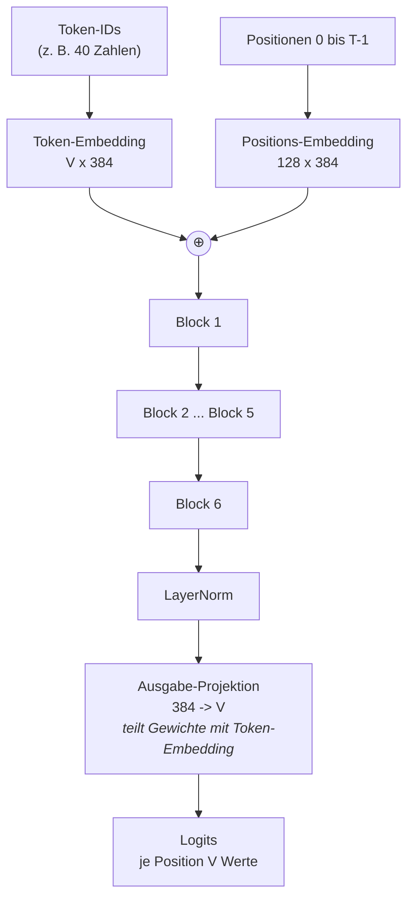
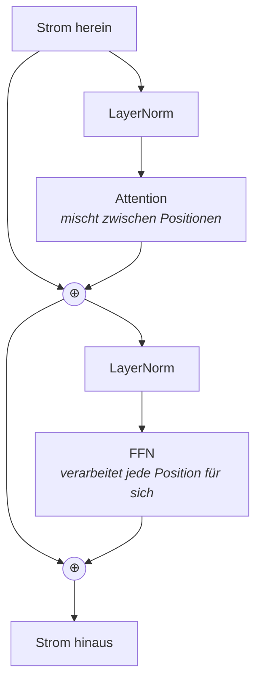

# Wie GuppyLM entsteht

*Begleittext zum Notebook `guppylm_lehrnotebook.ipynb`*

---

## Worum es geht

Am Ende des Notebooks liegt ein trainiertes Sprachmodell mit rund zwölf
Millionen Parametern vor. Die genaue Zahl hängt von der tatsächlichen
Vokabulargröße ab und wird im Notebook berechnet. Die Gewichte entstehen aus
57.000 englischen Trainingsdialogen. Die Aufgabe lautet an jeder gültigen
Position: **Sage das nächste Token voraus.**

Eine englische Frage wie „hello guppy“ wird anschließend Token für Token
fortgesetzt. Ob die Antwort zur Frage passt, prüfen wir anhand echter Ausgaben.

Dieser Text erklärt, wie aus dieser einen Aufgabe ein sprechender Fisch wird.

---

## Teil 1: Die Daten

### Der Rohstoff

Der Datensatz enthält 60.000 kurze Gespräche. 57.000 zum Üben, 3.000 im Evaluationssplit. Das Notebook lädt die
bereits formatierten Texte aus `guppy/data/train.jsonl` und `guppy/data/eval.jsonl`, ohne
Hugging-Face-Download. Entpacken Sie dafür `Train_and_Eval.zip` vor dem Start einmal
in `guppy/data`. Zur Checkpointauswahl werden standardmäßig die ersten
320 Evaluationsbeispiele als Validierung verwendet. Jedes Beispiel besteht aus einer Frage und einer Antwort, im ursprünglichen Datensatz ergänzt um ein
Themenwort (im lokalen ChatML-Text nicht als eigenes Feld enthalten):

```
Frage:  lots of rain today
Antwort: the outside is getting wet. finally something i can relate to.
Thema:  rain
```

Es gibt 60 Themen: Begrüßung, Futter, Wassertemperatur, Licht, Katzen vor dem
Becken, Langeweile, der Sinn des Lebens. Die Antworten sind alle kurz,
kleingeschrieben und drehen sich um das Leben im Aquarium.

Diese Enge ist kein Mangel, sondern die Voraussetzung. Ein Modell dieser Größe
kann keine Weltsprache lernen. Eine Fischsprache mit ein paar hundert Wörtern
kann es lernen.

### Rollen sichtbar machen

Das Modell sieht später nur eine lange Kette von Zeichen. Es muss darin erkennen
können, wo eine Frage aufhört und eine Antwort anfängt. Dafür bekommt jedes
Beispiel Markierungen — dieses Format heißt **ChatML**:

```
<|im_start|>user
lots of rain today<|im_end|>
<|im_start|>assistant
the outside is getting wet. finally something i can relate to.<|im_end|>
```

So sieht dann auch die Trainingsdatei `train.jsonl` aus. Eine Zeile pro
Beispiel, jede Zeile ein JSON-Objekt mit einem einzigen Feld:

```jsonl
{"text": "<|im_start|>user\nlots of rain today<|im_end|>\n<|im_start|>assistant\nthe outside is getting wet. finally something i can relate to.<|im_end|>"}
{"text": "<|im_start|>user\nis that plant real<|im_end|>\n<|im_start|>assistant\nthe plant waves in the current. it's relaxing to watch.<|im_end|>"}
```

Das `\n` ist ein Zeilenumbruch, der hier als zwei Zeichen geschrieben steht,
weil JSON keine echten Umbrüche in Zeichenketten erlaubt.

**Der wichtigste Teil ist `<|im_end|>` am Schluss.** Das Modell lernt nicht nur,
was es antworten soll, sondern auch, **wann es aufhören soll**. Aufhören ist
eine gelernte Fähigkeit wie jede andere. Für die Generierung ist zusätzlich eine Abbruchbedingung im Programm nötig.
Das Notebook unterscheidet Endtoken, Tokenlimit und Kontextgrenze.

### Vom Text zu Zahlen: der Tokenizer

Ein Rechenwerk kann nichts mit Buchstaben anfangen. Der Text muss in Zahlen
übersetzt werden. Diese Übersetzung übernimmt der **Tokenizer**.

Er zerlegt den Text nicht in Buchstaben (zu viele Schritte) und nicht in Wörter
(zu viele verschiedene), sondern in häufige Bruchstücke. Das Verfahren heißt
**BPE** (Byte Pair Encoding): Es fasst wiederholt häufige benachbarte Einheiten zusammen. Die Zielgröße
ist 4096; Mindesthäufigkeit und verfügbare Paare können das Wachstum vorher
beenden. Verwendet wird die tatsächlich erreichte Größe V. Ein vollständiges
Byte-Alphabet sichert die Kodierbarkeit auch bisher ungesehener UTF-8-Zeichen.

Wichtig: Der Tokenizer wird **auf diesen Daten** trainiert, nicht von einem
fremden Modell übernommen. Dadurch bekommt fast jedes häufige Fischwort ein
eigenes Kürzel. Die eigene Tokenisierung passt die Zerlegung an diesen engen Datenbereich an.

Die konkreten IDs und Textstücke für `"guppy likes bubbles"` werden im
Notebook ausgegeben. Sie hängen vom trainierten Tokenizer ab; deshalb stehen
hier keine vorgegebenen IDs. `Ġ` kennzeichnet ein führendes Leerzeichen,
`Ċ` einen Zeilenumbruch. Eine Kodierung unbekannter Wörter ist noch kein
Nachweis dafür, dass das Sprachmodell sie verstanden hat.

Drei Kürzel werden zuerst vergeben und behalten feste Nummern:

| Nummer | Token | Bedeutung |
|---|---|---|
| 0 | `<pad>` | Füllmaterial, siehe unten |
| 1 | `<|im_start|>` | hier beginnt eine Rolle |
| 2 | `<|im_end|>` | hier ist Schluss |

### Eingabe und Ziel

Jetzt kommt der Kniff, auf dem alles beruht. Aus **einer** Zahlenfolge werden
**zwei** gemacht: die Eingabe ohne das letzte Element, das Ziel ohne das erste.

```
Folge:   [1, 48, 29, 127, 87, 123, 2]

x:       [1, 48, 29, 127, 87, 123]      <- was das Modell sieht
y:       [   48, 29, 127, 87, 123, 2]   <- was es vorhersagen soll
```

Beide sind gleich lang und um genau eine Position gegeneinander verschoben. An
jeder einzelnen Stelle lautet die Aufgabe: „Du siehst alles bis hierher — was
kommt als Nächstes?"

Ein Beispiel mit 40 Tokens liefert damit 39 Übungsaufgaben auf einmal. Diese vielen Vorhersagepositionen liefern das Trainingssignal; die Qualität
hängt zusätzlich von Vielfalt, Wiederholungen und Modellkonfiguration ab.

### Auffüllen

Beispiele sind unterschiedlich lang, Rechenwerke wollen rechteckige Tabellen.
Kürzere Beispiele werden deshalb mit `<pad>` (Nummer 0) aufgefüllt.

Dieses Füllmaterial darf das Lernen nicht beeinflussen. Deshalb bekommt die
Fehlerrechnung die Anweisung `ignore_index=0`: Jede Zielstelle mit der Token-ID 0 zählt nicht. Das bezeichnet die ID des
Fülltokens, nicht die erste Position. Im Code wird die ID vom Tokenizer abgelesen.
Bei rechtem Padding und kausaler Attention können gültige Positionen das
nachfolgende Padding nicht sehen.

---

## Teil 2: Das Modell

### Der Grundgedanke: der Residualstrom

Man stelle sich einen breiten Datenstrom vor, der von unten nach oben durch das
Modell fließt. Er ist 384 Zahlen breit — das ist `d_model`. Für **jedes** Token
gibt es einen solchen Strom.

Am Anfang enthält der Strom nur, welches Token an dieser Stelle steht und die
wievielte Stelle es ist. Danach folgen sechs Stationen. Jede Station **schreibt
etwas hinein**, statt den Strom zu ersetzen. Am Ende wird abgelesen, welches
Token als Nächstes kommen soll.

Die Residualpfade erleichtern den Gradientenfluss durch die Blöcke. Sie
garantieren keine stabile Optimierung unter beliebigen Trainingsbedingungen.

### Der Aufbau



### Was in einem Block passiert

Jeder der sechs Blöcke besteht aus zwei Stationen. Beide arbeiten nach demselben
Muster: normieren, rechnen, das Ergebnis zum Strom addieren.



**Station 1 — Attention.** Hier tauschen die Positionen Informationen aus. Jedes
Token bildet drei Vektoren:

- **Query** — wonach suche ich?
- **Key** — was biete ich an?
- **Value** — was gebe ich weiter, wenn man mich auswählt?

Passen Query und Key gut zusammen, fließt viel vom Value herüber. Das geschieht
sechsmal parallel mit je 64 Zahlen Breite; diese sechs **Köpfe** können sich auf
verschiedene Beziehungen spezialisieren.

Entscheidend ist die **kausale Maske**: Jede Position darf sich selbst und frühere Positionen sehen.
Ohne diese Sperre könnte das Modell die Antwort einfach ablesen, statt sie
vorherzusagen. Die Maske ist eine Dreiecksmatrix:

```
Position 0 sieht:   [1 0 0 0 0 0]
Position 1 sieht:   [1 1 0 0 0 0]
Position 2 sieht:   [1 1 1 0 0 0]
Position 3 sieht:   [1 1 1 1 0 0]
Position 4 sieht:   [1 1 1 1 1 0]
Position 5 sieht:   [1 1 1 1 1 1]
```

**Station 2 — das FFN.** Hier redet keine Position mit einer anderen. Jede wird
einzeln verarbeitet: von 384 auf 1536 Zahlen aufweiten, eine Aktivierungsfunktion
(GELU) anwenden, wieder auf 384 zusammenführen. In dieser Aufweitung steckt der
größere Teil der Parameter.

### Die Zahlen

| | |
|---|---|
| Vokabular | V = tatsächliche Größe, Zielgröße 4.096 |
| Maximale Länge | 128 Tokens |
| Strombreite `d_model` | 384 |
| Blöcke | 6 |
| Attention-Köpfe | 6 (je 64 breit) |
| FFN-Weite | 1.536 (das Vierfache) |

Die Parameterbilanz wird im Notebook aus dem tatsächlich gebauten Modell
berechnet. Bei den unveränderten Architekturwerten gilt:

| Bauteil | Parameter |
|---|---:|
| Token-Embedding | V × 384 |
| Positions-Embedding | 49.152 |
| die sechs Blöcke | 10.646.784 |
| Abschluss-Normierung | 768 |
| **gesamt** | **10.696.704 + V × 384** |

Die Ausgabeprojektion teilt ihre Gewichtsmatrix mit dem Token-Embedding
(Weight Tying). Dadurch kommen für sie keine zusätzlichen V × 384 Parameter
hinzu. Das ist eine gemeinsame Parametrisierung, keine mathematische
Umkehrfunktion des Embeddings. In den Blöcken liegen ungefähr zwei Drittel
der Parameter im FFN.

---

## Teil 3: Das Training

### Was gemessen wird

Das Modell gibt an jeder Position V Werte aus — für jedes mögliche nächste
Token einen. Daraus wird eine Wahrscheinlichkeitsverteilung. Gemessen wird, wie
viel Wahrscheinlichkeit auf das **tatsächlich richtige** Token entfällt. Dieses
Maß heißt **Kreuzentropie**. Je kleiner, desto besser.

Als Referenz dient der Verlust einer Gleichverteilung über das tatsächliche
Vokabular: **ln(V)**. Bei V = 4096 wären das etwa 8,32; das Notebook berechnet
den Wert für seinen eigenen Tokenizer. Ein zufällig initialisiertes Modell
liefert keine exakt gleichförmige Verteilung. Abweichungen sind daher allein
weder Beweis für eine fehlerhafte Maske noch für defekte Anfangsgewichte.

### Der Ablauf

Ein Schritt sieht so aus:

1. 32 Beispiele zufällig ziehen und zu einer rechteckigen Tabelle auffüllen
2. durch das Modell schicken, Fehlerwert berechnen
3. rückwärts ausrechnen, welche Gewichtsänderung den Fehler verkleinert
4. Gewichte ein kleines Stück in diese Richtung schieben

Das Ganze 3.000-mal. Drei Details verdienen Erklärung:

**Die Lernrate ändert sich.** Sie steigt über die ersten 200 Schritte langsam
an und fällt danach als Kosinuskurve wieder ab. Der Anstieg kann die Optimierung zu Beginn stabilisieren. Die spätere
Absenkung erlaubt kleinere Optimierungsschritte gegen Ende des Trainings.

```
Lernrate
  3e-4 |      .-'''''--..__
       |    .'              ''--..__
       |  .'                        ''--..
  3e-5 |.'                                ''---
       +------+---------------------------------
       0     200                            3000
           Warmup                        Schritte
```

**Gradient Clipping.** Die Norm des Gradientenvektors wird auf höchstens 1,0
begrenzt. Das kann extreme Ausschläge begrenzen. Die von AdamW ausgeführte
Gewichtsänderung wird dadurch nicht unmittelbar auf die Länge 1,0 begrenzt.

**Feste Prüfbeispiele.** Alle 200 Schritte wird auf einer festen Stichprobe von
standardmäßig 320 Beispielen validiert. Der Mittelwert wird über gültige Tokens
gewichtet. Die feste Stichprobe reduziert Schwankungen durch wechselnde Beispiele.

### Die Kurve lesen

Der Trainingsverlust wird mit Dropout und wechselnden Batches berechnet; die
Validierung ohne Dropout am aktuellen Modellstand. Der geglättete Trainingswert
enthält frühere Modellstände. Die Validierung darf daher unter der Trainingskurve liegen.
Steigender Validierungsverlust bei sinkendem Trainingsverlust kann auf
Überanpassung hindeuten. Gemeinsam fallende Kurven allein belegen keine
Generalisierung auf neue Fragen.

Im lokalen Archiv sind 2.320 der 3.000 Evaluationsdialoge bereits wortgleich im
Training enthalten. Unter den ersten 320 sind es 248. Dieser Split ist daher
kein unabhängiger Generalisierungstest. Neue englische Formulierungen ergänzen
die Beurteilung.

Das Notebook speichert den jeweils besten Validierungsstand. Vor den
Antwortexperimenten wird dieser Checkpoint samt seinem Tokenizer geladen.

---

## Teil 4: Was am Ende herauskommt

### Antworten erzeugen

Trainiert wird auf ganzen Sätzen gleichzeitig. Erzeugt wird Token für Token:

1. Der Prompt wird in Zahlen übersetzt
2. Das Modell liefert V Werte für die nächste Position
3. Aus diesen Werten wird **ein** Token gezogen
4. Es wird angehängt, und alles beginnt von vorn
5. Schluss ist beim Endtoken, Tokenlimit oder Erreichen der Kontextgrenze

Schritt 4 erklärt, warum Textgenerierung langsam ist: Jedes einzelne Token
wird in dieser einfachen Implementierung mit dem bisherigen Kontext neu
berechnet. Ein KV-Cache könnte bereits berechnete Keys und Values wiederverwenden.

Bei Schritt 3 gibt es zwei Stellschrauben:

- **Temperatur.** Bei 0 wird das wahrscheinlichste zulässige Token gewählt
  (Greedy-Decoding). Positive kleine Werte verstärken die wahrscheinlichsten Tokens — die
  Antworten werden vorhersagbar und wiederholen sich. Große Werte gleichen die
  Verteilung an — die Antworten werden mutiger und irgendwann wirr.
- **top-k.** Nur die 50 wahrscheinlichsten Tokens bleiben überhaupt zur Wahl.
  Das schließt sehr unwahrscheinliche Kandidaten aus, garantiert aber keine
  passende Antwort.

### Die tatsächlichen Antworten prüfen

Verwenden Sie englische Fragen wie `"hello guppy"`, `"are you hungry"` oder
`"how is the water"`. Dokumentieren Sie die echten Modellantworten einschließlich
des Abbruchgrunds. Deutsche Antworten werden durch die englischen Trainingsdaten
nicht vermittelt. Es werden hier keine erfundenen Ausgaben als Messergebnis dargestellt.

Das Modell hat kein Gedächtnis über Nachrichten hinweg. Jede Frage steht für
sich; es sieht immer nur den aktuellen Prompt.

### Was es kann und was nicht

Das Trainingsziel begünstigt kurze englische Sätze im Fischstil und ein
passendes Ende. Ob Antworten thematisch passen und auch neue Formulierungen
verarbeitet werden, muss untersucht werden. Faktenprüfung, Rechnen und
mehrere Gesprächsrunden sind keine gesonderten Trainingsziele dieses Datensatzes.
Das folgt aus Daten und Training, nicht aus einer festen Fähigkeitsgrenze bei
einer bestimmten Parameterzahl.

**Und genau das ist der Punkt der Übung.** Die Bauteile in diesem Notebook —
Tokenizer, Embeddings, Attention mit kausaler Maske, FFN, Residualstrom,
Kreuzentropie, Sampling — sind dieselben, aus denen die großen Modelle bestehen.
Große Modelle teilen diese Grundstruktur; konkrete Architekturen können sich
auch bei Normalisierung, Positionierung, Attention und Aktivierungen unterscheiden. Wer diesen Fisch
verstanden hat, versteht auch, was ein Modell mit tausendfacher Größe im Kern
tut.

---

## Kurzübersicht

```
guppy/data/train.jsonl (57.000 Zeilen, vorher aus Train_and_Eval.zip entpackt)
        |
        v
   Tokenizer (BPE, tatsächliche Größe V)          Text -> Zahlen
        |
        v
   Sequenzen, max. 128 Tokens
        |
        v
   x / y um eine Position versetzt   die eigentliche Aufgabe
        |
        v
   Batch: 32 Beispiele, aufgefüllt
        |
        v
   +---------------------------+
   |  Embeddings (Token + Pos) |
   |  6 x Block                |
   |    - Attention (6 Köpfe)  |     Parameterzahl abhängig von V
   |    - FFN (384 -> 1536)    |
   |  LayerNorm                |
   |  Projektion -> V      |
   +---------------------------+
        |
        v
   Kreuzentropie gegen y            Gleichverteilungsreferenz ln(V)
        |
        v
   3.000 Schritte AdamW
        |
        v
   bestes_modell.pt                 Gewichte + Konfiguration + Tokenizer
```

Der Tokenizer wird zusammen mit Konfiguration und Gewichten im Checkpoint
gespeichert und beim Laden durch eine Prüfsumme geprüft. Eine separat neu
trainierte `tokenizer.json` verändert dieses gespeicherte Paar nicht.
Der Checkpoint enthält keinen vollständigen Optimiererzustand zum exakten
Fortsetzen des Trainings.
