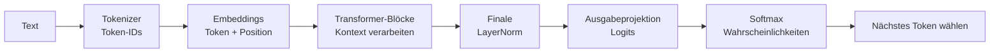
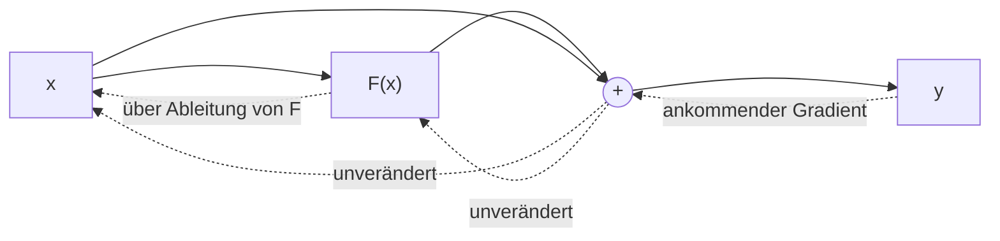
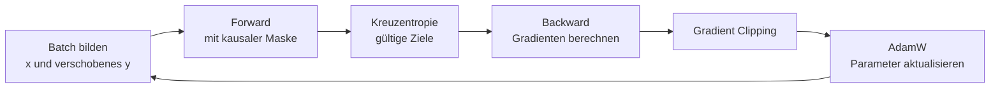

# Transformer verstehen und trainieren

## Eine Einführung am Beispiel von GuppyLM

Wie wird aus einer Folge von Zahlen ein Modell, das einen Satz sinnvoll fortsetzt? Dieses Lehrdokument verfolgt den gesamten Weg: vom Text über die Architektur bis zum Trainingssignal, das jede Gewichtsmatrix verändert. Als konkretes Beispiel dient **GuppyLM**, das kleine Sprachmodell aus dem begleitenden Python-Notebook.

Vorausgesetzt werden die Grundlagen neuronaler Netze und ein vertrauter PyTorch-Trainingszyklus: Batches bilden, vorwärts rechnen, einen Verlust bestimmen, Gradienten per Backpropagation berechnen, den Optimierer einen Schritt machen lassen und auf Validierungsdaten prüfen. Daran knüpft dieses Dokument an und zeigt, was bei einem Sprachmodell hinzukommt. Die benötigten mathematischen Begriffe werden unterwegs erklärt. Die zwölf Kapitel bilden einen Lernweg. Die Ableitungen in Kapitel 10 sind eine Vertiefung: Beim ersten Lesen genügt zunächst die Zusammenfassung in Worten am Kapitelanfang.

Am Ende stehen eine Formelsammlung mit Symbolverzeichnis und das Literaturverzeichnis. Quellen werden im Text kurz als „Autor Jahr“ angegeben. Kästen mit der Überschrift **Typische Fehlvorstellung** greifen verbreitete Missverständnisse auf.

**Lernziel:** Sie können erklären, wie ein Transformer das nächste Token vorhersagt und wie aus einem einzigen Verlustwert Lernsignale für Embeddings, Attention, FFN und Normierungen entstehen.

---

## 1. Die Helikopterperspektive: eine Vorhersage, viele Fähigkeiten

Betrachten wir den Satzanfang:

> Gut Ding braucht …

Eine plausible Fortsetzung ist „Weile“. Ein Sprachmodell berechnet jedoch keine einzelne feststehende Antwort, sondern eine **Wahrscheinlichkeitsverteilung über mögliche Fortsetzungen**. Aus dieser Verteilung wird ein Token ausgewählt, angehängt und der Vorgang wiederholt. Ein Token kann ein Wort, ein Wortteil, ein Satzzeichen, ein einzelnes Byte oder eine besondere Markierung sein.

Die zentrale Aufgabe lautet:

$$
P_\theta(s_{t+1}\mid s_0,\ldots,s_t).
$$

Gelesen: „Wie wahrscheinlich ist das nächste Token $s_{t+1}$, wenn die bisherigen Tokens bekannt sind?“ $\theta$ bezeichnet alle trainierbaren Parameter. Die senkrechte Linie bedeutet „unter der Bedingung“. **Autoregressiv** heißt: Bereits vorhandene Tokens bilden den Kontext für das nächste.



Um viele unterschiedliche Texte gut vorherzusagen, sind wiederkehrende Muster hilfreich: Grammatik, Wortbezüge, Gesprächsrollen und Faktenassoziationen. Das Training kann solche Regelmäßigkeiten in den Gewichten verankern. Das Ziel bleibt dabei die Vorhersage beobachteter Tokens; es garantiert weder Wahrheit noch menschliches Verständnis.

Der ursprüngliche Transformer wurde für Übersetzungen als **Encoder-Decoder** vorgestellt: Ein Encoder verarbeitet den Quelltext; ein Decoder erzeugt die Übersetzung und greift über Cross-Attention auf den Encoder zu. GuppyLM verwendet einen **Decoder-only-Transformer**: Prompt und Antwort laufen durch denselben Stapel mit kausaler Self-Attention. Ein Encoder mit bidirektionaler Attention kann dagegen auch spätere Eingabepositionen berücksichtigen. Die Architekturgrundlage stammt aus [Vaswani et al. 2017, *Attention Is All You Need*](https://arxiv.org/abs/1706.03762).

Direktes Vorbild von GuppyLM ist GPT-2 (Radford et al. 2019): gelernte Positions-Embeddings, LayerNorm am Eingang jedes Teilblocks und nach dem letzten Block, GELU-Aktivierung, eine gemeinsame Matrix für Eingabe-Embedding und Ausgabe sowie Byte-Level-BPE. Vom Original-Transformer weicht GuppyLM damit bei Positionskodierung, Normierungsposition und Aktivierungsfunktion ab. Deshalb lassen sich seine Gewichte ohne Änderung der Architektur in das GPT-2-Format übertragen ([Export-Notebook](../guppylm_export_lmstudio.ipynb)).

**Training und Anwendung sind verschiedene Vorgänge.** Beim Training sind die richtigen Fortsetzungen bekannt und die Gewichte werden verändert. Bei der Anwendung, der **Inferenz**, bleiben die Gewichte fest; nur Eingabe und berechnete Zwischenwerte ändern sich.

## 2. Vom Text zum Trainingsbeispiel

### Tokenisierung ist noch kein Sprachverständnis

Der Tokenizer übersetzt Text in ganzzahlige IDs. Die ID ist lediglich eine Adresse: Token 100 ist nicht „doppelt so bedeutungsvoll“ wie Token 50. GuppyLM verwendet Byte-Level-BPE. Beim **BPE-Training** werden häufige benachbarte Einheiten schrittweise zusammengefasst (Sennrich et al. 2016). Die byteweise Variante beginnt mit einem Grundvokabular aus 256 Bytes (Radford et al. 2019, Abschn. 2.2). Später wendet der fertige Tokenizer seine Regeln auf neue Texte an.

Dieses Zählen und Zusammenfassen ist vom anschließenden **Training des neuronalen Netzes** zu unterscheiden. Während des Modelltrainings bleiben Token-IDs und BPE-Regeln fest. Ein vollständiges Byte-Alphabet macht auch unbekannte UTF-8-Zeichen kodierbar; deren Bedeutung ist damit noch nicht gelernt.

GuppyLM lernt aus kurzen englischen Dialogen im ChatML-Format:

```text
<|im_start|>user
hello guppy<|im_end|>
<|im_start|>assistant
hi there.<|im_end|>
```

Rollenmarkierungen kennzeichnen die Gesprächsstruktur. Das Endtoken wird wie jedes andere Zieltoken gelernt. Damit die Generierung tatsächlich endet, muss das Programm beim erzeugten Endtoken zusätzlich abbrechen.

### Die Zielwerte stecken bereits im Text

Aus einer Folge $s_0,\ldots,s_T$ entstehen zwei gleich lange Folgen:

$$
x_t=s_t,\qquad y_t=s_{t+1},\qquad t=0,\ldots,T-1.
$$

Für ein **didaktisches Worttoken-Beispiel**, ausdrücklich nicht die tatsächliche BPE-Zerlegung, ergibt sich:

| Position $t$ | 0 | 1 | 2 | 3 |
|---|---|---|---|---|
| Eingabe $x_t$ | `<Start>` | Gut | Ding | braucht |
| Erlaubter Kontext | `<Start>` | `<Start>` Gut | `<Start>` Gut Ding | `<Start>` Gut Ding braucht |
| Ziel $y_t$ | Gut | Ding | braucht | Weile |

Ein Text mit fünf Tokens liefert somit vier Vorhersageaufgaben. Weil die Zielwerte aus dem Text selbst stammen, heißt dieses Verfahren **selbstüberwachtes Lernen**. Im Training werden die echten bisherigen Tokens vorgegeben, auch wenn das Modell selbst zuvor etwas anderes vorhergesagt hätte. Dieses Vorgehen heißt **Teacher Forcing** (Williams & Zipser 1989).

Mehrere Beispiele werden zu einem **Batch** zusammengefasst. Kürzere Folgen erhalten rechts Fülltokens, damit alle Zeilen gleich lang sind. Ihre Ziele sollen später nicht zum Verlust beitragen. Das Notebook verwendet dafür die ID von `<pad>`.

> **Zum Ausprobieren:** In [BPE zum Anfassen](../Lernapp/2a_einstieg_tokenizerWerkbank.html) einzelne Verschmelzungen verfolgen; anschließend in der [Tokenizer-Werkbank](../Lernapp/2b_tokenizer-werkbank.html) Training und Anwendung unterscheiden.

## 3. Embeddings: aus einer Adresse wird ein lernbarer Vektor

Ein **Vektor** ist hier eine Liste reeller Zahlen; eine **Matrix** eine rechteckige Tabelle solcher Zahlen. Wir schreiben Tokenvektoren als Zeilen. Weil das Komma als Dezimalzeichen dient, trennen wir Vektorkomponenten durch ein Semikolon: $(0{,}5;\,3)$ hat zwei Komponenten. $A^\top$ bedeutet: Zeilen und Spalten der Matrix $A$ vertauschen. Bei Matrixprodukten müssen die inneren Dimensionen übereinstimmen: $(T\times d)(d\times k)$ ergibt $(T\times k)$.

Die Embedding-Matrix $E\in\mathbb{R}^{n_{\mathrm{vocab}}\times d}$ enthält für jedes Token eine Zeile. $n_{\mathrm{vocab}}$ ist die Vokabulargröße, $d$ die Modellbreite. Das Nachschlagen lautet:

$$
e_t=E[x_t].
$$

Dieselbe Token-ID liefert zunächst immer denselben Vektor. Das Token „Bank“ kann daher denselben Ausgangsvektor besitzen, während sein späterer Kontextvektor in „Geld auf der Bank“ und „Sitzen auf der Bank“ verschieden ausfällt. Einzelne Vektorkomponenten haben keine vorab vergebenen Bedeutungen wie „Geld“ oder „Möbel“.

### Die Position gehört zur Eingabe

„Die Katze jagt die Maus“ und „Die Maus jagt die Katze“ bestehen aus denselben Wörtern. Welches Tier jagt, ergibt sich nur aus der Reihenfolge. Unmaskierte Self-Attention ohne Positionsinformation unterscheidet die Reihenfolge nicht eigenständig: Beim Vertauschen der Eingabezeilen werden die Ausgabezeilen entsprechend mitvertauscht. Deshalb wird Positionsinformation zur Eingabe addiert (Vaswani et al. 2017, Abschn. 3.5). Die kausale Maske führt zwar bereits eine gerichtete Struktur ein; kausale Sprachmodelle können Positionsinformation sogar ganz ohne Positionskodierung erlernen (Haviv et al. 2022). Das GuppyLM-Hauptnotebook gibt die Position trotzdem ausdrücklich an.

Es verwendet eine zweite, gelernte Tabelle $E_{\mathrm{pos}}\in\mathbb{R}^{T_{\max}\times d}$:

$$
X_t^{(0)}=E[x_t]+E_{\mathrm{pos}}[t].
$$

Die Addition erfolgt komponentenweise; die Breite bleibt $d$. Im Notebook folgt darauf während des Trainings Dropout. Die Embeddings beginnen mit kleinen Zufallswerten und lernen gemeinsam mit den übrigen Parametern. Ein separates Word2vec-Training ist nicht erforderlich.

Eine Alternative aus dem ursprünglichen Transformer ist eine feste Sinus-/Kosinus-Kodierung:

$$
\mathrm{PE}_{t,2m}=\sin\!\left(\frac{t}{10000^{2m/d}}\right),\qquad
\mathrm{PE}_{t,2m+1}=\cos\!\left(\frac{t}{10000^{2m/d}}\right).
$$

Hier nummeriert $m$ die Dimensionspaare. Diese Werte werden berechnet, nicht gelernt. Jedes Dimensionspaar schwingt mit eigener Frequenz; die Wellenlängen wachsen geometrisch von $2\pi$ bis $10000\cdot2\pi$. Die Autoren vermuteten, dass das Modell damit leicht lernt, nach relativen Abständen zu gewichten, und möglicherweise auf längere Folgen als im Training extrapolieren kann. Eine gelernte Tabelle lieferte im Original nahezu gleiche Ergebnisse (Vaswani et al. 2017, Abschn. 3.5 und Tab. 3, Zeile E). GPT-1 bis GPT-3 verwenden gelernte Positionen (Radford et al. 2018, Abschn. 4.1; Brown et al. 2020). Im Folgenden bleiben wir bei der gelernten Positionstabelle des Hauptnotebooks.

| Größe | Bedeutung | GuppyLM, Grundkonfiguration |
|---|---|---:|
| $n_{\mathrm{vocab}}$ | Tatsächlich gelernte Tokenzahl | Zielgröße 4.096; im dokumentierten Lauf 2.597 – stets die gemessene Größe verwenden |
| $T_{\max}$ | Maximale Eingabelänge | 128 |
| $d$ | Breite jedes Tokenvektors ($d_{\mathrm{model}}$) | 384 |
| $n_{\mathrm{layers}}$ | Zahl der Blöcke | 6 |
| $n_{\mathrm{heads}}$ | Attention-Köpfe pro Block | 6 |
| $d_k=d/n_{\mathrm{heads}}$ | Breite pro Kopf | 64 |
| $d_{\mathrm{ff}}$ | Innere Breite des FFN | 1.536 |

> **Zum Ausprobieren:** In der [Embedding-Werkbank](../Lernapp/3_embeddings-werkbank.html) dasselbe Token an zwei Positionen vergleichen: Die Tokenzeile ist gleich, die Positionszeile verschieden.

## 4. Self-Attention: Informationen aus dem Kontext auswählen

Attention berechnet für jede Position, welche Informationen anderer sichtbarer Positionen zu ihrer weiteren Verarbeitung beitragen. **Self** bedeutet: Query, Key und Value entstehen aus derselben Eingabefolge.

Für einen Kopf sei $U\in\mathbb{R}^{T\times d}$ die normierte Eingabe des Attentionzweigs (LayerNorm, siehe Kapitel 6). Dann gilt, zunächst ohne Bias:

$$
Q=UW_Q,\qquad K=UW_K,\qquad V=UW_V.
$$

Die drei Gewichtsmatrizen haben hier jeweils die Form $d\times d_k$. Ihre Ergebnisse haben die Form $T\times d_k$. Dabei ist $V$ die **Value-Matrix**, nicht die Vokabulargröße.

| Größe | Anschauliche Frage | Mathematische Rolle |
|---|---|---|
| Query $q_i$ | Welche Information suche ich hier? | Bewertet Keys aus Sicht der Position $i$ |
| Key $k_j$ | Unter welchen Merkmalen bin ich auffindbar? | Wird mit Queries verglichen |
| Value $v_j$ | Welche Information gebe ich weiter? | Geht in die gewichtete Summe ein |

Diese Fragen sind eine Merkhilfe. Im Modell stehen ausschließlich Zahlen.

> **Typische Fehlvorstellung:** „Jeder der sechs Köpfe bekommt ein Sechstel des Embeddings.“ Tatsächlich entsteht jede der 64 Kopfkomponenten aus allen $d=384$ Eingabekomponenten. Aufgeteilt wird erst das Ergebnis der Projektion, nicht die Eingabe.

### Vom Skalarprodukt zur gewichteten Mischung

Das Skalarprodukt multipliziert passende Komponenten und addiert die Ergebnisse: $(1;\,2)\cdot(3;\,4)=1\cdot3+2\cdot4=11$. Es hängt sowohl von Richtung als auch Länge der Vektoren ab. In der Attention misst es eine **gelernte Passung**, keine allgemeingültige semantische Ähnlichkeit:

$$
S_{ij}=\frac{q_i\cdot k_j}{\sqrt{d_k}},\qquad
A_{ij}=\frac{\exp(S_{ij}+M_{ij})}{\sum_r\exp(S_{ir}+M_{ir})},\qquad
Z_i=\sum_j A_{ij}v_j.
$$

$i$ ist die suchende Position, $j$ die betrachtete Position. $M$ ist die Maske aus Kapitel 5. Die **Softmax** wandelt die Scores zeilenweise in nichtnegative Gewichte um, deren Summe 1 beträgt. Große Scores erhalten relativ mehr Gewicht. Die Ausgabe des Kopfes, $Z_i$, ist damit ein **gewichteter Mittelwert der Values**: Jede Komponente von $Z_i$ liegt zwischen dem kleinsten und dem größten Wert dieser Komponente unter den sichtbaren Values. In Matrixform für alle Positionen zugleich lautet die Rechnung $Z=\operatorname{softmax}\!\left(QK^\top/\sqrt{d_k}+M\right)V$, zeilenweise angewendet (Vaswani et al. 2017, Abschn. 3.2.1; Maske: Abschn. 3.2.3).

Warum durch $\sqrt{d_k}$ teilen? Unter der vereinfachenden Annahme unabhängiger, zentrierter Query- und Key-Komponenten mit Varianz 1 hat ihr Skalarprodukt Varianz $d_k$. Die Division hält die typische Größenordnung vergleichbar. Ohne Skalierung kann Softmax sehr spitz werden und extrem kleine Ableitungen liefern (Vaswani et al. 2017, Abschn. 3.2.1 mit Fußnote 4). Bei Guppy ist $\sqrt{64}=8$.

Ein **reines Rechenbeispiel**: Für zwei erlaubte Positionen seien die Scores $0$ und $\ln 3$. Softmax ergibt $(1/4;\,3/4)$. Aus $v_1=(2;\,0)$ und $v_2=(0;\,4)$ wird:

$$
Z_i=\tfrac14\,(2;\,0)+\tfrac34\,(0;\,4)=(0{,}5;\,3).
$$

### Mehrere Köpfe und die Rolle von $W_O$

Mehrere Köpfe berechnen parallel verschiedene Mischungen. Ihre Ausgaben werden aneinandergehängt und anschließend linear verarbeitet (Vaswani et al. 2017, Abschn. 3.2.2):

$$
C=\operatorname{Concat}(Z^{(1)},\ldots,Z^{(n_{\mathrm{heads}})}),\qquad
O=CW_O+b_O.
$$

Bei Guppy ist $C$ bereits $T\times384$ groß und $W_O$ eine $384\times384$-Matrix. $W_O$ verkleinert also nicht zwingend die Dimension. Sie lernt, wie die Beiträge aller Köpfe kombiniert und als Beitrag in den gemeinsamen Residualstrom geschrieben werden.

> **Typische Fehlvorstellung:** „$W_O$ ist die Ausgabeschicht, die die Wörter erzeugt.“ $W_O$ gehört zu jedem einzelnen Attention-Block und schreibt in den Residualstrom. Vokabular-Logits erzeugt erst der **LM-Head** nach dem letzten Block (Kapitel 7).

Die Matrizen sind innerhalb eines Kopfes für alle Positionen dieselben, zwischen Köpfen und Blöcken jedoch verschieden. Guppys Code berechnet die Q/K/V-Projektionen effizient mit einer gemeinsamen linearen Schicht und teilt das Ergebnis anschließend auf. Die mathematische Funktion bleibt gleich. Ein Kopf bekommt keine fest programmierte Aufgabe wie „erkenne Subjekte“. Beobachtete Spezialisierungen entstehen erst im Training, und viele Köpfe lassen sich nach dem Training sogar ohne deutlichen Leistungsverlust entfernen (Michel et al. 2019).

> **Zum Ausprobieren:** In der [Attention-Werkbank](../Lernapp/4_attention-werkbank.html) einzelne Köpfe des trainierten Guppy-Checkpoints Schritt für Schritt nachrechnen: Projektion, Score, Maske, Softmax und Mischung der Values. Beim Kopfwechsel bleibt die Eingabe gleich, während sich Query, Key und Value vollständig ändern.

## 5. Maskierung: paralleles Training ohne Abschreiben

Im Trainingsbeispiel steht das Ziel „Ding“ von Position 1 bereits an Eingabeposition 2. Ohne Begrenzung könnte Position 1 auf diese Stelle zugreifen. Das Modell würde beim Training Informationen nutzen, die beim späteren Fortsetzen fehlen.

Deshalb gilt in **jedem Block** die kausale Maske (Vaswani et al. 2017, Abschn. 3.2.3):

$$
M_{ij}=\begin{cases}
0,&j\le i,\\
-\infty,&j>i.
\end{cases}
\qquad
M=\begin{pmatrix}
0&-\infty&-\infty&-\infty\\
0&0&-\infty&-\infty\\
0&0&0&-\infty\\
0&0&0&0
\end{pmatrix}.
$$

Weil $\exp(-\infty)=0$, erhalten gesperrte Positionen nach Softmax Gewicht null. Die erlaubten Positionen werden weiterhin auf Summe 1 normiert. **Die Diagonale bleibt offen:** Das aktuelle Eingabetoken ist bekannt; vorhergesagt wird das nächste.

Eine Null im additiven Maskenwert würde nichts sperren. Im Notebook wird zunächst eine 0/1-Dreiecksmatrix gebaut; `masked_fill` setzt die gesperrten **Scores** auf $-\infty$. Das ist die Umsetzung der obigen additiven Maske.

So lassen sich alle Positionen eines Trainingsbeispiels parallel verarbeiten. Die Schichten selbst werden weiterhin nacheinander durchlaufen. Innerhalb einer Attention-Schicht lesen alle Positionen aus deren Eingang; Position 3 wartet nicht erst auf den gerade neu berechneten Ausgang von Position 2. Schon der erste Kopf kann auf den gesamten erlaubten bisherigen Kontext zugreifen. Weitere Blöcke verarbeiten diese Informationen erneut und ermöglichen zusammengesetzte Berechnungen.

### Die Maske gilt auch bei der Inferenz

Bei der Generierung gibt es zwar keine zukünftigen Tokens, wohl aber einen Prompt mit vielen Positionen. Ohne Maske könnten frühere Prompt-Positionen auf spätere zugreifen. Ihre Repräsentationen wichen dann von denen ab, die das Modell im Training kennengelernt hat. Im ersten Block ändert das an der letzten Position noch nichts, denn sie sieht ohnehin alle Vorgänger. Ab dem zweiten Block stammen ihre Keys und Values aber aus anders berechneten Vektoren, und die Vorhersage verschiebt sich. Die Maske sorgt dafür, dass Training und Inferenz dieselbe Rechnung ausführen. Auf dieser Eigenschaft beruht auch der KV-Cache aus Kapitel 12.

> **Typische Fehlvorstellung:** „Die Maske braucht man nur im Training; bei der Inferenz gibt es ja keine Zukunft.“ Mit dem trainierten Guppy lässt sich das widerlegen: Ohne Maske weichen die Kopfausgänge der letzten Position ab Block 2 ab, und die Greedy-Antwort auf „hello guppy“ fällt anders aus. Schritt 4 der [Attention-Werkbank](../Lernapp/4_attention-werkbank.html) zeigt diesen Versuch.

### Drei verschiedene Aufgaben von Masken

| Verfahren | Wo wirkt es? | Was verhindert es? |
|---|---|---|
| Kausale Attention-Maske | Vor Attention-Softmax | Zugriff auf zukünftige Eingabetokens |
| Padding-Maske der Attention | Ebenfalls auf Attention-Scores | Zugriff auf Füllpositionen als Informationsquelle |
| Loss-Maske, etwa `ignore_index` | Bei der Verlustberechnung | Bewertung unerwünschter Zielpositionen |

Bei Guppys **rechtem Padding** liegen Fülltokens hinter allen gültigen Eingabetokens. Gültige Positionen können sie wegen der kausalen Maske nicht sehen. Die zusätzlich ignorierten Padding-Ziele machen deshalb hier eine gesonderte Attention-Padding-Maske entbehrlich. Für linkes Padding oder bidirektionale Attention gilt diese Begründung nicht.

`ignore_index=pad_id` ignoriert ganze **Zielpositionen**: Sie zählen weder im Verlust noch bei der Mittelung mit (PyTorch-Dokumentation, CrossEntropyLoss).

> **Typische Fehlvorstellung:** „Mit `ignore_index` verschwindet `<pad>` aus dem Modell.“ Die Klasse `<pad>` bleibt im Softmax-Nenner jeder gültigen Vorhersage stehen; ignoriert werden nur die Positionen, deren Ziel `<pad>` ist. Ebenso bedeutet „Position trägt keinen eigenen Loss bei“ nicht grundsätzlich „ihr Eingabetoken erhält keinen Gradienten“: Als Kontext kann es andere bewertete Positionen beeinflussen.

Bei einem reinen Antworttraining könnte man zusätzlich die Ziele der Benutzerfrage aus dem Loss ausschließen. Guppys Notebook tut das nicht: Es bewertet alle Nicht-Padding-Ziele einschließlich Rollen- und Benutzertext. BERTs Masked-Language-Modeling ist wiederum eine andere Aufgabe: Dort werden ausgewählte Eingabetokens verborgen und aus beidseitigem Kontext rekonstruiert (Devlin et al. 2019).

> **Prüfidee:** Zwei Eingaben stimmen bis Position $i$ überein und unterscheiden sich nur danach. Im Evaluationsmodus müssen ihre Logits bis einschließlich $i$ bis auf numerische Rundung gleich bleiben. Mehr Blöcke dürfen diese Sperre nicht umgehen.

## 6. Der vollständige Block: verarbeiten und zum Bestehenden addieren

Die Folge von Tokenvektoren, die durch das Modell läuft, heißt **Residualstrom**. Attention und FFN lesen aus ihm und ergänzen ihn durch Addition; er wirkt wie ein gemeinsamer Kommunikationskanal der Schichten (Elhage et al. 2021).

Guppy verwendet wie GPT-2 **Pre-LayerNorm**: Normiert wird jeweils im Rechenzweig vor dessen Verarbeitung. Der Original-Transformer normierte dagegen erst nach der Addition, $\operatorname{LN}(X+\operatorname{Sublayer}(X))$, als **Post-LayerNorm** (Vaswani et al. 2017, Abschn. 3.1). GPT-2 verlegte die Normierung an den Eingang jedes Teilblocks und ergänzte eine LayerNorm nach dem letzten Block (Radford et al. 2019, Abschn. 2.3). Pre-LN liefert bei der Initialisierung gut kontrollierte Gradienten und ist dadurch leichter zu trainieren (Xiong et al. 2020; siehe Kapitel 9).


$$
R=X+\operatorname{MHA}(\operatorname{LN}_1(X)),\qquad
X'=R+\operatorname{FFN}(\operatorname{LN}_2(R)).
$$

Der direkte Weg besitzt keine eigene Gewichtsmatrix. Es wird auch nicht in jedem Block erneut das Positions-Embedding addiert. Die Gestalt $T\times d$ bleibt erhalten, obwohl sich die Werte verändern.

**LayerNorm** arbeitet für jeden Tokenvektor $x$ getrennt über dessen $d$ Komponenten:

$$
\mu=\frac1d\sum_{a=1}^d x_a,\quad
\sigma^2=\frac1d\sum_{a=1}^d(x_a-\mu)^2,\quad
\operatorname{LN}(x)=\gamma\odot\frac{x-\mu}{\sqrt{\sigma^2+\varepsilon}}+\beta.
$$

$\varepsilon$ ist eine kleine positive Konstante, in PyTorch standardmäßig $10^{-5}$; die Varianz wird wie oben mit $1/d$ berechnet, also ohne Korrektur (Ba et al. 2016; PyTorch-Dokumentation, LayerNorm). $\gamma$ und $\beta$ sind gelernte Skalierungen und Verschiebungen. $\odot$ bedeutet komponentenweise Multiplikation. Die Normierung verwendet keine Statistiken zukünftiger Tokens. Nach der gelernten Skalierung und Verschiebung müssen Mittelwert und Varianz nicht mehr 0 beziehungsweise 1 sein.

Das **Feed-Forward-Netz (FFN)** verarbeitet jede Position einzeln mit denselben Gewichten:

$$
\operatorname{FFN}(u)=\operatorname{GELU}(uW_1+b_1)W_2+b_2,
\qquad W_1\in\mathbb{R}^{d\times d_{\mathrm{ff}}},\quad
W_2\in\mathbb{R}^{d_{\mathrm{ff}}\times d}.
$$

Es erweitert den Merkmalsraum, verändert ihn nichtlinear und führt ihn auf die Modellbreite zurück. Der Original-Transformer verwendete hier ReLU (Vaswani et al. 2017, Abschn. 3.3). GELU ist eine glatte Aktivierungsfunktion, definiert durch $\operatorname{GELU}(a)=a\Phi(a)$ mit der Standardnormal-Verteilungsfunktion $\Phi$ (Hendrycks & Gimpel 2016). Das Notebook nutzt die übliche tanh-Näherung:

$$
\operatorname{GELU}(a)\approx\tfrac12\,a\left(1+\tanh\!\left[\sqrt{2/\pi}\,\left(a+0{,}044715\,a^3\right)\right]\right).
$$

Ohne nichtlineare Aktivierung ließen sich beide linearen Schichten zu einer einzigen affinen Abbildung zusammenfassen.

Attention mischt **zwischen Positionen**, das FFN verarbeitet **Merkmale innerhalb einer Position**. Weil diese Merkmale bereits Kontext enthalten, kann das FFN auf Kontext reagieren. Jeder Block besitzt eigene FFN- und Normierungsparameter. Bei Guppy liegen etwa zwei Drittel der Blockparameter im FFN: 1.181.568 von 1.774.464, also 66,6 %.

**Dropout** setzt während des Trainings zufällig ausgewählte Aktivierungen mit der Rate $p_{\mathrm{drop}}$ auf null (Srivastava et al. 2014). In PyTorch werden die übrigen dabei mit $1/(1-p_{\mathrm{drop}})$ skaliert; im Evaluationsmodus, also bei Validierung und Inferenz, reicht die Schicht ihre Eingabe unverändert durch (PyTorch-Dokumentation, Dropout). Guppy verwendet $p_{\mathrm{drop}}=0{,}1$ nach der Eingangsaddition, auf Attention-Gewichten und am FFN-Ausgang. Nach Attention-Dropout muss eine einzelne Zeilensumme nicht mehr 1 sein. Die Softmax-Gewichte davor sind normiert.

## 7. Aus dem Residualstrom wird eine Wahrscheinlichkeitsverteilung

Nach dem letzten Block folgt eine abschließende LayerNorm; GPT-2 führte sie zusammen mit Pre-LN ein (Radford et al. 2019, Abschn. 2.3). Sie gehört zu diesem Aufbau, weil innerhalb der Blöcke nur die Eingänge der Rechenzweige normiert werden, der Residualstrom selbst aber nie. Die finale LayerNorm normiert ihn vor der Ausgabe. Wir nennen ihr Ergebnis $H_{\mathrm{out}}\in\mathbb{R}^{T\times d}$. Der **LM-Head** erzeugt pro Position eine Punktzahl für jedes Vokabulartoken:

$$
\ell=H_{\mathrm{out}}E^\top,\qquad
p_{t,k}=\frac{\exp(\ell_{t,k})}{\sum_{r=0}^{n_{\mathrm{vocab}}-1}\exp(\ell_{t,r})}.
$$

$\ell$ enthält die **Logits**, beliebige reelle Zahlen, noch keine Wahrscheinlichkeiten. $p_{t,k}$ ist die Wahrscheinlichkeit für Token $k$ als Fortsetzung an Position $t$.

Guppy verwendet am Ausgang dieselbe Matrix $E$ wie beim Eingabe-Embedding. Dieses **Weight Tying** spart Parameter, bei Guppy 997.248 und damit rund 8 % des ungebundenen Modells, und lässt beide Verwendungen dieselbe Repräsentation mitformen (Press & Wolf 2017; Inan et al. 2017; auch Vaswani et al. 2017, Abschn. 3.4). Es ist keine mathematische Umkehrung des Nachschlagens: Ein Logit ist ein Skalarprodukt des Ausgangsvektors mit einer Embedding-Zeile.

| Rechenstufe | Form für einen Batch mit $B$ Beispielen |
|---|---|
| Token-IDs | $B\times T$ |
| Residualstrom | $B\times T\times d$ |
| Q, K, V, nach Aufteilung in Köpfe | jeweils $B\times n_{\mathrm{heads}}\times T\times d_k$ |
| Attention-Gewichte | $B\times n_{\mathrm{heads}}\times T\times T$ |
| Logits | $B\times T\times n_{\mathrm{vocab}}$ |

Im Training werden alle gültigen Vorhersagepositionen bewertet. Bei der Generierung wird die Verteilung der **letzten Eingabeposition** verwendet. Es gibt keinen zusätzlichen, unabhängig trainierten „Satzvektor“, der am Ende die gesamte Antwort auf einmal ausgibt.

## 8. Der Loss: warum Kreuzentropie?

An einer Position ist das beobachtete Ziel $y_t$ bekannt. Der Verlust lautet:

$$
\mathcal L_t=-\ln p_{t,y_t}.
$$

| Wahrscheinlichkeit des richtigen Tokens | Verlust $-\ln p$ |
|---:|---:|
| 0,9 | 0,105 |
| 0,5 | 0,693 |
| 0,1 | 2,303 |
| 0,01 | 4,605 |

Hohe Wahrscheinlichkeit für das richtige Token ergibt kleinen Verlust. Sehr selbstsichere Fehlvorhersagen werden deutlich bestraft. Dabei wird nicht nur geprüft, ob das richtige Token auf Platz 1 liegt: Ein Anstieg seiner Wahrscheinlichkeit von 0,1 auf 0,2 ist bereits eine Verbesserung.

Die allgemeine **Kreuzentropie** zwischen Zielverteilung $q$ und Vorhersage $p$ ist $-\sum_k q_k\ln p_k$. Beim einzelnen beobachteten Ziel ist $q$ ein One-hot-Vektor: Dort steht 1, sonst 0. Deshalb bleibt genau $-\ln p_{t,y_t}$ übrig.

Warum passt diese Formel zur Aufgabe? Die Wahrscheinlichkeit einer beobachteten Fortsetzung ist das Produkt ihrer bedingten Tokenwahrscheinlichkeiten. Der negative Logarithmus macht daraus eine Summe:

$$
-\ln\prod_t P_\theta(s_{t+1}\mid s_{\le t})
=-\sum_t\ln P_\theta(s_{t+1}\mid s_{\le t}).
$$

Den Verlust zu minimieren bedeutet somit, den beobachteten Text wahrscheinlicher zu machen: **Maximum-Likelihood-Training**. Dasselbe Ziel verwendet bereits GPT-1 für sein Vortraining (Radford et al. 2018, Gl. 1). Die Token-ID selbst ist keine sinnvolle Regressionszielzahl; ein quadratischer Abstand zwischen IDs würde eine nicht vorhandene numerische Bedeutung ihrer Reihenfolge unterstellen.

### Über gültige Tokens mitteln

Für den Batch sei $\mathbf 1_{b,t}=1$, wenn das Ziel bewertet wird, sonst 0. Mit $N=\sum_{b,t}\mathbf 1_{b,t}$ gilt:

$$
\boxed{\mathcal L=-\frac1N\sum_{b,t}\mathbf 1_{b,t}\ln p_{b,t,y_{b,t}}.}
$$

Der Mittelwert zählt **gültige Tokens**, nicht aufgefüllte Positionen. Bei gültigen Zielwahrscheinlichkeiten $0{,}5$; $0{,}25$ und $0{,}8$ ist er etwa $0{,}768$. Zusätzliche Padding-Ziele ändern weder Zähler noch Nenner.

Im Notebook übernimmt `F.cross_entropy` die Berechnung direkt aus den Logits, numerisch stabil mit Log-Softmax. Davor wird **keine zusätzliche Softmax** aufgerufen. `ignore_index` schließt die Padding-Ziele aus der Mittelung aus; siehe die [PyTorch-Dokumentation zu CrossEntropyLoss](https://docs.pytorch.org/docs/stable/generated/torch.nn.CrossEntropyLoss.html).

Bei einer Gleichverteilung ist der Verlust $\ln n_{\mathrm{vocab}}$, für Guppy also $\ln 2597\approx7{,}86$. Zufällige Anfangsgewichte liefern allerdings keine exakt gleichförmige Verteilung; in der dokumentierten Notebook-Ausgabe lag der Startverlust bei 7,98.

Die **Perplexität** $\exp(\mathcal L)$ übersetzt den mittleren Verlust in eine anschauliche Größe: die effektive Zahl gleich wahrscheinlicher Alternativen, zwischen denen das Modell im Mittel wählt, auch gewichteter Verzweigungsfaktor genannt (Jurafsky 2021). Bei Gleichverteilung ist sie genau $n_{\mathrm{vocab}}$, für Guppy also 2.597. Ein Validierungsverlust um 0,4, wie ihn die Guppy-Läufe erreichen, entspricht einer Perplexität von etwa 1,5.

> **Typische Fehlvorstellung:** „Die Perplexität ist eine Fehler- oder Trefferquote.“ Sie ist keine Prozentzahl. Eine Perplexität von 1,5 heißt: Das Modell ist im Mittel so unsicher, als wählte es zwischen etwa anderthalb gleich wahrscheinlichen Tokens. Ob es neue Fragen sinnvoll beantwortet, sagt sie nicht (Kapitel 12).

## 9. Backpropagation: dieselbe Kettenregel, zusätzliche Wege

Die Rückwärtsrechnung ist dieselbe wie bei jedem neuronalen Netz, das Sie bereits trainiert haben. Dieses Kapitel frischt sie kurz auf und zeigt dann, was der Rechengraph eines Transformers hinzufügt: Softmax mit Kreuzentropie über ein großes Vokabular, Residualpfade und mehrfach verwendete Matrizen.

Ein Gradient beschreibt, wie empfindlich der Verlust auf kleine Änderungen einer Größe reagiert. Ist $\partial\mathcal L/\partial w$ positiv, erhöht eine kleine Vergrößerung von $w$ lokal den Verlust. Gradientenabstieg bewegt $w$ deshalb in Gegenrichtung.

Backpropagation verwendet die **Kettenregel** (Rumelhart et al. 1986): Bei $w\rightarrow u\rightarrow v\rightarrow\mathcal L$ gilt

$$
\frac{\partial\mathcal L}{\partial w}
=\frac{\partial\mathcal L}{\partial v}
\frac{\partial v}{\partial u}
\frac{\partial u}{\partial w}.
$$

Bei mehreren Wegen werden die Beiträge addiert. Automatische Differenzierung speichert die benötigten Zwischenwerte aus dem Vorwärtslauf und wendet solche lokalen Ableitungsregeln rückwärts an (Baydin et al. 2018). Sie probiert nicht jedes Gewicht durch wiederholtes Training einzeln aus.

Für Softmax und Kreuzentropie ergibt sich an einer gültigen Position besonders einfach:

$$
\frac{\partial\mathcal L}{\partial\ell_{t,k}}
=\frac1N\left(p_{t,k}-\mathbf1[k=y_t]\right).
$$

Die eckige Bedingung ist 1, wenn sie zutrifft, sonst 0. Für $p=(0{,}1;\,0{,}2;\,0{,}7)$ und die zweite Klasse (Index 1) als Ziel ist der Gradient ohne Mittelungsfaktor $(0{,}1;\,-0{,}8;\,0{,}7)$. Ein direkter Schritt gegen diesen Logitgradienten würde den richtigen Logit erhöhen und die anderen senken. Tatsächlich verändert der Optimierer die gemeinsamen Parameter, die diese Logits erzeugen.

### Was die Residualverbindung ändert

Der Unterschied zum gewöhnlichen Feed-Forward-Netz liegt nicht im Verfahren, sondern im Rechengraphen. Für einen skalaren Residualschritt $y=x+F(x)$ gilt:

$$
\frac{\partial\mathcal L}{\partial x}
=\frac{\partial\mathcal L}{\partial y}
\left(1+F'(x)\right).
$$

Ohne Residualpfad fehlt die 1. Wenn etwa $F'(x)=0{,}01$ ist, wird der ankommende Gradient ohne direkten Pfad mit $0{,}01$, mit direktem Pfad mit $1{,}01$ multipliziert. In Vektorform lautet die lokale Ableitung $I+J_F$, wobei $I$ die Identität und $J_F$ die Matrix der Ableitungen von $F$ ist.



Bei Pre-LN ist $F$ der gesamte Zweig einschließlich LayerNorm. Am Pluszeichen geht der Gradient ungeteilt in beide Zweige; erst auf dem Weg durch $F$ wirkt dessen Ableitung. Am gemeinsamen Eingang werden beide Rückmeldungen addiert.

> **Typische Fehlvorstellung:** „Am Pluszeichen teilt sich der Gradient auf, jeder Zweig bekommt die Hälfte.“ Die Ableitung einer Summe nach jedem Summanden ist 1. Beide Zweige erhalten deshalb den vollen ankommenden Gradienten.

Über viele Schichten können Produkte kleiner Ableitungen sonst sehr klein werden. Residualpfade bieten zusätzliche direkte Wege und erleichtern die Optimierung tiefer Netze (He et al. 2016). Sie garantieren keine Stabilität: Beiträge können sich auch aufheben oder anwachsen. Flachere Netze lassen sich häufig ohne solche Wege trainieren; Residualverbindungen sind jedoch keineswegs ausschließlich für Transformer nützlich. Zur Bedeutung der Normierungsposition siehe [Xiong et al. 2020, *On Layer Normalization in the Transformer Architecture*](https://arxiv.org/abs/2002.04745) und Kapitel 6.

## 10. Wie die einzelnen Matrizen lernen

> **Kapitel 10 in drei Sätzen:** Jede lineare Schicht lernt nach derselben Regel: Ihr Gewichtsgradient verbindet die Aktivität am Eingang mit der Rückmeldung am Ausgang. Attention hat zwei Rückwege, einen über die Values (*was* weitergegeben wird) und einen über Softmax, Queries und Keys (*wohin* geschaut wird). Embeddings, FFN und LayerNorm lernen aus derselben Vorhersageaufgabe; durch Weight Tying erhält die Embedding-Matrix einen zweiten Beitrag über die Ausgabe.

Für die folgenden Formeln schreiben wir $G_A=\partial\mathcal L/\partial A$: Der Gradient hat dieselbe Form wie $A$. Wir betrachten ein Beispiel und einen Kopf, ohne Dropout; über Beispiele, Positionen und Verwendungen werden Beiträge summiert. Die Formeln folgen direkt aus den bisher eingeführten Operationen.

### Die gemeinsame Regel aller linearen Schichten

Für $Y=XW$ gilt:

$$
\boxed{G_W=X^\top G_Y,\qquad G_X=G_YW^\top.}
$$

Die erste Formel verbindet Eingangsaktivität mit der Rückmeldung am Ausgang: Eine Gewichtskomponente wird relevant, wenn ihr Eingang aktiv ist und ihr Ausgang den Verlust beeinflusst. Die zweite Formel reicht die Rückmeldung an frühere Schichten weiter. Ein Bias erhält die Summe der Ausgangsgradienten über alle betreffenden Zeilen.

### $W_O$ lernt, Kopfbeiträge passend einzuschreiben

Aus $O=CW_O$ folgt:

$$
G_{W_O}=C^\top G_O,\qquad G_C=G_OW_O^\top.
$$

$G_O$ stammt aus dem weiteren Netzwerk und letztlich aus dem Tokenverlust. $W_O$ lernt damit, welche Mischung der Kopfmerkmale nützlich ist. Anschließend wird $G_C$ entsprechend der Verkettung auf die Köpfe aufgeteilt. **Verketten** hat keine lernbaren Parameter; rückwärts werden die passenden Spalten ausgeschnitten.

### $W_V$ lernt, welche Inhalte weitergegeben werden

Für einen Kopf ist $Z=AV$. Die Produktregel liefert:

$$
G_V=A^\top G_Z,\qquad G_A=G_ZV^\top.
$$

Ein Value erhält also Rückmeldungen von allen Positionen, die ihn verwenden, gewichtet durch deren Attention-Anteile. Aus $V=UW_V$ folgt:

$$
G_{W_V}=U^\top G_V.
$$

So lernt $W_V$ ohne eigenes Zielsignal für „gute Values“: Entscheidend ist, ob die übermittelten Inhalte bei der späteren Tokenvorhersage helfen.

### $W_Q$ und $W_K$ lernen, wohin Aufmerksamkeit fließt

Der andere Rückweg führt durch $A=\operatorname{softmax}(S+M)$. Für eine erlaubte Position gilt:

$$
G_{S,ij}=A_{ij}\left(G_{A,ij}-\sum_r A_{ir}G_{A,ir}\right).
$$

Die Summe läuft über die erlaubten Positionen der Zeile. Ein Score wird im Verhältnis zu den anderen Scores bewertet, weil alle um denselben Gesamtanteil 1 konkurrieren. Für gesperrte Verbindungen ist der Gradient zum ursprünglichen Score null. Die feste Maske selbst wird nicht trainiert.

Aus $S=QK^\top/\sqrt{d_k}$ folgt anschließend:

$$
G_Q=\frac{G_SK}{\sqrt{d_k}},\qquad
G_K=\frac{G_S^\top Q}{\sqrt{d_k}},\qquad
G_{W_Q}=U^\top G_Q,\qquad G_{W_K}=U^\top G_K.
$$

Die Query lernt, welche Quellen für ihre Vorhersage nützlich sind. Der Key lernt, für welche Queries seine Position auffindbar sein soll. Weil die Matrizen an allen Positionen wiederverwendet werden, müssen sie über viele Kontexte hinweg brauchbare Projektionen bilden.

Ein anschaulicher Sonderfall: An der allerersten Position ist nur ein Key erlaubt. Softmax liefert dort immer $(1)$. Diese Zeile liefert deshalb keinen Scoregradienten für die Auswahl zwischen Keys.

> **Typische Fehlvorstellung:** „Das erste Token kann nicht lernen, weil seine Attention-Zeile immer $(1)$ ist.“ Es fehlt nur der Scoregradient dieser einen Zeile. Der Value-Pfad bleibt lernfähig, und spätere Positionen greifen auf den ersten Key zu und liefern ihm Rückmeldungen.

Die drei Projektionswege treffen am gemeinsamen Eingang wieder zusammen:

$$
G_U=G_QW_Q^\top+G_KW_K^\top+G_VW_V^\top.
$$

Danach läuft das Signal durch LayerNorm und zusammen mit dem direkten Residualbeitrag weiter rückwärts.

### Embeddings lernen über Nachschlagen und Ausgabe

Eine ID ist diskret, aber die ausgewählte Tabellenzeile enthält gewöhnliche reelle Parameter. Für den **Eingangspfad** gilt:

$$
G_E^{\mathrm{in}}[k]
=\sum_{b,t:\,x_{b,t}=k}G_{X^{(0)}}[b,t],\qquad
G_{E_{\mathrm{pos}}}[t]=\sum_b G_{X^{(0)}}[b,t].
$$

Alle Vorkommen desselben Tokens tragen zur selben Embedding-Zeile bei. Token- und Positionsvektor bekommen bei ihrer Addition jeweils dieselbe ankommende Rückmeldung. Falls Eingangsdropout aktiv ist, ist dessen Ableitung davor zu berücksichtigen.

Beim **Weight Tying** kommt ein zweiter Weg hinzu. Fasst man die Batch- und Positionsachsen zu Zeilen zusammen, folgt aus $\ell=H_{\mathrm{out}}E^\top$:

$$
G_E^{\mathrm{out}}=G_\ell^\top H_{\mathrm{out}},\qquad
G_{H_{\mathrm{out}}}=G_\ell E,\qquad
G_E=G_E^{\mathrm{in}}+G_E^{\mathrm{out}}.
$$

Über den Eingang erhalten nur nachgeschlagene Zeilen Beiträge. Über den Ausgang können grundsätzlich alle Vokabularzeilen Gradienten erhalten, weil alle Klassen an Softmax teilnehmen. Das gilt sogar für `<pad>` trotz ignorierter Padding-Ziele. Die geteilte Matrix wird einmal mit dem summierten Gradienten aktualisiert, nicht als zwei unabhängige Kopien.

### FFN und LayerNorm lernen ebenfalls aus demselben Loss

Im FFN wird dieselbe Regel für lineare Schichten zweimal angewendet. Zwischen beiden multipliziert Backpropagation komponentenweise mit der GELU-Ableitung. LayerNorm leitet durch Mittelwert und Varianz zurück; diese sind berechnete Größen, keine gespeicherten Lernparameter. Für $z=(x-\mu)/\sqrt{\sigma^2+\varepsilon}$ und $y=\gamma\odot z+\beta$ gilt über die Tokenzeilen summiert:

$$
G_\gamma=\sum_{b,t}G_y[b,t]\odot z[b,t],\qquad
G_\beta=\sum_{b,t}G_y[b,t].
$$

**Es gibt keinen separaten Loss für Embeddings, Queries oder Köpfe.** Alle trainierbaren Teile erhalten Rückmeldungen aus ihrer Beteiligung an derselben Vorhersageaufgabe. Nicht jeder Parameter bekommt dabei in jedem Batch zwingend einen von null verschiedenen Gradienten.

## 11. Ein vollständiger Trainingszyklus

Diesen Zyklus kennen Sie von anderen PyTorch-Modellen: Batch ziehen, vorwärts rechnen, Verlust bestimmen, rückwärts rechnen, Parameter aktualisieren, gelegentlich validieren. Neu sind beim Sprachmodell nur die Bausteine aus den vorigen Kapiteln: Eingabe und Ziel entstehen durch Verschieben derselben Tokenfolge, die kausale Maske erlaubt paralleles Training aller Positionen, `ignore_index` und die Mittelung über gültige Tokens behandeln das Padding, und über Weight Tying erhält die Embedding-Matrix zwei Gradientenbeiträge.



Eine übersichtliche Schreibweise des Notebookablaufs ist:

```python
modell.train()
for schritt in range(MAX_STEPS):
    x, y = naechster_batch()              # schematisch: ziehen und aufs Gerät legen
    setze_lernrate(optimierer, schritt)   # schematisch: Warmup und Kosinusplan
    optimierer.zero_grad(set_to_none=True)
    logits, verlust = modell(x, y)
    verlust.backward()
    torch.nn.utils.clip_grad_norm_(modell.parameters(), 1.0)
    optimierer.step()
```

Die beiden Hilfsfunktionen sind hier Platzhalter; im Notebook stehen die entsprechenden Schritte direkt in der Schleife. Dort werden die Gradienten am Ende des Schritts gelöscht. Entscheidend ist, dass keine unbeabsichtigte Akkumulation zwischen Batches entsteht.

**Forward** berechnet Vorhersage und Loss bei festen Gewichten. **Backward** berechnet die Gradienten und lässt die Gewichte weiterhin unverändert. Erst **`step()`** verändert die Parameter. Der nächste Vorwärtslauf verwendet den neuen Stand.

Der einfachste Optimierer, SGD, würde $\theta\leftarrow\theta-\eta\nabla_\theta\mathcal L$ ausführen. $\eta$ ist die Lernrate. Guppy verwendet **AdamW**: Es führt gleitende Mittel der Gradienten und ihrer Quadrate, korrigiert deren Anfangsverzerrung und skaliert die Schritte komponentenweise (Kingma & Ba 2015). Den Weight Decay rechnet es getrennt vom Gradienten (Loshchilov & Hutter 2019). Schematisch lautet das Update, wie PyTorch es umsetzt:

$$
\theta\leftarrow(1-\eta\lambda)\theta
-\eta\frac{\widehat m}{\sqrt{\widehat v}+\varepsilon_{\mathrm{opt}}}.
$$

$\widehat m$ und $\widehat v$ sind die korrigierten Mittelwerte; $\lambda$ ist der Weight-Decay-Faktor. Weight Decay zieht Parameter zusätzlich Richtung null. Das ist getrennt vom Gradienten der Kreuzentropie. In PyTorch wird $\lambda$ dabei mit der Lernrate $\eta$ multipliziert (PyTorch-Dokumentation, AdamW). Die Formel für einfachen Gradientenabstieg erklärt das Prinzip, ist aber nicht das vollständige AdamW-Verfahren; die Einzelschritte stehen in der Formelsammlung.

Guppy übergibt dem Optimierer alle Parameter. Der Weight Decay wirkt deshalb auch auf Biases und LayerNorm-Parameter. Die Referenzimplementierung nanoGPT wendet ihn dagegen nur auf zweidimensionale Gewichtsmatrizen an, nicht auf Biases und Normierungsparameter (Karpathy, nanoGPT).

Guppys aktuelles Hauptnotebook verwendet standardmäßig 3.000 Schritte mit je 32 zufällig gezogenen Beispielen. Die Lernrate steigt über 200 Warmup-Schritte auf $3\cdot10^{-4}$ und fällt danach nach einem Kosinusplan in Richtung $3\cdot10^{-5}$. Die Momente mittelt AdamW mit $\beta_1=0{,}9$ und $\beta_2=0{,}95$. Gradient Clipping begrenzt die gemeinsame Norm aller Gradienten, berechnet wie für einen einzigen langen Vektor, auf 1 (Pascanu et al. 2013; PyTorch-Dokumentation, clip_grad_norm_). Es begrenzt nicht unmittelbar die Länge des späteren AdamW-Updates.

### Warum kann dieser Zyklus funktionieren?

Für einen kleinen SGD-Schritt gilt für den Verlust des aktuellen Batches lokal näherungsweise:

$$
\mathcal L(\theta-\eta g)
\approx\mathcal L(\theta)-\eta\lVert g\rVert^2,
\qquad g=\nabla_\theta\mathcal L.
$$

Die negative Gradientenrichtung kann diesen Verlust also für hinreichend kleine Schritte senken. AdamW skaliert die Komponenten dieser Richtung um und glättet sie über die gleitenden Mittel; das Prinzip bleibt ein Schritt gegen den Gradienten. Gemeinsame Parameter über viele Beispiele hinweg begünstigen wiederverwendbare Muster. Attention ermöglicht kontextabhängigen Informationsaustausch, FFNs ermöglichen nichtlineare Verarbeitung, Residualpfade erleichtern den Gradientenfluss. Zufällige Initialisierung gibt verschiedenen Einheiten unterschiedliche Ausgangspunkte.

Damit ist erklärt, wie die Teile gemeinsam lernen können, nicht garantiert, dass jeder Schritt oder jeder Trainingslauf erfolgreich ist. Zu große Schritte, widersprüchliche oder einseitige Daten und Überanpassung können den Nutzen begrenzen. Insbesondere folgt aus einem sinkenden Trainingsverlust noch keine gute Leistung auf neuen Texten.

> **Zum Ausprobieren:** In der [Transformer-Werkbank](../Lernapp/1_transformer-werkbank.html) nacheinander Forward, Backward und Update auslösen. Nur der letzte Schritt verändert die Gewichte. Die App verwendet ein kleineres Modell und SGD; sie ist kein geladener Guppy-Checkpoint.

## 12. Generieren, prüfen und das Gelernte einordnen

Bei der Inferenz wird der Prompt tokenisiert und durch das Modell geschickt. Aus den Logits der letzten Position wird ein Token gewählt. Danach beginnt der Vorgang mit der verlängerten Folge erneut. Die echte zukünftige Fortsetzung ist jetzt unbekannt: Das Modell muss mit seinen eigenen Entscheidungen weiterarbeiten. Im Training hatte es dagegen per Teacher Forcing stets den echten Kontext erhalten; diese Diskrepanz zwischen Training und Anwendung ist ein bekanntes Problem autoregressiver Modelle (Bengio et al. 2015).

Für positive Temperatur $\tau$ wird aus den letzten Logits:

$$
p_k^{(\tau)}=\frac{\exp(\ell_k/\tau)}{\sum_r\exp(\ell_r/\tau)}.
$$

Kleine Temperaturen machen die Verteilung spitzer, große flacher. **Greedy-Decoding** wählt direkt das wahrscheinlichste Token; eine Einstellung „Temperatur 0“ wird im Code als gesonderte Argmax-Auswahl umgesetzt, nicht durch Division durch null. **Top-k** begrenzt die Auswahl auf die $k$ größten Logits und normiert die verbleibende Verteilung erneut (Fan et al. 2018, Abschn. 5.4). Guppys Funktion `erzeuge` sperrt vor der Auswahl außerdem `<pad>` und `<|im_start|>`, indem sie deren Logits auf $-\infty$ setzt: Eine einzelne Antwort enthält weder Füllung noch einen neuen Rollenbeginn. Gezogen wird also nicht exakt aus der rohen Modellverteilung.

> **Typische Fehlvorstellung:** „Mit einer anderen Temperatur lernt das Modell etwas anderes.“ Temperatur, Top-k und gesperrte Tokens verändern nur, wie aus den berechneten Logits ausgewählt wird. Die Gewichte bleiben unverändert; es findet kein weiteres Training statt.

Guppy rechnet den bisherigen Kontext bei jedem Generierungsschritt neu. Ein **KV-Cache** könnte pro Block die Keys und Values früherer Positionen wiederverwenden (Pope et al. 2022): Ihre Repräsentationen ändern sich bei festem Modell, ausgeschaltetem Dropout und kausaler Maske (Kapitel 5) durch später angehängte Tokens nicht. Die Generierung stoppt beim Endtoken, am Tokenlimit oder an der Kontextgrenze.

### Was ein niedriger Verlust belegt – und was nicht

Validierung verwendet Daten ohne Gewichtsupdates und mit ausgeschaltetem Dropout. Der Validierungsverlust kann deshalb unter dem während des Trainings gemessenen Verlust liegen. Hinzu kommt: Der angezeigte Trainingswert ist ein Mittel über die letzten 200 Schritte und enthält damit frühere, schlechtere Modellstände. Sinkender Trainingsverlust bei steigendem Validierungsverlust kann auf Überanpassung hindeuten. Weil Guppy mit denselben Validierungsdaten auch den besten Checkpoint auswählt, ist der Validierungsverlust schon deshalb kein unabhängiger Test.

Im mitgelieferten Guppy-Datensatz sind 2.320 der 3.000 Evaluationsdialoge wortgleich im Training enthalten; unter den ersten 320 Validierungsbeispielen sind es 248. Der Datensatz ist zudem stark vorlagenbasiert: Die 57.000 Trainingsdialoge enthalten nur 15.613 verschiedene Dialoge mit 713 verschiedenen Benutzerfragen, und 2.999 der 3.000 Validierungsfragen kommen wörtlich auch im Training vor (ausgezählt in `train.jsonl` und `eval.jsonl`). Diese Validierung eignet sich deshalb nicht als unabhängiger Nachweis für Generalisierung. Ergänzend sind neue Formulierungen und ein sauber getrennter Testdatensatz nötig. Sprachliche Plausibilität, thematische Passung und ein gelerntes Antwortende sollten getrennt beurteilt werden.

### Verständnisprüfung

1. Warum darf eine Position ihr eigenes Eingabetoken sehen, aber nicht das nächste?
2. Was verändert `verlust.backward()`, und was verändert erst `optimierer.step()`?
3. Warum kann die Embedding-Zeile eines im Batch nicht eingegebenen Tokens trotzdem einen Gradienten erhalten?
4. Worin unterscheiden sich $W_O$ und der LM-Head?
5. Warum kann ein späterer Vorhersagefehler frühere Embeddings trainieren, obwohl der Vorwärtslauf kausal bleibt?
6. Weshalb lässt ein niedriger Validierungsverlust hier noch keine sichere Aussage über neue Fragen zu?
7. Ein Kopf rechnet nur mit 64 Komponenten. Warum erhält er trotzdem keinen festen Ausschnitt des Embeddings?
8. Welche Aufgabe übernimmt im Block die Attention, welche das FFN?
9. Warum braucht auch die Inferenz die kausale Maske, obwohl es dort keine zukünftigen Tokens gibt?
10. Ein Modell erreicht eine Perplexität von 1,5. Was bedeutet das, und was bedeutet es nicht?

**Kurzantworten:** (1) Das eigene Token gehört zum bekannten Kontext; das nächste ist das Ziel. (2) Backward berechnet Gradienten, der Optimierer aktualisiert Parameter. (3) Weight Tying liefert einen zusätzlichen Ausgangsgradienten. (4) $W_O$ mischt Kopfmerkmale in den Residualstrom; der LM-Head bildet auf Vokabular-Logits ab. (5) Frühere Repräsentationen beeinflussen spätere Vorhersagen. Backpropagation folgt diesen erlaubten Abhängigkeiten rückwärts; sie öffnet keinen zukünftigen Kontext im Vorwärtslauf. (6) Der Evaluationssplit enthält viele Trainingsduplikate und dient zugleich der Checkpointauswahl. (7) Jede Kopfkomponente ist eine gewichtete Summe aller $d$ Eingabekomponenten; aufgeteilt wird erst das Ergebnis der Projektion. (8) Attention mischt Information zwischen Positionen; das FFN verarbeitet jede Position einzeln und nichtlinear mit denselben Gewichten. (9) Ohne Maske sähen frühere Prompt-Positionen spätere; ihre Repräsentationen wichen vom Training ab und veränderten ab Block 2 auch die Vorhersage an der letzten Position. (10) Das Modell ist im Mittel so unsicher, als wählte es zwischen etwa anderthalb gleich wahrscheinlichen Tokens. Die Perplexität ist keine Trefferquote und belegt bei diesem Datensatz keine Generalisierung.

---

## Materialien und Bezug zum vorhandenen Code

Dieses Dokument führt den lokalen Vortrag **GPT_Vortrag_Version2026_rev**, das GuppyLM-Lehrnotebook, die Begleittexte zur Transformer-, Embedding- und Attention-Werkbank sowie die Werkbankmaterialien zusammen. Der PDF-Export und die PPTX gelten als dieselbe Quelle. Die zusätzlichen Gradientenformeln sind Herleitungen aus den beschriebenen Rechenoperationen; Zahlenbeispiele sind didaktisch gewählt und keine gemessenen Modellausgaben.

Maßgeblich für konkrete Codebezüge ist [guppylm_lehrnotebook.ipynb](../guppylm_lehrnotebook.ipynb). Die zentrale Zuordnung lautet:

| Lehrbuchbegriff | Notebook |
|---|---|
| Token- und Positions-Embedding | `tok_emb`, `pos_emb` |
| Q/K/V-Projektionen, $W_O$ | `Attention.qkv`, `Attention.out` |
| Kausale Sperre | `kausale_maske`, `masked_fill` |
| Pre-LN und Residualadditionen | `Block.forward` |
| FFN | `FFN.hoch`, `FFN.runter` |
| Finale Norm und geteilte Ausgabe | `norm`, `lm_head.weight = tok_emb.weight` |
| Tokenverlust | `F.cross_entropy(..., ignore_index=pad_id)` |
| Gradienten und Aktualisierung | `verlust.backward()`, `optimierer.step()` |

Die Vortragsfolien zeigen teilweise einen dokumentierten Lauf mit 6.000 Schritten und einer konkreten Vokabulargröße. Das Hauptnotebook ist aktuell auf 3.000 Schritte eingestellt. Laufwerte und allgemeine Architektur dürfen deshalb nicht gleichgesetzt werden. Alle Formeln verwenden die tatsächlich erreichte Vokabulargröße. Für die unveränderte Grundarchitektur beträgt die Parameterzahl einschließlich Weight Tying $10\,696\,704+384\,n_{\mathrm{vocab}}$, bei $n_{\mathrm{vocab}}=2597$ also 11.693.952.

Als lokale Vertiefung dienen die [Übungsaufgaben](guppylm_aufgaben.md), der [Wissens-Check](../Lernapp/guppylm_quiz.html) und die Begleittexte zur [Transformer-Werkbank](Lernapp_Begleittexte/transformer-werkbank.md), [Embedding-Werkbank](Lernapp_Begleittexte/embeddings-werkbank.md) und [Attention-Werkbank](Lernapp_Begleittexte/attention-werkbank.md). Die zitierten Arbeiten stehen im Literaturverzeichnis.

---

## Formelsammlung

### Schreibweisen

| Schreibweise | Bedeutung | Beispiel |
|---|---|---|
| $(a;\,b)$ | Vektor, als Zeile geschrieben; Komponenten durch Semikolon getrennt | $(0{,}5;\,3)$ |
| $A\in\mathbb{R}^{m\times n}$ | Matrix mit $m$ Zeilen und $n$ Spalten | $E\in\mathbb{R}^{2597\times384}$ |
| $A^\top$ | Transponierte: Zeilen und Spalten vertauscht | eine $2\times3$-Matrix wird $3\times2$ |
| $E[k]$ | Zeile $k$ der Matrix $E$, also Nachschlagen | $E[x_t]$ |
| $a\cdot b$ | Skalarprodukt: Komponenten multiplizieren, Ergebnisse addieren | $(1;\,2)\cdot(3;\,4)=11$ |
| $a\odot b$ | komponentenweise Multiplikation | $(1;\,2)\odot(3;\,4)=(3;\,8)$ |
| $P(A\mid B)$ | Wahrscheinlichkeit von $A$ unter der Bedingung $B$ | $P_\theta(s_{t+1}\mid s_{\le t})$ |
| $\mathbf 1[\ldots]$, $\mathbf 1_{b,t}$ | Indikator: 1, wenn die Bedingung zutrifft, sonst 0 | $\mathbf 1[k=y_t]$ |
| $G_A$ | Gradient $\partial\mathcal L/\partial A$; gleiche Form wie $A$ | $G_{W_Q}$ |
| $\leftarrow$ | Zuweisung: Der linke Wert wird durch den rechten ersetzt | $\theta\leftarrow\theta-\eta\nabla_\theta\mathcal L$ |
| $X^{(0)}$ | Hochgestellt in Klammern: Index, kein Exponent | Eingang des ersten Blocks |

### Größen und Symbole

Die rechte Spalte nennt die Schreibweise im Vortrag und den Namen im Notebook, soweit sie abweichen oder vorhanden sind.

| Symbol | Bedeutung | GuppyLM | Vortrag / Notebook |
|---|---|---|---|
| $s_t$ | Token-ID an Position $t$ | 0 bis 2.596 | $\mathrm{tok}_t$ / `ids` |
| $x_t,\ y_t$ | Eingabe- und Zieltoken, $y_t=s_{t+1}$ | – | – / `x`, `y` |
| $T$ | Länge der Eingabefolge | höchstens 128 | $T$ / `T` |
| $T_{\max}$ | maximale Eingabelänge, Kontextfenster | 128 | $n_{\mathrm{ctx}}$ / `max_seq_len` |
| $B$ | Batchgröße | 32 | – / `BATCH_SIZE` |
| $n_{\mathrm{vocab}}$ | Vokabulargröße | 2.597 (Ziel 4.096) | $n_{\mathrm{vocab}}$ / `vocab_size` |
| $d$ | Breite des Residualstroms | 384 | $d_{\mathrm{model}}$ / `d_model` |
| $n_{\mathrm{layers}}$ | Zahl der Blöcke | 6 | $n_{\mathrm{layers}}$ / `n_layers` |
| $n_{\mathrm{heads}}$ | Köpfe je Block | 6 | $n_{\mathrm{heads}}$ / `n_heads` |
| $d_k$ | Breite je Kopf, $d/n_{\mathrm{heads}}$ | 64 | $d_k$ / `head_dim` |
| $d_{\mathrm{ff}}$ | innere Breite des FFN | 1.536 | $d_{\mathrm{ff}}$ / `ffn_hidden` |
| $E$ | Token-Embedding, zugleich Gewicht des LM-Heads | $2597\times384$ | $W_E$ / `tok_emb.weight` |
| $E_{\mathrm{pos}}$ | gelernte Positionstabelle | $128\times384$ | $\mathbf p_t$ / `pos_emb.weight` |
| $\mathrm{PE}$ | feste Sinus-Positionstabelle (Alternative) | – | $PE$ / – |
| $X^{(0)},\ X,\ R,\ X'$ | Residualstrom: Modelleingang, Blockeingang, nach Attention, Blockausgang | je $T\times384$ | $\mathbf x^{(0)},\ \mathbf x,\ \tilde{\mathbf x},\ \mathbf x'$ / `x` |
| $U$ | normierte Eingabe eines Rechenzweigs | $T\times384$ | $\mathrm{LN}(\mathbf x)$ / `norm1(x)` |
| $W_Q,\ W_K,\ W_V$ | Projektionen eines Kopfes | je $384\times64$ | $W_Q,\ W_K,\ W_V$ / zusammen in `attn.qkv` |
| $Q,\ K,\ V$ | Queries, Keys, Values eines Kopfes | je $T\times64$ | $\mathbf q,\ \mathbf k,\ \mathbf v$ / `q`, `k`, `v` |
| $S,\ A,\ Z$ | Scores, Attention-Gewichte, Kopfausgabe | $T\times T$, $T\times T$, $T\times64$ | $s_{ij},\ \alpha_{ij},\ \mathbf z_i$ / `roh`, `gewichte`, `y` |
| $M$ | kausale Maske | $T\times T$ | $M$ / `kausale_maske` |
| $C,\ W_O$ | verkettete Kopfausgaben; Ausgabeprojektion der Attention | $T\times384$; $384\times384$ | $W_O$ / `attn.out` |
| $W_1,\ W_2$ | Gewichte des FFN | $384\times1536$; $1536\times384$ | $W_1,\ W_2$ / `ffn.hoch`, `ffn.runter` |
| $\gamma,\ \beta,\ \mu,\ \sigma^2,\ \varepsilon$ | LayerNorm: Skalierung, Verschiebung, Mittelwert, Varianz, kleine Konstante | $\varepsilon=10^{-5}$ | gleich / `norm1`, `norm2`, `norm` |
| $H_{\mathrm{out}}$ | Residualstrom nach der finalen LayerNorm | $T\times384$ | $\mathrm{LN}(\mathbf x^{(n_{\mathrm{layers}})})$ / `self.norm(x)` |
| $\ell,\ p$ | Logits, Wahrscheinlichkeiten | je $T\times2597$ | $\ell_t$ / `logits` |
| $\mathcal L,\ N$ | Verlust; Zahl der bewerteten Zieltokens | – | $\mathcal L$ / `verlust` |
| $\theta,\ \eta,\ \lambda$ | alle Parameter, Lernrate, Weight-Decay-Faktor | 11.693.952; $3\cdot10^{-4}$ bis $3\cdot10^{-5}$; 0,1 | $\theta,\ \eta$ / `LR`, `MIN_LR`, `WEIGHT_DECAY` |
| $\beta_1,\ \beta_2,\ \varepsilon_{\mathrm{opt}}$ | AdamW: Mittelungsfaktoren und Konstante (nicht verwechseln mit LayerNorm-$\beta$) | 0,9; 0,95; $10^{-8}$ | – / `betas` |
| $m,\ v$ und $\widehat m,\ \widehat v$ | AdamW: gleitende Mittel und ihre korrigierten Werte | – | – |
| $m$ (bei $\mathrm{PE}$) | Nummer des Dimensionspaars in der Sinustabelle | 0 bis 191 | $m$ / – |
| $p_{\mathrm{drop}}$ | Dropout-Rate | 0,1 | – / `dropout` |
| $\tau,\ k$ | Temperatur, Top-k | 0,7; 50 | $\tau$ / `temperatur`, `top_k` |

### Formeln

**Daten und Eingabe**

| Formel | Erklärung | Kap. |
|---|---|---|
| $P_\theta(s_1,\ldots,s_T\mid s_0)=\prod_{t=0}^{T-1}P_\theta(s_{t+1}\mid s_{\le t})$ | Autoregressive Zerlegung: Die Wahrscheinlichkeit einer Folge ist das Produkt der Wahrscheinlichkeiten jedes nächsten Tokens. | 1, 8 |
| $x_t=s_t,\quad y_t=s_{t+1}$ | Eingabe und Ziel sind dieselbe Folge, um eine Position verschoben. | 2 |
| $X^{(0)}_t=E[x_t]+E_{\mathrm{pos}}[t]$ | Eingangsvektor: Tokenzeile plus Positionszeile, komponentenweise addiert. | 3 |
| $\mathrm{PE}_{t,2m}=\sin\!\left(t/10000^{2m/d}\right),\quad \mathrm{PE}_{t,2m+1}=\cos\!\left(t/10000^{2m/d}\right)$ | Feste Sinus-/Kosinus-Positionskodierung des Original-Transformers. | 3 |

**Attention**

| Formel | Erklärung | Kap. |
|---|---|---|
| $Q=UW_Q,\quad K=UW_K,\quad V=UW_V$ | Lineare Projektionen der normierten Eingabe; jeder Kopf in jedem Block hat eigene Matrizen. | 4 |
| $S_{ij}=\dfrac{q_i\cdot k_j}{\sqrt{d_k}}$ | Score: gelernte Passung von Query $i$ und Key $j$, skaliert. | 4 |
| $\operatorname{Var}(q\cdot k)=d_k$ | Gilt für unabhängige Komponenten mit Mittelwert 0 und Varianz 1; Grund für die Division durch $\sqrt{d_k}$. | 4 |
| $M_{ij}=0$ für $j\le i$, $\ M_{ij}=-\infty$ für $j>i$ | Kausale Maske: kein Zugriff auf spätere Positionen, die Diagonale bleibt offen. | 5 |
| $A_{ij}=\dfrac{\exp(S_{ij}+M_{ij})}{\sum_r\exp(S_{ir}+M_{ir})}$ | Softmax je Zeile: nichtnegative Gewichte mit Summe 1; gesperrte Einträge werden 0. | 4, 5 |
| $Z_i=\sum_j A_{ij}\,v_j$ | Kopfausgabe: gewichteter Mittelwert der sichtbaren Values. | 4 |
| $Z=\operatorname{softmax}\!\left(QK^\top/\sqrt{d_k}+M\right)V$ | Dieselbe Rechnung für alle Positionen in Matrixform; Softmax zeilenweise. | 4 |
| $O=\operatorname{Concat}\!\left(Z^{(1)},\ldots,Z^{(n_{\mathrm{heads}})}\right)W_O+b_O$ | Kopfausgaben verketten und mit $W_O$ in den Residualstrom schreiben. | 4 |

**Block**

| Formel | Erklärung | Kap. |
|---|---|---|
| $R=X+\operatorname{MHA}(\operatorname{LN}_1(X)),\quad X'=R+\operatorname{FFN}(\operatorname{LN}_2(R))$ | Pre-LN-Block: Attention und FFN addieren je einen Beitrag zum Residualstrom. | 6 |
| $\operatorname{LN}(x)=\gamma\odot\dfrac{x-\mu}{\sqrt{\sigma^2+\varepsilon}}+\beta$, $\ \mu=\tfrac1d\sum_a x_a$, $\ \sigma^2=\tfrac1d\sum_a(x_a-\mu)^2$ | LayerNorm: jeder Tokenvektor für sich über seine $d$ Komponenten. | 6 |
| $\operatorname{FFN}(u)=\operatorname{GELU}(uW_1+b_1)\,W_2+b_2$ | Feed-Forward-Netz: jede Position einzeln, mit denselben Gewichten. | 6 |
| $\operatorname{GELU}(a)=a\,\Phi(a)\approx\tfrac12\,a\left(1+\tanh\!\left[\sqrt{2/\pi}\,(a+0{,}044715\,a^3)\right]\right)$ | Glatte Aktivierungsfunktion; Guppy nutzt die tanh-Näherung. | 6 |
| $\tilde a=\dfrac{r}{1-p_{\mathrm{drop}}}\,a$, $\ r\in\{0;\,1\}$, $\ P(r=1)=1-p_{\mathrm{drop}}$ | Dropout im Training, wie in PyTorch umgesetzt; bei der Inferenz gilt $\tilde a=a$. | 6 |
| $n_{\mathrm{layers}}\left(12d^2+13d\right)+T_{\max}\,d+2d+n_{\mathrm{vocab}}\,d$ | Parameterzahl mit Weight Tying: Blöcke, Positionstabelle, finale LayerNorm, Embedding. Guppy: $10\,696\,704+384\,n_{\mathrm{vocab}}$. | 6, Mat. |

**Ausgabe und Verlust**

| Formel | Erklärung | Kap. |
|---|---|---|
| $\ell=H_{\mathrm{out}}E^\top$ | Logits: Skalarprodukt jedes Ausgangsvektors mit jeder Embedding-Zeile (Weight Tying). | 7 |
| $p_{t,k}=\dfrac{\exp(\ell_{t,k})}{\sum_r\exp(\ell_{t,r})}$ | Softmax über das ganze Vokabular. | 7 |
| $\mathcal L_t=-\ln p_{t,y_t}$ | Verlust an einer Position: negativer Logarithmus der Wahrscheinlichkeit des richtigen Tokens. | 8 |
| $\mathrm{CE}(q,p)=-\sum_k q_k\ln p_k$ | Allgemeine Kreuzentropie; mit One-hot-Ziel $q$ bleibt $-\ln p_{t,y_t}$. | 8 |
| $\mathcal L=-\dfrac1N\sum_{b,t}\mathbf 1_{b,t}\ln p_{b,t,y_{b,t}},\quad N=\sum_{b,t}\mathbf 1_{b,t}$ | Batchverlust: Mittel über gültige Zieltokens; Padding zählt weder im Zähler noch im Nenner. | 8 |
| $\mathcal L_{\mathrm{gleich}}=\ln n_{\mathrm{vocab}}$ | Verlust einer Gleichverteilung; Guppy: $\ln 2597\approx7{,}86$. | 8 |
| $\mathrm{PPL}=\exp(\mathcal L)$ | Perplexität: effektive Zahl gleich wahrscheinlicher Alternativen. | 8 |

**Backpropagation**

| Formel | Erklärung | Kap. |
|---|---|---|
| $\dfrac{\partial\mathcal L}{\partial w}=\dfrac{\partial\mathcal L}{\partial v}\,\dfrac{\partial v}{\partial u}\,\dfrac{\partial u}{\partial w}$ | Kettenregel; bei mehreren Wegen werden die Beiträge addiert. | 9 |
| $\dfrac{\partial\mathcal L}{\partial\ell_{t,k}}=\dfrac1N\left(p_{t,k}-\mathbf 1[k=y_t]\right)$ | Gradient von Softmax und Kreuzentropie nach den Logits. | 9 |
| $\dfrac{\partial\mathcal L}{\partial x}=\dfrac{\partial\mathcal L}{\partial y}\left(1+F'(x)\right)$, vektoriell $I+J_F$ | Residualschritt $y=x+F(x)$: Der direkte Pfad liefert die 1. | 9 |
| $G_W=X^\top G_Y,\quad G_X=G_Y W^\top$ | Regel jeder linearen Schicht $Y=XW$; ein Bias erhält die Summe der Zeilen von $G_Y$. | 10 |
| $G_V=A^\top G_Z,\quad G_A=G_Z V^\top$ | Rückweg durch die Mischung $Z=AV$. | 10 |
| $G_{S,ij}=A_{ij}\left(G_{A,ij}-\sum_r A_{ir}\,G_{A,ir}\right)$ | Rückweg durch die Softmax; gesperrte Einträge erhalten den Gradienten 0. | 10 |
| $G_Q=\dfrac{G_S K}{\sqrt{d_k}},\quad G_K=\dfrac{G_S^\top Q}{\sqrt{d_k}}$ | Rückweg durch die Scores zu Queries und Keys. | 10 |
| $G_U=G_Q W_Q^\top+G_K W_K^\top+G_V W_V^\top$ | Die drei Projektionswege treffen am gemeinsamen Eingang zusammen. | 10 |
| $G_E=G_E^{\mathrm{in}}+G_\ell^\top H_{\mathrm{out}}$ | Embedding-Gradient aus Nachschlagen und Ausgabe (Weight Tying). | 10 |
| $G_\gamma=\sum_{b,t}G_y\odot z,\quad G_\beta=\sum_{b,t}G_y$ | Gradienten der LayerNorm-Parameter, mit $z=(x-\mu)/\sqrt{\sigma^2+\varepsilon}$. | 10 |

**Optimierung**

| Formel | Erklärung | Kap. |
|---|---|---|
| $\theta\leftarrow\theta-\eta\,\nabla_\theta\mathcal L$ | Einfacher Gradientenabstieg (SGD). | 11 |
| $\mathcal L(\theta-\eta g)\approx\mathcal L(\theta)-\eta\,\lVert g\rVert^2$ | Taylor-Näherung: Kleine Schritte gegen den Gradienten senken den Verlust des Batches. | 11 |
| $g\leftarrow g\cdot\min\!\left(1,\ c/\lVert g\rVert\right)$ | Gradient Clipping auf die gemeinsame Norm $c$ aller Gradienten; Guppy: $c=1$. | 11 |
| $m\leftarrow\beta_1 m+(1-\beta_1)\,g,\quad v\leftarrow\beta_2 v+(1-\beta_2)\,g\odot g$ | AdamW: gleitende Mittel des Gradienten und seines Quadrats. | 11 |
| $\widehat m=\dfrac{m}{1-\beta_1^{\,n}},\quad \widehat v=\dfrac{v}{1-\beta_2^{\,n}}$ | Korrektur der Anfangsverzerrung im Schritt $n$. | 11 |
| $\theta\leftarrow(1-\eta\lambda)\,\theta-\eta\,\dfrac{\widehat m}{\sqrt{\widehat v}+\varepsilon_{\mathrm{opt}}}$ | AdamW-Update in PyTorch: Weight Decay plus komponentenweise skalierter Schritt. | 11 |
| $\eta_n=\eta_{\max}\,\dfrac{n+1}{n_{\mathrm{warm}}}$ für $n<n_{\mathrm{warm}}$ | Lernratenplan, Teil 1: linearer Warmup über $n_{\mathrm{warm}}=200$ Schritte bis $\eta_{\max}=3\cdot10^{-4}$. | 11 |
| $\eta_n=\eta_{\min}+(\eta_{\max}-\eta_{\min})\cdot\tfrac12\left(1+\cos\dfrac{\pi\,(n-n_{\mathrm{warm}})}{n_{\mathrm{ges}}-n_{\mathrm{warm}}}\right)$ | Lernratenplan, Teil 2: halbe Kosinuskurve bis $\eta_{\min}=3\cdot10^{-5}$; $n_{\mathrm{ges}}$ = Zahl aller Schritte. | 11 |

**Generierung**

| Formel | Erklärung | Kap. |
|---|---|---|
| $p_k^{(\tau)}=\dfrac{\exp(\ell_k/\tau)}{\sum_r\exp(\ell_r/\tau)}$ | Temperatur: $\tau<1$ macht die Verteilung spitzer, $\tau>1$ flacher; $\tau=0$ wird als Argmax umgesetzt. | 12 |
| $p_j^{(\tau,k)}=\dfrac{\exp(\ell_j/\tau)}{\sum_{r\in\mathcal K}\exp(\ell_r/\tau)}$ für $j\in\mathcal K$, sonst 0 | Top-k: Nur die $k$ größten Logits (Menge $\mathcal K$) bleiben, die Verteilung wird neu normiert. | 12 |

---

## Literatur

Stand der Angaben: 23.10.2026. Die Kurzbelege im Text verweisen auf diese Einträge.

- Ba, J. L.; Kiros, J. R.; Hinton, G. E. (2016): *Layer Normalization*. [arXiv:1607.06450](https://arxiv.org/abs/1607.06450)
- Baydin, A. G.; Pearlmutter, B. A.; Radul, A. A.; Siskind, J. M. (2018): *Automatic Differentiation in Machine Learning: a Survey*. Journal of Machine Learning Research 18 (153), 1–43. [jmlr.org](https://jmlr.org/papers/v18/17-468.html)
- Bengio, S.; Vinyals, O.; Jaitly, N.; Shazeer, N. (2015): *Scheduled Sampling for Sequence Prediction with Recurrent Neural Networks*. NeurIPS 28. [arXiv:1506.03099](https://arxiv.org/abs/1506.03099)
- Brown, T. B. et al. (2020): *Language Models are Few-Shot Learners*. NeurIPS 33. [arXiv:2005.14165](https://arxiv.org/abs/2005.14165)
- Devlin, J.; Chang, M.-W.; Lee, K.; Toutanova, K. (2019): *BERT: Pre-training of Deep Bidirectional Transformers for Language Understanding*. NAACL-HLT. [arXiv:1810.04805](https://arxiv.org/abs/1810.04805)
- Elhage, N. et al. (2021): *A Mathematical Framework for Transformer Circuits*. Transformer Circuits Thread. [transformer-circuits.pub](https://transformer-circuits.pub/2021/framework/)
- Fan, A.; Lewis, M.; Dauphin, Y. (2018): *Hierarchical Neural Story Generation*. ACL. [arXiv:1805.04833](https://arxiv.org/abs/1805.04833)
- Haviv, A.; Ram, O.; Press, O.; Izsak, P.; Levy, O. (2022): *Transformer Language Models without Positional Encodings Still Learn Positional Information*. Findings of EMNLP. [arXiv:2203.16634](https://arxiv.org/abs/2203.16634)
- He, K.; Zhang, X.; Ren, S.; Sun, J. (2016): *Deep Residual Learning for Image Recognition*. CVPR. [arXiv:1512.03385](https://arxiv.org/abs/1512.03385)
- Hendrycks, D.; Gimpel, K. (2016): *Gaussian Error Linear Units (GELUs)*. [arXiv:1606.08415](https://arxiv.org/abs/1606.08415)
- Inan, H.; Khosravi, K.; Socher, R. (2017): *Tying Word Vectors and Word Classifiers: A Loss Framework for Language Modeling*. ICLR. [arXiv:1611.01462](https://arxiv.org/abs/1611.01462)
- Jurafsky, D. (2021): *Language Modeling*. Vorlesungsfolien, Stanford CS124. [PDF](https://web.stanford.edu/class/cs124/lec/lm2021.pdf)
- Karpathy, A.: *nanoGPT*. GitHub-Repository; Trainingsparameter `weight_decay`. [github.com/karpathy/nanoGPT](https://github.com/karpathy/nanoGPT)
- Kingma, D. P.; Ba, J. (2015): *Adam: A Method for Stochastic Optimization*. ICLR. [arXiv:1412.6980](https://arxiv.org/abs/1412.6980)
- Loshchilov, I.; Hutter, F. (2019): *Decoupled Weight Decay Regularization*. ICLR. [arXiv:1711.05101](https://arxiv.org/abs/1711.05101)
- Michel, P.; Levy, O.; Neubig, G. (2019): *Are Sixteen Heads Really Better than One?* NeurIPS 32. [arXiv:1905.10650](https://arxiv.org/abs/1905.10650)
- Pascanu, R.; Mikolov, T.; Bengio, Y. (2013): *On the Difficulty of Training Recurrent Neural Networks*. ICML. [arXiv:1211.5063](https://arxiv.org/abs/1211.5063)
- Pope, R. et al. (2022): *Efficiently Scaling Transformer Inference*. MLSys 2023. [arXiv:2211.05102](https://arxiv.org/abs/2211.05102)
- Press, O.; Wolf, L. (2017): *Using the Output Embedding to Improve Language Models*. EACL. [arXiv:1608.05859](https://arxiv.org/abs/1608.05859)
- PyTorch-Dokumentation: [CrossEntropyLoss](https://docs.pytorch.org/docs/stable/generated/torch.nn.CrossEntropyLoss.html), [LayerNorm](https://docs.pytorch.org/docs/stable/generated/torch.nn.LayerNorm.html), [Dropout](https://docs.pytorch.org/docs/stable/generated/torch.nn.Dropout.html), [AdamW](https://docs.pytorch.org/docs/stable/generated/torch.optim.AdamW.html), [clip_grad_norm_](https://docs.pytorch.org/docs/stable/generated/torch.nn.utils.clip_grad_norm_.html)
- Radford, A.; Narasimhan, K.; Salimans, T.; Sutskever, I. (2018): *Improving Language Understanding by Generative Pre-Training*. OpenAI, technischer Bericht. [PDF](https://cdn.openai.com/research-covers/language-unsupervised/language_understanding_paper.pdf)
- Radford, A.; Wu, J.; Child, R.; Luan, D.; Amodei, D.; Sutskever, I. (2019): *Language Models are Unsupervised Multitask Learners*. OpenAI, technischer Bericht. [PDF](https://cdn.openai.com/better-language-models/language_models_are_unsupervised_multitask_learners.pdf)
- Rumelhart, D. E.; Hinton, G. E.; Williams, R. J. (1986): *Learning Representations by Back-propagating Errors*. Nature 323, 533–536. [doi:10.1038/323533a0](https://doi.org/10.1038/323533a0)
- Sennrich, R.; Haddow, B.; Birch, A. (2016): *Neural Machine Translation of Rare Words with Subword Units*. ACL. [arXiv:1508.07909](https://arxiv.org/abs/1508.07909)
- Srivastava, N.; Hinton, G.; Krizhevsky, A.; Sutskever, I.; Salakhutdinov, R. (2014): *Dropout: A Simple Way to Prevent Neural Networks from Overfitting*. Journal of Machine Learning Research 15, 1929–1958. [jmlr.org](https://jmlr.org/papers/v15/srivastava14a.html)
- Vaswani, A.; Shazeer, N.; Parmar, N.; Uszkoreit, J.; Jones, L.; Gomez, A. N.; Kaiser, Ł.; Polosukhin, I. (2017): *Attention Is All You Need*. NIPS 30. [arXiv:1706.03762](https://arxiv.org/abs/1706.03762)
- Williams, R. J.; Zipser, D. (1989): *A Learning Algorithm for Continually Running Fully Recurrent Neural Networks*. Neural Computation 1 (2), 270–280. [doi:10.1162/neco.1989.1.2.270](https://doi.org/10.1162/neco.1989.1.2.270)
- Xiong, R. et al. (2020): *On Layer Normalization in the Transformer Architecture*. ICML. [arXiv:2002.04745](https://arxiv.org/abs/2002.04745)
