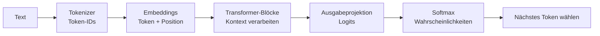
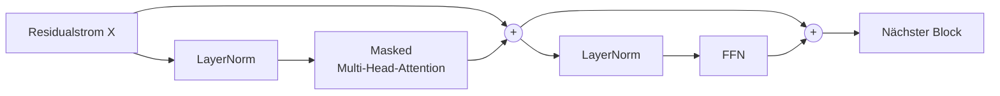
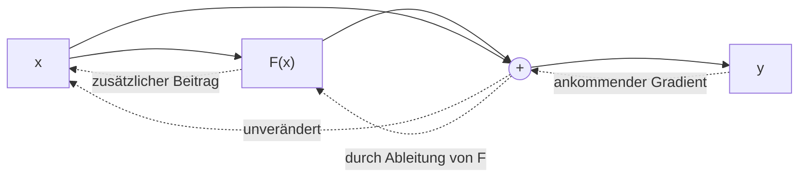
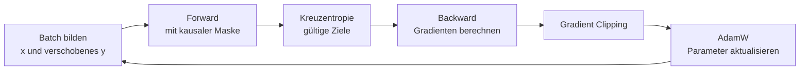

# Transformer verstehen und trainieren

## Eine Einführung am Beispiel von GuppyLM

Wie wird aus einer Folge von Zahlen ein Modell, das einen Satz sinnvoll fortsetzt? Dieses Lehrdokument verfolgt den gesamten Weg: vom Text über die Architektur bis zum Trainingssignal, das jede Gewichtsmatrix verändert. Als konkretes Beispiel dient **GuppyLM**, das kleine Sprachmodell aus dem begleitenden Python-Notebook.

Vorausgesetzt werden nur Grundideen neuronaler Netze: Gewichte verändern eine Berechnung; ein Fehlermaß bewertet das Ergebnis; Training passt die Gewichte an. Die benötigten mathematischen Begriffe werden unterwegs erklärt. Die zwölf Kapitel bilden einen Lernweg. Die Ableitungen in Kapitel 10 sind eine Vertiefung: Beim ersten Lesen genügt zunächst ihre Erklärung in Worten.

**Lernziel:** Sie können erklären, wie ein Transformer das nächste Token vorhersagt und wie aus einem einzigen Verlustwert Lernsignale für Embeddings, Attention, FFN und Normierungen entstehen.

---

## 1. Die Helikopterperspektive: eine Vorhersage, viele Fähigkeiten

Betrachten wir den Satzanfang:

> Gut Ding braucht …

Eine plausible Fortsetzung ist „Weile“. Ein Sprachmodell berechnet jedoch keine einzelne feststehende Antwort, sondern eine **Wahrscheinlichkeitsverteilung über mögliche Fortsetzungen**. Aus dieser Verteilung wird ein Token ausgewählt, angehängt und der Vorgang wiederholt. Ein Token kann ein Wort, ein Wortteil, ein Satzzeichen oder eine besondere Markierung sein.

Die zentrale Aufgabe lautet:

$$
P_\theta(s_{t+1}\mid s_0,\ldots,s_t).
$$

Gelesen: „Wie wahrscheinlich ist das nächste Token $s_{t+1}$, wenn die bisherigen Tokens bekannt sind?“ $\theta$ bezeichnet alle trainierbaren Parameter. Die senkrechte Linie bedeutet „unter der Bedingung“. **Autoregressiv** heißt: Bereits vorhandene Tokens bilden den Kontext für das nächste.



Um viele unterschiedliche Texte gut vorherzusagen, sind wiederkehrende Muster hilfreich: Grammatik, Wortbezüge, Gesprächsrollen und Faktenassoziationen. Das Training kann solche Regelmäßigkeiten in den Gewichten verankern. Das Ziel bleibt dabei die Vorhersage beobachteter Tokens; es garantiert weder Wahrheit noch menschliches Verständnis.

Der ursprüngliche Transformer wurde für Übersetzungen als **Encoder-Decoder** vorgestellt: Ein Encoder verarbeitet den Quelltext; ein Decoder erzeugt die Übersetzung und greift über Cross-Attention auf den Encoder zu. GuppyLM verwendet einen **Decoder-only-Transformer**: Prompt und Antwort laufen durch denselben Stapel mit kausaler Self-Attention. Ein Encoder mit bidirektionaler Attention kann dagegen auch spätere Eingabepositionen berücksichtigen. Die Architekturgrundlage stammt aus [Vaswani et al., *Attention Is All You Need*](https://arxiv.org/abs/1706.03762).

**Training und Anwendung sind verschiedene Vorgänge.** Beim Training sind die richtigen Fortsetzungen bekannt und die Gewichte werden verändert. Bei der Anwendung, der **Inferenz**, bleiben die Gewichte fest; nur Eingabe und berechnete Zwischenwerte ändern sich.

## 2. Vom Text zum Trainingsbeispiel

### Tokenisierung ist noch kein Sprachverständnis

Der Tokenizer übersetzt Text in ganzzahlige IDs. Die ID ist lediglich eine Adresse: Token 100 ist nicht „doppelt so bedeutungsvoll“ wie Token 50. GuppyLM verwendet Byte-Level-BPE. Beim **BPE-Training** werden häufige benachbarte Einheiten schrittweise zusammengefasst. Später wendet der fertige Tokenizer seine Regeln auf neue Texte an.

Dieses Zählen und Zusammenfassen ist vom anschließenden **Training des neuronalen Netzes** zu unterscheiden. Während des Modelltrainings bleiben Token-IDs und BPE-Regeln fest. Ein vollständiges Byte-Alphabet macht auch unbekannte UTF-8-Zeichen kodierbar; deren Bedeutung ist damit noch nicht gelernt.

GuppyLM lernt aus kurzen englischen Dialogen im ChatML-Format:

```text
<|im_start|>user
hello guppy<|im_end|>
<|im_start|>assistant
hi there.<|im_end|>
```

Rollenmarkierungen kennzeichnen die Gesprächsstruktur. Das Endtoken wird wie jedes andere Zieltoken gelernt. Damit die Generierung tatsächlich endet, muss das Programm beim erzeugten Endtoken zusätzlich abbrechen.

### Die Zielwerte stecken bereits im Text

Aus einer Folge $s_0,\ldots,s_T$ entstehen zwei gleich lange Folgen:

$$
x_t=s_t,\qquad y_t=s_{t+1},\qquad t=0,\ldots,T-1.
$$

Für ein **didaktisches Worttoken-Beispiel**, ausdrücklich nicht die tatsächliche BPE-Zerlegung, ergibt sich:

| Position $t$ | 0 | 1 | 2 | 3 |
|---|---|---|---|---|
| Eingabe $x_t$ | `<Start>` | Gut | Ding | braucht |
| Erlaubter Kontext | `<Start>` | `<Start>` Gut | `<Start>` Gut Ding | `<Start>` Gut Ding braucht |
| Ziel $y_t$ | Gut | Ding | braucht | Weile |

Ein Text mit fünf Tokens liefert somit vier Vorhersageaufgaben. Weil die Zielwerte aus dem Text selbst stammen, heißt dieses Verfahren **selbstüberwachtes Lernen**. Im Training werden die echten bisherigen Tokens vorgegeben, auch wenn das Modell selbst zuvor etwas anderes vorhergesagt hätte. Dieses Vorgehen heißt **Teacher Forcing**.

Mehrere Beispiele werden zu einem **Batch** zusammengefasst. Kürzere Folgen erhalten rechts Fülltokens, damit alle Zeilen gleich lang sind. Ihre Ziele sollen später nicht zum Verlust beitragen. Das Notebook verwendet dafür die ID von `<pad>`.

> **Zum Ausprobieren:** In [BPE zum Anfassen](../Lernapp/2a_einstieg_tokenizerWerkbank.html) einzelne Verschmelzungen verfolgen; anschließend in der [Tokenizer-Werkbank](../Lernapp/2b_tokenizer-werkbank.html) Training und Anwendung unterscheiden.

## 3. Embeddings: aus einer Adresse wird ein lernbarer Vektor

Ein **Vektor** ist hier eine Liste reeller Zahlen; eine **Matrix** eine rechteckige Tabelle solcher Zahlen. Wir schreiben Tokenvektoren als Zeilen. $A^\top$ bedeutet: Zeilen und Spalten der Matrix $A$ vertauschen. Bei Matrixprodukten müssen die inneren Dimensionen übereinstimmen: $(T\times d)(d\times k)$ ergibt $(T\times k)$.

Die Embedding-Matrix $E\in\mathbb{R}^{n_{\mathrm{vocab}}\times d}$ enthält für jedes Token eine Zeile. $n_{\mathrm{vocab}}$ ist die Vokabulargröße, $d$ die Modellbreite. Das Nachschlagen lautet:

$$
e_t=E[x_t].
$$

Dieselbe Token-ID liefert zunächst immer denselben Vektor. Das Token „Bank“ kann daher denselben Ausgangsvektor besitzen, während sein späterer Kontextvektor in „Geld auf der Bank“ und „Sitzen auf der Bank“ verschieden ausfällt. Einzelne Vektorkomponenten haben keine vorab vergebenen Bedeutungen wie „Geld“ oder „Möbel“.

### Die Position gehört zur Eingabe

„Der Hund jagt die Katze“ und „Die Katze jagt den Hund“ enthalten dieselben Wörter, aber unterschiedliche Beziehungen. Unmaskierte Self-Attention ohne Positionsinformation unterscheidet die Reihenfolge nicht eigenständig: Beim Vertauschen der Eingabezeilen werden die Ausgabezeilen entsprechend mitvertauscht. Die kausale Maske führt zwar bereits eine gerichtete Struktur ein; GuppyLM gibt die Position zusätzlich ausdrücklich an.

Es verwendet eine zweite gelernte Tabelle $P\in\mathbb{R}^{T_{\max}\times d}$:

$$
X_t^{(0)}=E[x_t]+P[t].
$$

Die Addition erfolgt komponentenweise; die Breite bleibt $d$. Im Notebook folgt darauf während des Trainings Dropout. Die Embeddings beginnen mit kleinen Zufallswerten und lernen gemeinsam mit den übrigen Parametern. Ein separates Word2vec-Training ist nicht erforderlich.

Eine Alternative aus dem ursprünglichen Transformer ist eine feste Sinus-/Kosinus-Kodierung:

$$
P_{t,2m}=\sin\!\left(\frac{t}{10000^{2m/d}}\right),\qquad
P_{t,2m+1}=\cos\!\left(\frac{t}{10000^{2m/d}}\right).
$$

Hier nummeriert $m$ die Dimensionspaare. Diese Werte werden berechnet, nicht gelernt. Im Folgenden bleiben wir bei Guppys gelernter Positionstabelle.

| Größe | Bedeutung | GuppyLM, Grundkonfiguration |
|---|---|---:|
| $n_{\mathrm{vocab}}$ | Tatsächlich gelernte Tokenzahl | Zielgröße 4.096; tatsächliche Größe verwenden |
| $T_{\max}$ | Maximale Eingabelänge | 128 |
| $d$ | Breite jedes Tokenvektors | 384 |
| $L$ | Zahl der Blöcke | 6 |
| $H$ | Attention-Köpfe pro Block | 6 |
| $d_k=d/H$ | Breite pro Kopf | 64 |
| $d_{\mathrm{ff}}$ | Innere Breite des FFN | 1.536 |

> **Zum Ausprobieren:** In der [Embedding-Werkbank](../Lernapp/3_embeddings-werkbank.html) dasselbe Token an zwei Positionen vergleichen: Die Tokenzeile ist gleich, die Positionszeile verschieden.

## 4. Self-Attention: Informationen aus dem Kontext auswählen

Attention berechnet für jede Position, welche Informationen anderer sichtbarer Positionen zu ihrer weiteren Verarbeitung beitragen. **Self** bedeutet: Query, Key und Value entstehen aus derselben Eingabefolge.

Für einen Kopf sei $U\in\mathbb{R}^{T\times d}$ die normierte Eingabe des Attentionzweigs. Dann gilt, zunächst ohne Bias:

$$
Q=UW_Q,\qquad K=UW_K,\qquad V=UW_V.
$$

Die drei Gewichtsmatrizen haben hier jeweils die Form $d\times d_k$. Ihre Ergebnisse haben die Form $T\times d_k$. Dabei ist $V$ die **Value-Matrix**, nicht die Vokabulargröße.

| Größe | Anschauliche Frage | Mathematische Rolle |
|---|---|---|
| Query $q_i$ | Welche Information suche ich hier? | Bewertet Keys aus Sicht der Position $i$ |
| Key $k_j$ | Unter welchen Merkmalen bin ich auffindbar? | Wird mit Queries verglichen |
| Value $v_j$ | Welche Information gebe ich weiter? | Geht in die gewichtete Summe ein |

Diese Fragen sind eine Merkhilfe. Im Modell stehen ausschließlich Zahlen. Jede Kopfkomponente entsteht aus allen $d$ Eingabekomponenten; ein Kopf erhält keinen festen Ausschnitt des ursprünglichen Embeddings.

### Vom Skalarprodukt zur gewichteten Mischung

Das Skalarprodukt multipliziert passende Komponenten und addiert die Ergebnisse: $(1,2)\cdot(3,4)=11$. Es hängt sowohl von Richtung als auch Länge der Vektoren ab. In der Attention misst es eine **gelernte Passung**, keine allgemeingültige semantische Ähnlichkeit:

$$
S_{ij}=\frac{q_i\cdot k_j}{\sqrt{d_k}},\qquad
A_{ij}=\frac{\exp(S_{ij}+M_{ij})}{\sum_r\exp(S_{ir}+M_{ir})},\qquad
Z_i=\sum_j A_{ij}v_j.
$$

$i$ ist die suchende Position, $j$ die betrachtete Position. $M$ ist die Maske aus Kapitel 5. Die **Softmax** wandelt die Scores zeilenweise in nichtnegative Gewichte um, deren Summe 1 beträgt. Große Scores erhalten relativ mehr Gewicht. Der Value-Mittelwert $Z_i$ ist die Ausgabe des Kopfes.

Warum durch $\sqrt{d_k}$ teilen? Unter der vereinfachenden Annahme unabhängiger, zentrierter Query- und Key-Komponenten mit Varianz 1 hat ihr Skalarprodukt Varianz $d_k$. Die Division hält die typische Größenordnung vergleichbar. Ohne Skalierung kann Softmax sehr spitz werden und kleine Ableitungen liefern. Bei Guppy ist $\sqrt{64}=8$.

Ein **reines Rechenbeispiel**: Für zwei erlaubte Positionen seien die Scores $0$ und $\ln 3$. Softmax ergibt $(1/4,3/4)$. Aus $v_1=(2,0)$ und $v_2=(0,4)$ wird:

$$
Z_i=\tfrac14(2,0)+\tfrac34(0,4)=(0{,}5,3).
$$

### Mehrere Köpfe und die Rolle von $W_O$

Mehrere Köpfe berechnen parallel verschiedene Mischungen. Ihre Ausgaben werden aneinandergehängt und anschließend linear verarbeitet:

$$
C=\operatorname{Concat}(Z^{(1)},\ldots,Z^{(H)}),\qquad
O=CW_O+b_O.
$$

Bei Guppy ist $C$ bereits $T\times384$ groß und $W_O$ eine $384\times384$-Matrix. $W_O$ verkleinert also nicht zwingend die Dimension. Sie lernt, wie die Beiträge aller Köpfe kombiniert und als Beitrag in den gemeinsamen Residualstrom geschrieben werden. Sie ist **nicht der LM-Head**, der später Vokabular-Logits erzeugt.

Die Matrizen sind innerhalb eines Kopfes für alle Positionen dieselben, zwischen Köpfen und Blöcken jedoch verschieden. Guppys Code berechnet die Q/K/V-Projektionen effizient mit einer gemeinsamen linearen Schicht und teilt das Ergebnis anschließend auf. Die mathematische Funktion bleibt gleich. Ein Kopf bekommt keine fest programmierte Aufgabe wie „erkenne Subjekte“.

## 5. Maskierung: paralleles Training ohne Abschreiben

Im Trainingsbeispiel steht das Ziel „Ding“ von Position 1 bereits an Eingabeposition 2. Ohne Begrenzung könnte Position 1 auf diese Stelle zugreifen. Das Modell würde beim Training Informationen nutzen, die beim späteren Fortsetzen fehlen.

Deshalb gilt in **jedem Block** die kausale Maske:

$$
M_{ij}=\begin{cases}
0,&j\le i,\\
-\infty,&j>i.
\end{cases}
\qquad
M=\begin{pmatrix}
0&-\infty&-\infty&-\infty\\
0&0&-\infty&-\infty\\
0&0&0&-\infty\\
0&0&0&0
\end{pmatrix}.
$$

Weil $\exp(-\infty)=0$, erhalten gesperrte Positionen nach Softmax Gewicht null. Die erlaubten Positionen werden weiterhin auf Summe 1 normiert. **Die Diagonale bleibt offen:** Das aktuelle Eingabetoken ist bekannt; vorhergesagt wird das nächste.

Eine Null im additiven Maskenwert würde nichts sperren. Im Notebook wird zunächst eine 0/1-Dreiecksmatrix gebaut; `masked_fill` setzt die gesperrten **Scores** auf $-\infty$. Das ist die Umsetzung der obigen additiven Maske.

So lassen sich alle Positionen eines Trainingsbeispiels parallel verarbeiten. Die Schichten selbst werden weiterhin nacheinander durchlaufen. Innerhalb einer Attention-Schicht lesen alle Positionen aus deren Eingang; Position 3 wartet nicht erst auf den gerade neu berechneten Ausgang von Position 2. Schon der erste Kopf kann auf den gesamten erlaubten bisherigen Kontext zugreifen. Weitere Blöcke verarbeiten diese Informationen erneut und ermöglichen zusammengesetzte Berechnungen.

### Drei verschiedene Aufgaben von Masken

| Verfahren | Wo wirkt es? | Was verhindert es? |
|---|---|---|
| Kausale Attention-Maske | Vor Attention-Softmax | Zugriff auf zukünftige Eingabetokens |
| Padding-Maske der Attention | Ebenfalls auf Attention-Scores | Zugriff auf Füllpositionen als Informationsquelle |
| Loss-Maske, etwa `ignore_index` | Bei der Verlustberechnung | Bewertung unerwünschter Zielpositionen |

Bei Guppys **rechtem Padding** liegen Fülltokens hinter allen gültigen Eingabetokens. Gültige Positionen können sie wegen der kausalen Maske nicht sehen. Die zusätzlich ignorierten Padding-Ziele machen deshalb hier eine gesonderte Attention-Padding-Maske entbehrlich. Für linkes Padding oder bidirektionale Attention gilt diese Begründung nicht.

`ignore_index=pad_id` ignoriert ganze **Zielpositionen**. Es entfernt die Klasse `<pad>` nicht aus dem Softmax-Nenner gültiger Vorhersagen. Ebenso bedeutet „Position trägt keinen eigenen Loss bei“ nicht grundsätzlich „ihr Eingabetoken erhält keinen Gradienten“: Als Kontext kann es andere bewertete Positionen beeinflussen.

Bei einem reinen Antworttraining könnte man zusätzlich die Ziele der Benutzerfrage aus dem Loss ausschließen. Guppys Notebook tut das nicht: Es bewertet alle Nicht-Padding-Ziele einschließlich Rollen- und Benutzertext. BERTs Masked-Language-Modeling ist wiederum eine andere Aufgabe: Dort werden ausgewählte Eingabetokens verborgen und aus beidseitigem Kontext rekonstruiert.

> **Prüfidee:** Zwei Eingaben stimmen bis Position $i$ überein und unterscheiden sich nur danach. Im Evaluationsmodus müssen ihre Logits bis einschließlich $i$ bis auf numerische Rundung gleich bleiben. Mehr Blöcke dürfen diese Sperre nicht umgehen.

## 6. Der vollständige Block: verarbeiten und zum Bestehenden addieren

Die Folge von Tokenvektoren, die durch das Modell läuft, heißt **Residualstrom**. Attention und FFN ergänzen ihn durch Addition. Guppy verwendet **Pre-LayerNorm**: Normiert wird jeweils im Rechenzweig vor dessen Verarbeitung.



$$
R=X+\operatorname{MHA}(\operatorname{LN}_1(X)),\qquad
X'=R+\operatorname{FFN}(\operatorname{LN}_2(R)).
$$

Der direkte Weg besitzt keine eigene Gewichtsmatrix. Es wird auch nicht in jedem Block erneut das Positions-Embedding addiert. Die Gestalt $T\times d$ bleibt erhalten, obwohl sich die Werte verändern.

**LayerNorm** arbeitet für jeden Tokenvektor $x$ getrennt über dessen $d$ Komponenten:

$$
\mu=\frac1d\sum_{a=1}^d x_a,\quad
\sigma^2=\frac1d\sum_{a=1}^d(x_a-\mu)^2,\quad
\operatorname{LN}(x)=\gamma\odot\frac{x-\mu}{\sqrt{\sigma^2+\varepsilon}}+\beta.
$$

$\varepsilon$ ist eine kleine positive Konstante; $\gamma$ und $\beta$ sind gelernte Skalierungen und Verschiebungen. $\odot$ bedeutet komponentenweise Multiplikation. Die Normierung verwendet keine Statistiken zukünftiger Tokens. Nach der gelernten Skalierung und Verschiebung müssen Mittelwert und Varianz nicht mehr 0 beziehungsweise 1 sein.

Das **Feed-Forward-Netz (FFN)** verarbeitet jede Position einzeln mit denselben Gewichten:

$$
\operatorname{FFN}(u)=\operatorname{GELU}(uW_1+b_1)W_2+b_2,
\qquad W_1\in\mathbb{R}^{d\times d_{\mathrm{ff}}},\quad
W_2\in\mathbb{R}^{d_{\mathrm{ff}}\times d}.
$$

Es erweitert den Merkmalsraum, verändert ihn nichtlinear und führt ihn auf die Modellbreite zurück. GELU ist eine glatte Aktivierungsfunktion, definiert durch $\operatorname{GELU}(a)=a\Phi(a)$ mit der Standardnormal-Verteilungsfunktion $\Phi$. Das Notebook nutzt die übliche tanh-Näherung. Ohne nichtlineare Aktivierung ließen sich beide linearen Schichten zu einer einzigen affinen Abbildung zusammenfassen.

Attention mischt **zwischen Positionen**, das FFN verarbeitet **Merkmale innerhalb einer Position**. Weil diese Merkmale bereits Kontext enthalten, kann das FFN auf Kontext reagieren. Jeder Block besitzt eigene FFN- und Normierungsparameter. Bei Guppy liegen etwa zwei Drittel der Blockparameter im FFN.

**Dropout** setzt während des Trainings zufällig ausgewählte Aktivierungen auf null und skaliert die übrigen mit $1/(1-p)$. Guppy verwendet $p=0{,}1$ nach der Eingangsaddition, auf Attention-Gewichten und am FFN-Ausgang. Nach Attention-Dropout muss eine einzelne Zeilensumme nicht mehr 1 sein. Die Softmax-Gewichte davor sind normiert. In der Inferenz ist Dropout abgeschaltet.

## 7. Aus dem Residualstrom wird eine Wahrscheinlichkeitsverteilung

Nach dem letzten Block folgt eine abschließende LayerNorm. Wir nennen ihr Ergebnis $H_{\mathrm{out}}\in\mathbb{R}^{T\times d}$. Der **LM-Head** erzeugt pro Position eine Punktzahl für jedes Vokabulartoken:

$$
\ell=H_{\mathrm{out}}E^\top,\qquad
p_{t,k}=\frac{\exp(\ell_{t,k})}{\sum_{r=0}^{n_{\mathrm{vocab}}-1}\exp(\ell_{t,r})}.
$$

$\ell$ enthält die **Logits**, beliebige reelle Zahlen, noch keine Wahrscheinlichkeiten. $p_{t,k}$ ist die Wahrscheinlichkeit für Token $k$ als Fortsetzung an Position $t$.

Guppy verwendet am Ausgang dieselbe Matrix $E$ wie beim Eingabe-Embedding. Dieses **Weight Tying** spart Parameter und lässt beide Verwendungen dieselbe Repräsentation mitformen. Es ist keine mathematische Umkehrung des Nachschlagens: Ein Logit ist ein Skalarprodukt des Ausgangsvektors mit einer Embedding-Zeile.

| Rechenstufe | Form für einen Batch mit $B$ Beispielen |
|---|---|
| Token-IDs | $B\times T$ |
| Residualstrom | $B\times T\times d$ |
| Q, K, V, nach Aufteilung in Köpfe | jeweils $B\times H\times T\times d_k$ |
| Attention-Gewichte | $B\times H\times T\times T$ |
| Logits | $B\times T\times n_{\mathrm{vocab}}$ |

Im Training werden alle gültigen Vorhersagepositionen bewertet. Bei der Generierung wird die Verteilung der **letzten Eingabeposition** verwendet. Es gibt keinen zusätzlichen, unabhängig trainierten „Satzvektor“, der am Ende die gesamte Antwort auf einmal ausgibt.

## 8. Der Loss: warum Kreuzentropie?

An einer Position ist das beobachtete Ziel $y_t$ bekannt. Der Verlust lautet:

$$
\mathcal L_t=-\ln p_{t,y_t}.
$$

| Wahrscheinlichkeit des richtigen Tokens | Verlust $-\ln p$ |
|---:|---:|
| 0,9 | 0,105 |
| 0,5 | 0,693 |
| 0,1 | 2,303 |
| 0,01 | 4,605 |

Hohe Wahrscheinlichkeit für das richtige Token ergibt kleinen Verlust. Sehr selbstsichere Fehlvorhersagen werden deutlich bestraft. Dabei wird nicht nur geprüft, ob das richtige Token auf Platz 1 liegt: Ein Anstieg seiner Wahrscheinlichkeit von 0,1 auf 0,2 ist bereits eine Verbesserung.

Die allgemeine **Kreuzentropie** zwischen Zielverteilung $q$ und Vorhersage $p$ ist $-\sum_k q_k\ln p_k$. Beim einzelnen beobachteten Ziel ist $q$ ein One-hot-Vektor: Dort steht 1, sonst 0. Deshalb bleibt genau $-\ln p_{t,y_t}$ übrig.

Warum passt diese Formel zur Aufgabe? Die Wahrscheinlichkeit einer beobachteten Fortsetzung ist das Produkt ihrer bedingten Tokenwahrscheinlichkeiten. Der negative Logarithmus macht daraus eine Summe:

$$
-\ln\prod_t P_\theta(s_{t+1}\mid s_{\le t})
=-\sum_t\ln P_\theta(s_{t+1}\mid s_{\le t}).
$$

Den Verlust zu minimieren bedeutet somit, den beobachteten Text wahrscheinlicher zu machen: **Maximum-Likelihood-Training**. Die Token-ID selbst ist keine sinnvolle Regressionszielzahl; ein quadratischer Abstand zwischen IDs würde eine nicht vorhandene numerische Bedeutung ihrer Reihenfolge unterstellen.

### Über gültige Tokens mitteln

Für den Batch sei $m_{b,t}=1$, wenn das Ziel bewertet wird, sonst 0. Mit $N=\sum_{b,t}m_{b,t}$ gilt:

$$
\boxed{\mathcal L=-\frac1N\sum_{b,t}m_{b,t}\ln p_{b,t,y_{b,t}}.}
$$

Der Mittelwert zählt **gültige Tokens**, nicht aufgefüllte Positionen. Bei gültigen Zielwahrscheinlichkeiten $0{,}5$, $0{,}25$ und $0{,}8$ ist er etwa $0{,}768$. Zusätzliche Padding-Ziele ändern weder Zähler noch Nenner.

Im Notebook übernimmt `F.cross_entropy` die Berechnung direkt aus den Logits, numerisch stabil mit Log-Softmax. Davor wird **keine zusätzliche Softmax** aufgerufen. `ignore_index` schließt die Padding-Ziele aus der Mittelung aus; siehe die [PyTorch-Dokumentation zu CrossEntropyLoss](https://docs.pytorch.org/docs/stable/generated/torch.nn.CrossEntropyLoss.html).

Bei einer Gleichverteilung ist der Verlust $\ln n_{\mathrm{vocab}}$. Zufällige Anfangsgewichte liefern allerdings keine exakt gleichförmige Verteilung. Die **Perplexität** $\exp(\mathcal L)$ übersetzt den mittleren Verlust in eine effektive Vorhersageunsicherheit; sie ist keine Prozentzahl korrekter Antworten.

## 9. Backpropagation: dieselbe Kettenregel, zusätzliche Wege

Ein Gradient beschreibt, wie empfindlich der Verlust auf kleine Änderungen einer Größe reagiert. Ist $\partial\mathcal L/\partial w$ positiv, erhöht eine kleine Vergrößerung von $w$ lokal den Verlust. Gradientenabstieg bewegt $w$ deshalb in Gegenrichtung.

Backpropagation verwendet die **Kettenregel**: Bei $w\rightarrow u\rightarrow v\rightarrow\mathcal L$ gilt

$$
\frac{\partial\mathcal L}{\partial w}
=\frac{\partial\mathcal L}{\partial v}
\frac{\partial v}{\partial u}
\frac{\partial u}{\partial w}.
$$

Bei mehreren Wegen werden die Beiträge addiert. Automatische Differenzierung speichert die benötigten Zwischenwerte aus dem Vorwärtslauf und wendet solche lokalen Ableitungsregeln rückwärts an. Sie probiert nicht jedes Gewicht durch wiederholtes Training einzeln aus.

Für Softmax und Kreuzentropie ergibt sich an einer gültigen Position besonders einfach:

$$
\frac{\partial\mathcal L}{\partial\ell_{t,k}}
=\frac1N\left(p_{t,k}-\mathbf1[k=y_t]\right).
$$

Die eckige Bedingung ist 1, wenn sie zutrifft, sonst 0. Für $p=(0{,}1,0{,}2,0{,}7)$ und Zielklasse 2, hier als zweite Klasse gezählt, ist der Gradient ohne Mittelungsfaktor $(0{,}1,-0{,}8,0{,}7)$. Ein direkter Schritt gegen diesen Logitgradienten würde den richtigen Logit erhöhen und die anderen senken. Tatsächlich verändert der Optimierer die gemeinsamen Parameter, die diese Logits erzeugen.

### Was die Residualverbindung ändert

Auch ein Transformer ist ein neuronales Netz; er verwendet keine andere Backpropagation als ein gewöhnliches Feed-Forward-Netz. Der Unterschied liegt im Rechengraphen. Für einen skalaren Residualschritt $y=x+F(x)$ gilt:

$$
\frac{\partial\mathcal L}{\partial x}
=\frac{\partial\mathcal L}{\partial y}
\left(1+F'(x)\right).
$$

Ohne Residualpfad fehlt die 1. Wenn etwa $F'(x)=0{,}01$ ist, wird der ankommende Gradient ohne direkten Pfad mit $0{,}01$, mit direktem Pfad mit $1{,}01$ multipliziert. In Vektorform lautet die lokale Ableitung $I+J_F$, wobei $I$ die Identität und $J_F$ die Matrix der Ableitungen von $F$ ist.



Bei Pre-LN ist $F$ der gesamte Zweig einschließlich LayerNorm. Am Pluszeichen geht der Gradient ungeteilt in beide Zweige; am gemeinsamen Eingang werden deren Rückmeldungen addiert. Er wird nicht halbiert.

Über viele Schichten können Produkte kleiner Ableitungen sonst sehr klein werden. Residualpfade bieten zusätzliche direkte Wege und erleichtern die Optimierung tiefer Netze. Sie garantieren keine Stabilität: Beiträge können sich auch aufheben oder anwachsen. Flachere Netze lassen sich häufig ohne solche Wege trainieren; Residualverbindungen sind jedoch keineswegs ausschließlich für Transformer nützlich. Zur Bedeutung der Normierungsposition siehe [Xiong et al., *On Layer Normalization in the Transformer Architecture*](https://arxiv.org/abs/2002.04745).

## 10. Wie die einzelnen Matrizen lernen

Für die folgenden Formeln schreiben wir $G_A=\partial\mathcal L/\partial A$: Der Gradient hat dieselbe Form wie $A$. Wir betrachten ein Beispiel und einen Kopf, ohne Dropout; über Beispiele, Positionen und Verwendungen werden Beiträge summiert. Die Formeln folgen direkt aus den bisher eingeführten Operationen.

### Die gemeinsame Regel aller linearen Schichten

Für $Y=XW$ gilt:

$$
\boxed{G_W=X^\top G_Y,\qquad G_X=G_YW^\top.}
$$

Die erste Formel verbindet Eingangsaktivität mit der Rückmeldung am Ausgang: Eine Gewichtskomponente wird relevant, wenn ihr Eingang aktiv ist und ihr Ausgang den Verlust beeinflusst. Die zweite Formel reicht die Rückmeldung an frühere Schichten weiter. Ein Bias erhält die Summe der Ausgangsgradienten über alle betreffenden Zeilen.

### $W_O$ lernt, Kopfbeiträge passend einzuschreiben

Aus $O=CW_O$ folgt:

$$
G_{W_O}=C^\top G_O,\qquad G_C=G_OW_O^\top.
$$

$G_O$ stammt aus dem weiteren Netzwerk und letztlich aus dem Tokenverlust. $W_O$ lernt damit, welche Mischung der Kopfmerkmale nützlich ist. Anschließend wird $G_C$ entsprechend der Verkettung auf die Köpfe aufgeteilt. **Verketten** hat keine lernbaren Parameter; rückwärts werden die passenden Spalten ausgeschnitten.

### $W_V$ lernt, welche Inhalte weitergegeben werden

Für einen Kopf ist $Z=AV$. Die Produktregel liefert:

$$
G_V=A^\top G_Z,\qquad G_A=G_ZV^\top.
$$

Ein Value erhält also Rückmeldungen von allen Positionen, die ihn verwenden, gewichtet durch deren Attention-Anteile. Aus $V=UW_V$ folgt:

$$
G_{W_V}=U^\top G_V.
$$

So lernt $W_V$ ohne eigenes Zielsignal für „gute Values“: Entscheidend ist, ob die übermittelten Inhalte bei der späteren Tokenvorhersage helfen.

### $W_Q$ und $W_K$ lernen, wohin Aufmerksamkeit fließt

Der andere Rückweg führt durch $A=\operatorname{softmax}(S+M)$. Für eine erlaubte Position gilt:

$$
G_{S,ij}=A_{ij}\left(G_{A,ij}-\sum_r A_{ir}G_{A,ir}\right).
$$

Die Summe läuft über die erlaubten Positionen der Zeile. Ein Score wird im Verhältnis zu den anderen Scores bewertet, weil alle um denselben Gesamtanteil 1 konkurrieren. Für gesperrte Verbindungen ist der Gradient zum ursprünglichen Score null. Die feste Maske selbst wird nicht trainiert.

Aus $S=QK^\top/\sqrt{d_k}$ folgt anschließend:

$$
G_Q=\frac{G_SK}{\sqrt{d_k}},\qquad
G_K=\frac{G_S^\top Q}{\sqrt{d_k}},\qquad
G_{W_Q}=U^\top G_Q,\qquad G_{W_K}=U^\top G_K.
$$

Die Query lernt, welche Quellen für ihre Vorhersage nützlich sind. Der Key lernt, für welche Queries seine Position auffindbar sein soll. Weil die Matrizen an allen Positionen wiederverwendet werden, müssen sie über viele Kontexte hinweg brauchbare Projektionen bilden.

Ein anschaulicher Sonderfall: An der allerersten Position ist nur ein Key erlaubt. Softmax liefert dort immer $(1)$. Diese Zeile liefert deshalb keinen Scoregradienten für die Auswahl zwischen Keys. Der Value-Pfad bleibt lernfähig; außerdem können spätere Positionen auf den ersten Key zugreifen. Es ist daher falsch, daraus „das erste Token kann nicht lernen“ abzuleiten.

Die drei Projektionswege treffen am gemeinsamen Eingang wieder zusammen:

$$
G_U=G_QW_Q^\top+G_KW_K^\top+G_VW_V^\top.
$$

Danach läuft das Signal durch LayerNorm und zusammen mit dem direkten Residualbeitrag weiter rückwärts.

### Embeddings lernen über Nachschlagen und Ausgabe

Eine ID ist diskret, aber die ausgewählte Tabellenzeile enthält gewöhnliche reelle Parameter. Für den **Eingangspfad** gilt:

$$
G_E^{\mathrm{in}}[k]
=\sum_{b,t:\,x_{b,t}=k}G_{X^{(0)}}[b,t],\qquad
G_P[t]=\sum_b G_{X^{(0)}}[b,t].
$$

Alle Vorkommen desselben Tokens tragen zur selben Embedding-Zeile bei. Token- und Positionsvektor bekommen bei ihrer Addition jeweils dieselbe ankommende Rückmeldung. Falls Eingangsdropout aktiv ist, ist dessen Ableitung davor zu berücksichtigen.

Beim **Weight Tying** kommt ein zweiter Weg hinzu. Fasst man die Batch- und Positionsachsen zu Zeilen zusammen, folgt aus $\ell=H_{\mathrm{out}}E^\top$:

$$
G_E^{\mathrm{out}}=G_\ell^\top H_{\mathrm{out}},\qquad
G_{H_{\mathrm{out}}}=G_\ell E,\qquad
G_E=G_E^{\mathrm{in}}+G_E^{\mathrm{out}}.
$$

Über den Eingang erhalten nur nachgeschlagene Zeilen Beiträge. Über den Ausgang können grundsätzlich alle Vokabularzeilen Gradienten erhalten, weil alle Klassen an Softmax teilnehmen. Das gilt sogar für `<pad>` trotz ignorierter Padding-Ziele. Die geteilte Matrix wird einmal mit dem summierten Gradienten aktualisiert, nicht als zwei unabhängige Kopien.

### FFN und LayerNorm lernen ebenfalls aus demselben Loss

Im FFN wird dieselbe Regel für lineare Schichten zweimal angewendet. Zwischen beiden multipliziert Backpropagation komponentenweise mit der GELU-Ableitung. LayerNorm leitet durch Mittelwert und Varianz zurück; diese sind berechnete Größen, keine gespeicherten Lernparameter. Für $z=(x-\mu)/\sqrt{\sigma^2+\varepsilon}$ und $y=\gamma\odot z+\beta$ gilt über die Tokenzeilen summiert:

$$
G_\gamma=\sum_{b,t}G_y[b,t]\odot z[b,t],\qquad
G_\beta=\sum_{b,t}G_y[b,t].
$$

**Es gibt keinen separaten Loss für Embeddings, Queries oder Köpfe.** Alle trainierbaren Teile erhalten Rückmeldungen aus ihrer Beteiligung an derselben Vorhersageaufgabe. Nicht jeder Parameter bekommt dabei in jedem Batch zwingend einen von null verschiedenen Gradienten.

## 11. Ein vollständiger Trainingszyklus



Eine übersichtliche Schreibweise des Notebookablaufs ist:

```python
modell.train()
for schritt in range(MAX_STEPS):
    x, y = naechster_batch()              # schematisch: ziehen und aufs Gerät legen
    setze_lernrate(optimierer, schritt)   # schematisch: Warmup und Kosinusplan
    optimierer.zero_grad(set_to_none=True)
    logits, loss = modell(x, y)
    loss.backward()
    torch.nn.utils.clip_grad_norm_(modell.parameters(), 1.0)
    optimierer.step()
```

Die beiden Hilfsfunktionen sind hier Platzhalter; im Notebook stehen die entsprechenden Schritte direkt in der Schleife. Dort werden die Gradienten am Ende des Schritts gelöscht. Entscheidend ist, dass keine unbeabsichtigte Akkumulation zwischen Batches entsteht.

**Forward** berechnet Vorhersage und Loss bei festen Gewichten. **Backward** berechnet die Gradienten und lässt die Gewichte weiterhin unverändert. Erst **`step()`** verändert die Parameter. Der nächste Vorwärtslauf verwendet den neuen Stand.

Der einfachste Optimierer, SGD, würde $\theta\leftarrow\theta-\eta\nabla_\theta\mathcal L$ ausführen. $\eta$ ist die Lernrate. Guppy verwendet **AdamW**: Es führt gleitende Mittel der Gradienten und ihrer Quadrate, korrigiert deren Anfangsverzerrung und skaliert die Schritte komponentenweise. Schematisch lautet das Update:

$$
\theta\leftarrow(1-\eta\lambda)\theta
-\eta\frac{\widehat m}{\sqrt{\widehat v}+\varepsilon_{\mathrm{opt}}}.
$$

$\widehat m$ und $\widehat v$ sind die korrigierten Mittelwerte; $\lambda$ ist der Weight-Decay-Faktor. Weight Decay zieht Parameter zusätzlich Richtung null. Das ist getrennt vom Gradienten der Kreuzentropie. Die Formel für einfachen Gradientenabstieg erklärt das Prinzip, ist aber nicht das vollständige AdamW-Verfahren.

Guppys aktuelles Hauptnotebook verwendet standardmäßig 3.000 Schritte mit je 32 zufällig gezogenen Beispielen. Die Lernrate steigt über 200 Warmup-Schritte auf $3\cdot10^{-4}$ und fällt danach nach einem Kosinusplan in Richtung $3\cdot10^{-5}$. Gradient Clipping begrenzt die gemeinsame Gradientennorm auf 1; es begrenzt nicht unmittelbar die Länge des späteren AdamW-Updates.

### Warum kann dieser Zyklus funktionieren?

Für einen kleinen SGD-Schritt gilt lokal näherungsweise:

$$
\mathcal L(\theta-\eta g)
\approx\mathcal L(\theta)-\eta\lVert g\rVert^2,
\qquad g=\nabla_\theta\mathcal L.
$$

Die negative Gradientenrichtung kann den aktuellen Verlust also für hinreichend kleine Schritte senken. Gemeinsame Parameter über viele Beispiele hinweg begünstigen wiederverwendbare Muster. Attention ermöglicht kontextabhängigen Informationsaustausch, FFNs ermöglichen nichtlineare Verarbeitung, Residualpfade erleichtern den Gradientenfluss. Zufällige Initialisierung gibt verschiedenen Einheiten unterschiedliche Ausgangspunkte.

Damit ist erklärt, wie die Teile gemeinsam lernen können, nicht garantiert, dass jeder Schritt oder jeder Trainingslauf erfolgreich ist. Zu große Schritte, widersprüchliche oder einseitige Daten und Überanpassung können den Nutzen begrenzen. Insbesondere folgt aus einem sinkenden Trainingsverlust noch keine gute Leistung auf neuen Texten.

> **Zum Ausprobieren:** In der [Transformer-Werkbank](../Lernapp/1_transformer-werkbank.html) nacheinander Forward, Backward und Update auslösen. Nur der letzte Schritt verändert die Gewichte. Die App verwendet ein kleineres Modell und SGD; sie ist kein geladener Guppy-Checkpoint. In der [Attention-Werkbank](../Lernapp/4_attention-werkbank.html) lassen sich ergänzend exportierte Guppy-Projektionen und Attention-Gewichte verfolgen.

## 12. Generieren, prüfen und das Gelernte einordnen

Bei der Inferenz wird der Prompt tokenisiert und durch das Modell geschickt. Aus den Logits der letzten Position wird ein Token gewählt. Danach beginnt der Vorgang mit der verlängerten Folge erneut. Die echte zukünftige Fortsetzung ist jetzt unbekannt: Das Modell muss mit seinen eigenen Entscheidungen weiterarbeiten.

Für positive Temperatur $\tau$ wird aus den letzten Logits:

$$
p_k^{(\tau)}=\frac{\exp(\ell_k/\tau)}{\sum_r\exp(\ell_r/\tau)}.
$$

Kleine Temperaturen machen die Verteilung spitzer, große flacher. **Greedy-Decoding** wählt direkt das wahrscheinlichste Token; eine Einstellung „Temperatur 0“ wird im Code als gesonderte Argmax-Auswahl umgesetzt, nicht durch Division durch null. **Top-k** begrenzt die Auswahl auf die $k$ größten Logits und normiert die verbleibende Verteilung erneut. Diese Einstellungen verändern keine Gewichte und sind kein weiteres Training.

Guppy rechnet den bisherigen Kontext bei jedem Generierungsschritt neu. Ein **KV-Cache** könnte pro Block die Keys und Values früherer Positionen wiederverwenden: Ihre Repräsentationen ändern sich bei festem Modell, ausgeschaltetem Dropout und kausaler Verarbeitung durch später angehängte Tokens nicht. Die Generierung stoppt beim Endtoken, am Tokenlimit oder an der Kontextgrenze.

### Was ein niedriger Verlust belegt – und was nicht

Validierung verwendet Daten ohne Gewichtsupdates und mit ausgeschaltetem Dropout. Der Validierungsverlust kann deshalb unter dem während des Trainings gemessenen Verlust liegen. Sinkender Trainingsverlust bei steigendem Validierungsverlust kann auf Überanpassung hindeuten.

Im mitgelieferten Guppy-Datensatz sind laut den lokalen Begleitmaterialien 2.320 der 3.000 Evaluationsdialoge wortgleich im Training enthalten; unter den ersten 320 Validierungsbeispielen sind es 248. Diese Validierung eignet sich deshalb nicht als unabhängiger Nachweis für Generalisierung. Ergänzend sind neue Formulierungen und ein sauber getrennter Testdatensatz nötig. Sprachliche Plausibilität, thematische Passung und ein gelerntes Antwortende sollten getrennt beurteilt werden.

### Verständnisprüfung

1. Warum darf eine Position ihr eigenes Eingabetoken sehen, aber nicht das nächste?
2. Was verändert `loss.backward()`, und was verändert erst `optimierer.step()`?
3. Warum kann die Embedding-Zeile eines im Batch nicht eingegebenen Tokens trotzdem einen Gradienten erhalten?
4. Worin unterscheiden sich $W_O$ und der LM-Head?
5. Warum kann ein späterer Vorhersagefehler frühere Embeddings trainieren, obwohl der Vorwärtslauf kausal bleibt?
6. Weshalb lässt ein niedriger Validierungsverlust hier noch keine sichere Aussage über neue Fragen zu?

**Kurzantworten:** (1) Das eigene Token gehört zum bekannten Kontext; das nächste ist das Ziel. (2) Backward berechnet Gradienten, der Optimierer aktualisiert Parameter. (3) Weight Tying liefert einen zusätzlichen Ausgangsgradienten. (4) $W_O$ mischt Kopfmerkmale in den Residualstrom; der LM-Head bildet auf Vokabular-Logits ab. (5) Frühere Repräsentationen beeinflussen spätere Vorhersagen. Backpropagation folgt diesen erlaubten Abhängigkeiten rückwärts; sie öffnet keinen zukünftigen Kontext im Vorwärtslauf. (6) Der Evaluationssplit enthält viele Trainingsduplikate.

---

## Materialien und Bezug zum vorhandenen Code

Dieses Dokument führt den lokalen Vortrag **GPT_Vortrag_Version2026_rev**, die Begleittexte zu GuppyLM, Embeddings und Attention sowie die Werkbankmaterialien zusammen. Der PDF-Export und die PPTX gelten als dieselbe Quelle. Die zusätzlichen Gradientenformeln sind Herleitungen aus den beschriebenen Rechenoperationen; Zahlenbeispiele sind didaktisch gewählt und keine gemessenen Modellausgaben.

Maßgeblich für konkrete Codebezüge ist [guppylm_lehrnotebook.ipynb](../guppylm_lehrnotebook.ipynb). Die zentrale Zuordnung lautet:

| Lehrbuchbegriff | Notebook |
|---|---|
| Token- und Positions-Embedding | `tok_emb`, `pos_emb` |
| Q/K/V-Projektionen, $W_O$ | `Attention.qkv`, `Attention.out` |
| Kausale Sperre | `kausale_maske`, `masked_fill` |
| Pre-LN und Residualadditionen | `Block.forward` |
| FFN | `FFN.hoch`, `FFN.runter` |
| Finale Norm und geteilte Ausgabe | `norm`, `lm_head.weight = tok_emb.weight` |
| Tokenverlust | `F.cross_entropy(..., ignore_index=pad_id)` |
| Gradienten und Aktualisierung | `verlust.backward()`, `optimierer.step()` |

Die Vortragsfolien zeigen teilweise einen dokumentierten Lauf mit 6.000 Schritten und einer konkreten Vokabulargröße. Das Hauptnotebook ist aktuell auf 3.000 Schritte eingestellt. Laufwerte und allgemeine Architektur dürfen deshalb nicht gleichgesetzt werden. Alle Formeln verwenden die tatsächlich erreichte Vokabulargröße. Für die unveränderte Grundarchitektur beträgt die Parameterzahl einschließlich Weight Tying $10\,696\,704+384\,n_{\mathrm{vocab}}$.

Als lokale Vertiefung dienen der [Guppy-Begleittext](guppylm_lehrtext.md), die [Übungsaufgaben](guppylm_aufgaben.md) und der [Wissens-Check](../Lernapp/guppylm_quiz.html). Die im Text verlinkten Originalarbeit, Untersuchung zu LayerNorm und PyTorch-Dokumentation ergänzen diese Materialien.
